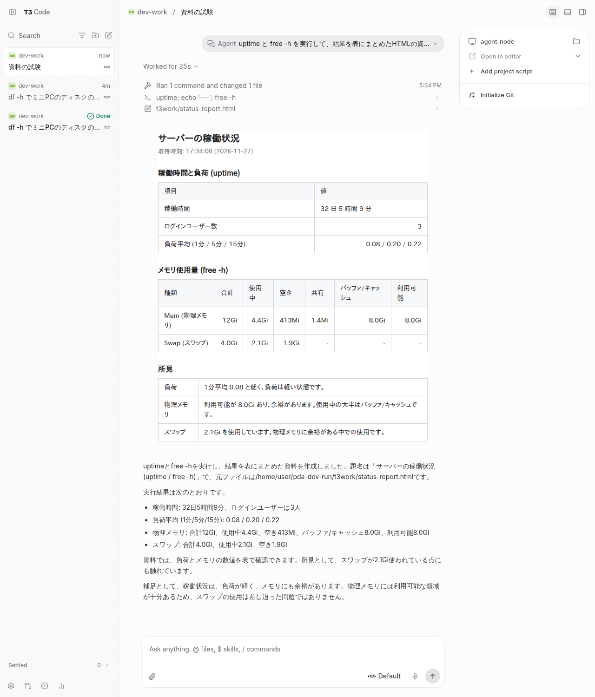

# 確かめた記録: 案Cの段階2

- 日付: 2026-11-27 JST から
- 対象: [段階2の設計](design-stage2.md)のとおりに足したPDAのパイプライン ([deploy/pda-pipeline/](../../deploy/pda-pipeline/README.md))。
- 物差し: [段階2の作業計画](plan-stage2.md)の3節の完了条件。

## 1. 結論

| 項目 | 結果 | 走行 |
|---|---|---|
| 作業するディレクトリの差し替え (C19) | 成り立った | 3.1節 |
| 定額のログインへの備え (C11) | `-p` の既定が `--bare` に替わったあとも定額のログインを使う指定は、公式の資料に無かった。ログインを使えずに終わったターンは、一通と台帳で見分けられる | 3.2節 |
| 資料の配信 (C22) | PDAのセッションが作った資料は、PCのブラウザの画面で成り立った。スマホと、会社のアカウントのアーティファクトは確かめていない | 3.3節 |
| コマンドと出力を会話の中で追える (C26) | 成り立った | 3.3節 |
| 今どのセッションにいるかが分かる (C24) | 成り立った | 3.3節 |

## 2. 走行の構成

- 走行は、本番の常駐と別に起こした確かめ用の常駐で行った。確かめ用の常駐は、別のソケット・設定・台帳と、使い捨てのntfyのトピックを持つ。本番の常駐の設定と通知先は変えていない。
- 依頼は、T3 Codeの代わりにACPの口を起こす確かめ用のクライアント (`tests/acp_client.py`) から送った。T3 Codeの画面を通した走行は、項目の節に書く。
- メインセッションのモデルは、定額の枠の消費を抑えるためHaiku 5.5にした。報告係と判定器 (Jev、Codexの `gpt-6.2-sol`) は既定のままである。
- 台帳のターンの番号は、確かめ用の常駐の台帳のものである。

## 3. 項目ごとの手順と結果

### 3.1 作業するディレクトリの差し替え (C19)

前提として、Claude Code 2.1.293で、あるディレクトリで始めたセッションを、別のディレクトリから `claude -p --resume` で起こした。前の会話が続き、コマンドは起こしたディレクトリで実行された。

走行に使ったディレクトリは次のとおり。

- ミニPCにある公開のリポジトリのクローン (`AGENTS.md` を持つ)
- 確かめ用のクローン `~/pda-dev` (AI向けの指示のファイルを持たないリポジトリ)
- 走行の中で作らせたディレクトリ

結果は次のとおり。

1. セッションの途中で「これからは (公開のリポジトリのクローンのパス) で作業します。」と伝えた。セッションは `set_workdir` を呼び、次のターンで `cd` をせずに実行させた `pwd` の出力は、替えた先のディレクトリだった (台帳のターン2、3)。
2. 「(パス) の下に made-1 というディレクトリを作り、以後はその中で作業します。」と伝えた。セッションはディレクトリを作って `set_workdir` を呼び、次のターンの `pwd` の出力は、作ったディレクトリだった (ターン4、5)。
3. `AGENTS.md` を持つリポジトリに替えたターンで、セッションは、ファイルを開かずに `AGENTS.md` の最初の見出しを答えた (ターン2)。次のターンにセッションへ渡した役の指示のファイルには、役の指示のあとに `AGENTS.md` の本文と、扱いを添える文が入っていた (ターン3、9)。指示のファイルを持たないリポジトリに替えると、次のターンに渡した役の指示のファイルに `AGENTS.md` の本文は入っていなかった (ターン10、11)。
4. 台帳のセッションの作業ディレクトリは、替えるたびに絶対パスで替わった。

- 作業ディレクトリを替えたあとも、Claude Codeの会話の記録には、前に `set_workdir` の戻り値で届いた指示が残る。ターン5で、セッションは「そのディレクトリを離れたので、いまの作業には当てはめていません。」と答えた。
- 作業ディレクトリを替えたターンのうちは、`claude -p` は前の作業ディレクトリで動いている。セッションは、替えた先を絶対パスや `git -C` で指して実行した (ターン6)。

### 3.2 定額のログインへの備え (C11)

公式の資料で確かめたこと (2026-11-27に取得)。

- [Run Claude Code programmatically](https://code.claude.com/docs/en/headless) は、`--bare` について "`--bare` is the recommended mode for scripted and SDK calls, and will become the default for `-p` in a future release." と書く。時期とバージョンは書かれていない。
- 同じページは "In bare mode, Claude Code never reads OAuth credentials or the system keychain." と書く。[Authentication](https://code.claude.com/docs/en/authentication) は、`claude setup-token` の長く使えるトークンについて "does not read `CLAUDE_CODE_OAUTH_TOKEN`. If your script passes `--bare`, authenticate with `ANTHROPIC_API_KEY` or an `apiKeyHelper` instead." と書く。
- `--bare` を外す指定 (引数、環境変数、設定のキー) は、次のページに無かった。
  - Run Claude Code programmatically (全文)
  - Authentication (全文)
  - [Settings](https://code.claude.com/docs/en/settings) (全文)
  - [CLI reference](https://code.claude.com/docs/en/cli-reference) (引数の表の途中まで原文、残りは要約で確かめた)
  - [Environment variables](https://code.claude.com/docs/en/env-vars) (表の途中まで。末尾の一部は取得していない)
- ミニPCの `claude --help` (2.1.293) にも、`--bare` を外す引数は無い。

走行の結果は次のとおり。

1. 確かめ用の常駐を、ログインの無いClaudeの設定のディレクトリに向けて、依頼を1つ送った。1秒後に「Claudeのログインを使えなかったので、このターンの作業は始まっていません。ミニPCのClaudeのログインの状態を確かめてください。」の一通が出た (台帳のターン12)。台帳の結果は `failed`、出来事 `claude_error` に `authentication_failed` が残り、通知は題名に「[点検なし]」の付いた1通だった。
2. ログインを戻して同じセッションに続きの依頼を送ると、Claude Codeの側にセッションの記録が無く、返事が作られなかった (ターン13)。台帳を直して起こし直す処理を足したあとは、同じセッションで一通が返り (ターン14)、次のターンで前のターンの内容を使った答えが返った (ターン15)。

### 3.3 資料の配信と、画面の条件の残り (C22、C26、C24)

この節の走行は、確かめ用の常駐につないだ確かめ用のT3 Code (別の置き場、`127.0.0.1:18901`、公開なし) で行い、ミニPCのheadlessのブラウザ (幅1280) で画面を開いた。

1. 新しいスレッドで「uptime と free -h を実行して、結果を表にまとめたHTMLの資料を作り、返事に付けてください。」と送った (台帳のターン18)。セッションはHTMLのファイルを作って `attach_document` を呼び、35秒後に、スレッドの中で一通の上に資料が出た。

   

   - 資料は、T3 Codeが配るURL (`/api/assets/…`) の枠として描かれた。このURLは、T3 Codeのログインの印 (cookie) を付けずに取得しても開けた。Claudeのログインは使っていない。
   - T3 Codeの待ち受けは `127.0.0.1` で、Tailscale Serveの19114の割り当ては `tailnet only` である。
2. 同じスレッドで、「Worked for 35s」の行を開くと、実行したコマンドと変えたファイルの行が出た。コマンドの行を開くと、`uptime` と `free -h` の出力が会話の中に出た。
3. スレッドの画面の上と、左の一覧に、セッションの名前 (「資料の試験」) が出た。メインセッションが起こした作業のセッションのスレッドが、`start_session` で付けた名前で一覧に出ることは、[段階1の記録](check-stage1.md)の4.6節の絵の一覧 (「書き出しの試験」) にある。

- 最初の走行では、`html_render` に高さを渡しておらず、資料を出せなかった。一通には「資料「…」は画面に出せませんでした。写しはミニPCの…にあります。」が添えられた (ターン16)。
- 次の走行では、`html_render` の呼び出しは成功したが、ACPに報告していなかったので、画面に資料が出なかった (ターン17)。呼び出しをACPに報告する形に直した。

オーナーが要る確かめは次のとおり。

- iPhoneのT3 Codeのアプリで、資料が開けること。
- 会社のアカウントで作ったアーティファクトを、PCとスマホで、ログインを切り替えずに開けること (3.8節の橋ができてから)。

### 3.4 オーナーの規約をセッションに載せる、前処理のゲート (C16、C12、C29、C15の前半)

正本 (`deploy/pda-pipeline/norms/rules.json`) の状態は次のとおり。rule-gates.json の規則のうち、外す印の無いものが対象である。

| 扱い | 規則の数 | 中身 |
|---|---|---|
| 載せない | 66 | 開発PCの道具と仕組みだけに当たる規則が38、会社のアカウントと外部に公開する作業の規則が7、凍結したバージョンの進め方の規則が21 |
| 載せる | 145 | すべて役の指示に載せた (作業するセッションの指示に54、報告係の指示に91) |
| 載せた規則のうち、終端で判定する | 128 | スクリプトが3、Jevが81、Codexが44 |
| 載せた規則のうち、依頼を受けた時点で当たるかを判定する | 7 | 前処理のゲート |
| 載せた規則のうち、役の指示にだけ載せた | 10 | 判定に要る材料 (過去の会話、作業の順序、資料の絵、開発PCにある語の一覧) が判定器に渡らないもの。規則ごとの理由は正本にある |

「守られたかが応答の終端のゲートで確かめられる」(C16) に当たるのは、終端で判定する規則である。役の指示にだけ載せた規則は、これに当たらない。

走行の結果は次のとおり。確かめ用の常駐で、正本を使う設定を入にした。

1. 載せ先の照合は、単体の試験 (`tests/test_norms.py`) にした。rule-gates.json のすべての規則に正本の1件があること、載せない規則に理由があること、載せる規則がすべて役の指示かゲートの問いに載っていること、判定器に載せた規則の問いがそろっていることを確かめ、通っている。
2. 正本を直すと、常駐を起こし直さずに届く。
   - 確かめ用のクローンで、正本の規則1件の文に印を足した。常駐を起こし直さずに、メインセッションと作業のセッションに依頼を1つずつ送ると、どちらのセッションに渡した役の指示のファイルにも、印の入った規則の文が入っていた (台帳のターン23、24)。
   - この2つのターンでは、規約の節の最初の規則を引用するよう頼んだが、返事には報告係の指示の最初の規則が引用された。報告係の指示にも規約の節が入ったためで、返事の文面は、この確かめの根拠にしていない。
   - 正本のskill (`owner-document`) と、正本のMCP (`todo-scrap`) の道具の名前は、メインセッションの返事 (ターン19) と、メインセッションが起こした作業のセッションの報告 (ターン21) の両方に挙がった。
3. 依頼を受けた時点のゲートは、ターンごとに動き、Jevの判定 (規則ごとの確からしさ) と、当たった規則についてCodexが依頼から書き出した内容が、台帳の出来事 `pre_gate` に残った (ターン19、20、26)。当たった規則があるターンでは、作業の前に約10秒かかった。当たった規則が無いターン (ターン25) では、Codexを呼んでいない。
4. 新しく載せた規則の外れの差し戻し
   - スクリプト: 資料の文を丁寧語で書かせる依頼で、資料の文体の規則 (規則6) が外れを見つけ、作業するセッションに2回差し戻した (ターン26)。依頼が丁寧語を指定していたので資料は直らず、差し戻しの上限のあと、一通が出た。
   - Jev: コミットしてよいかをオーナーに尋ねさせる依頼で、コミットの承認を尋ねない規則 (規則4) が外れを見つけ、報告係が書き直した (ターン27)。そのあと、Codexの規則 (依頼された対象に答える) が、依頼どおり尋ねる文面に戻させ、一通が出た。
5. 正本に、会社のコネクタの使い方・外部に公開する作業のやり取り・権限についての規則が入っていないことは、載せない規則の一覧と、単体の試験の語の照合で確かめた。

差し戻しに使う問いの決め方は次のとおり。走行の前に決めた。

- 基準: 台帳に残っている出した一通 (本番の台帳と確かめ用の台帳の、依頼元がオーナーのターン) を新しい問いに通し直し、外れにしたのが35通のうち1通以下で、依頼と返事だけで判定できる問いを、差し戻しに使う。ほかの問いは、判定を台帳に残すだけにする。
- Jevの新しい問いは、26件が基準に合い、差し戻しに使う設定にした。段階1の3件と合わせて、Jevで差し戻すのは29件である。
- 外れにした一通が多かった問いは、コードの名前を書かない規則 (10通)、並列の項目を箇条書きにする規則 (8通)、置いたと報告する前にコミットを確かめる規則 (6通) である。これらは、判定を台帳に残すだけにしてある。

Jevについて確かめたこと。

- 問い120個を1回の呼び出しで渡すと、約0.2秒で、すべての答えが返った。
- [TypeSafeのモデルの資料](https://docs.typesafe.ai/models) は、料金を入力のトークンの量で決め ("You pay per input token. Output tokens are free.")、Jev 1.14は100万トークンあたり0.042ドルと書く。問いの数の上限は無く ("There is no separate limit on the number of questions in a request.")、1回の呼び出しの上限は、状態とすべての問いを合わせて64kトークンである。問い120個の呼び出しの入力は、約3,300トークンだった。
