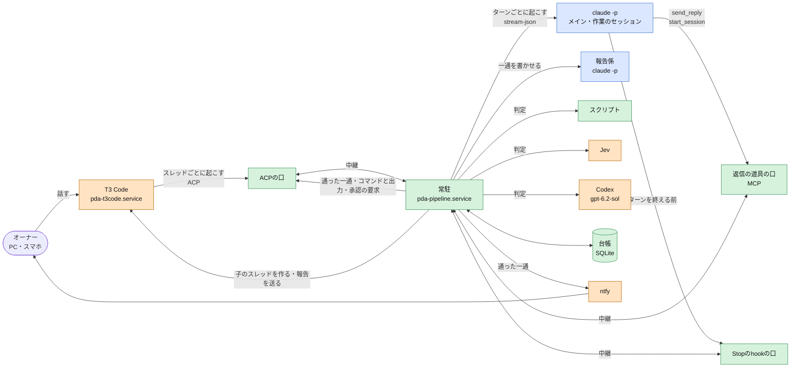
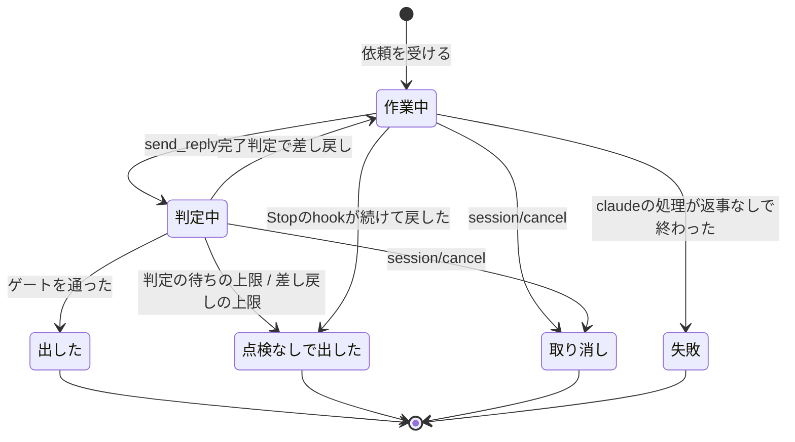
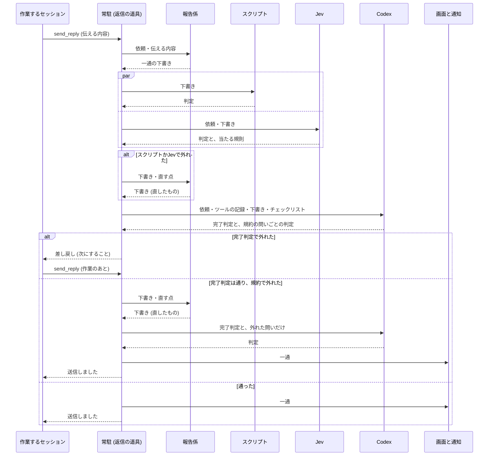
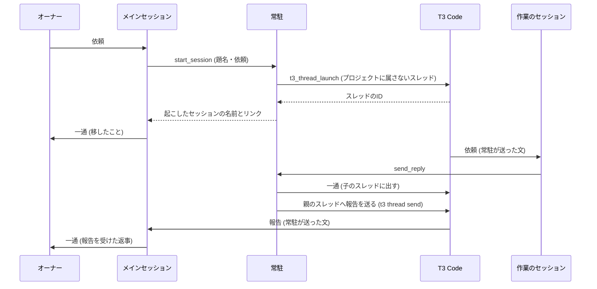
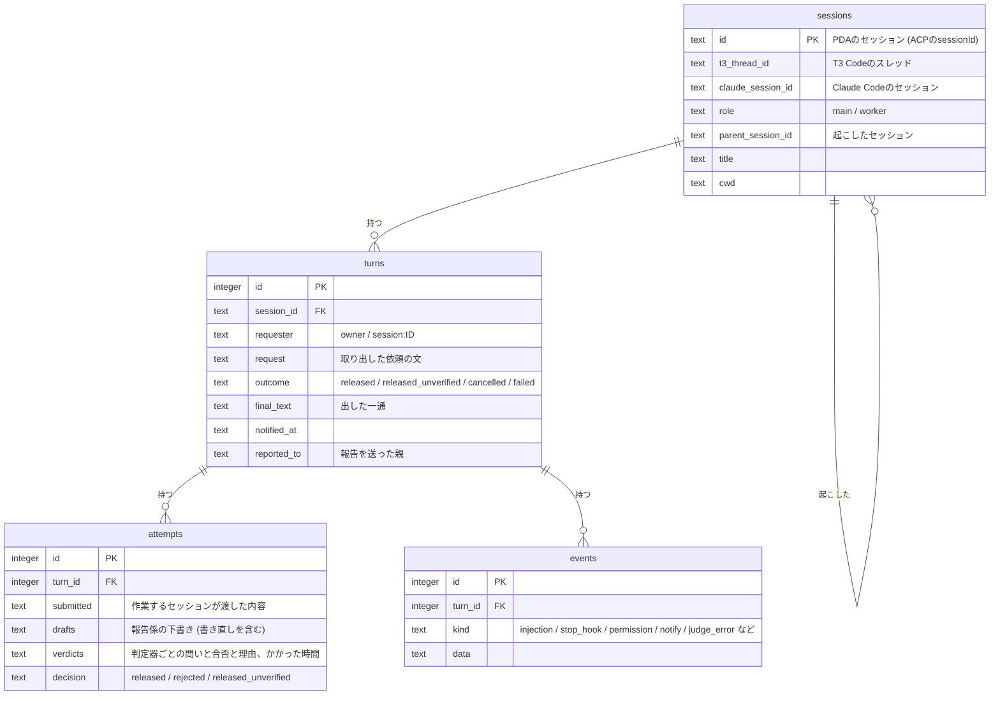

# 設計: 案Cの段階1 (頭と口を分ける)

- 種別: 設計。[案の比較](solution-options.md)の5.3節の案C (自前の応答パイプラインと、T3 Codeから借りる画面) の実現計画のうち、段階1で作る物と、その受け入れ条件を決める。
- 物差し: [要件](requirements.md)の4節のC7・C10・C14・C32。
- 前提にする記録
  - [T3 Codeの画面を借りる形の検証](spike-t3code-screen.md)の4節 (ACPのproviderとして作るときに効く振る舞い)
  - [返信の道具と終端のゲートの検証](spike-reply-gate.md)
  - [規則をゲートに振り分ける設計の観点](rule-gates.md)の6節と、規則のデータ [rule-gates.json](rule-gates.json)
  - [判定のモデルの検証](spike-gate-models.md)
- 確かめた手順と結果は [check-stage1.md](check-stage1.md)、入れ方と動かし方は [deploy/pda-pipeline/README.md](../../deploy/pda-pipeline/README.md) に置く。

## 1. 段階1の範囲

段階1は、作業するセッションの出力 (頭の中) と、オーナーに届く一通 (口) を分ける。オーナーがT3 Codeの画面で話しかけると、PDAのパイプラインがClaudeのセッションで作業し、終端のゲートを通った一通だけを画面と通知に出す。

作る物は次のとおり。

- T3 CodeにACPのproviderとしてつなぐ口と、常駐するパイプライン
- メインセッションと、メインセッションが起こす作業のセッション
- 返信の道具
- 終端のゲート2つ (完了判定、伝え方の規約)
- スマホへの通知
- 起動と報告の台帳

## 2. 構成

重い処理は常駐1つに集め、T3 CodeとClaude Codeが起こす処理は、標準入出力と常駐の間を中継するだけの口にする。T3 Codeはスレッドごとにproviderの処理を残すので、残る処理を小さく保つためである。

| 部品 | 役目 | 起こす者と寿命 |
|---|---|---|
| ACPの口 | T3 CodeのACPの通信を常駐へ中継する。T3 Codeが渡す環境変数 `T3CODE_THREAD_ID` を常駐に伝える | T3 Codeがスレッドごとに起こし、T3 Codeが止めるまで残る |
| 返信の道具の口 | Claude CodeのMCPの通信を常駐へ中継する | `claude -p` がターンごとに起こす |
| Stopのhookの口 | Stopのhookの入力を常駐へ渡し、常駐の答えを返す | `claude -p` がターンを終えようとするたびに起こす |
| 常駐 | ACPの応答、セッションの引き当て、`claude -p` の起動、返信の道具とゲートの実行、台帳、通知、子のスレッドの起動 | systemdのユーザー単位の常駐 `pda-pipeline.service` |

- コードは `deploy/pda-pipeline/` に置き、Pythonの標準ライブラリだけで書く。ミニPCでは、リポジトリの作業クローン `~/pda` の `deploy/pda-pipeline/` から直接動かす。役の指示とゲートの規則も同じディレクトリに置き、リポジトリを直すとすべてのセッションに届く。
- 口と常駐の間は、常駐が待ち受けるUnixドメインソケットでつなぐ。返信の道具の口とStopのhookの口は、常駐がターンごとに発行する合言葉を環境変数で受け取り、常駐はその合言葉でセッションとターンを引き当てる。
- 常駐のデータは `~/.local/share/pda-pipeline/` に置く。
- 同時に動かす処理は、セッションの `claude` を3つまで、報告係の `claude` を2つまで、`codex` を2つまでにし、超えた分は順番を待たせる。

## 3. セッションとターン

### 3.1 スレッドとセッションの対応

T3 Codeのスレッド1つがPDAのセッション1つに当たり、PDAのセッション1つがClaude Codeのセッション1つを持つ。

- オーナーがT3 Codeの画面で作ったスレッドは、メインセッションにする。
- メインセッションが道具 `start_session` で作らせたスレッドは、作業のセッションにする。子を起こす道具は、メインセッションの返信の道具の口にだけ載せる。
- `session/load` を受けたら、`T3CODE_THREAD_ID` で台帳のセッションを引き当て、Claude Codeのセッションを続きから使う。
- 作業ディレクトリは、T3 Codeがセッションの開始で渡すディレクトリにする。

### 3.2 依頼の文と、依頼元

- 依頼の文は、`<user_request>` の中から取り出す。その中が「Context handoff」で始まるときは、最後の `User message:` の後ろを取り出す。T3 Codeが先頭に付ける `[T3 Code: …]` の行は外す。取り出した文だけを作業するセッションに渡す。
- 依頼元は、オーナーか、別のセッションのどちらかにする。常駐がT3 Codeへ送った文 (子への依頼、親への報告) は送る前に台帳に登録し、届いた依頼が登録と一致すれば別のセッションからの依頼、一致しなければオーナーからの依頼とする。

### 3.3 ターンの進み方

1回の `session/prompt` を1ターンとし、ターンごとに `claude -p` を1つ起こす。どの終わり方でも、ACPに出す本文は1通までにする。

| 終わり方 | ACPに出す本文 | 通知 | 台帳の結果 |
|---|---|---|---|
| 出した | ゲートを通った一通 | 6節のとおり | `released` |
| 点検なしで出した | 最後の送信に、点検を通っていないことと残った理由を添えた一通 | 6節のとおり | `released_unverified` |
| 取り消し | なし (`stopReason` は `cancelled`) | なし | `cancelled` |
| 失敗 | 返事が作られないまま終わったことを伝える決まった文 | 6節のとおり | `failed` |

### 3.4 Claude Codeの起こし方

- `claude -p` は定額のログインで起こし、入力と出力はstream-jsonにする。初めのターンは `--session-id`、次からは `--resume` で同じセッションを続ける。
- ユーザーとプロジェクトの設定はロードさせず (`--setting-sources ""`)、MCPは常駐が渡すものだけにする (`--strict-mcp-config`)。
- 役の指示は、`deploy/pda-pipeline/roles/` の共通の指示と役ごとの指示をつないだファイルを `--append-system-prompt-file` で渡す。直した指示が続きのセッションにも届くよう、`--system-prompt-snapshot off` を付ける。
- 返信の道具は、道具の検索を経ずに使えるよう、常に載せる (`alwaysLoad`)。
- Stopのhookは、常駐が渡す設定 (`--settings`) で入れる。Stopのhookが戻せる回数は限らない (`CLAUDE_CODE_STOP_HOOK_BLOCK_CAP=0`)。
- オーナーに届く別の口になる道具と、ターンをまたいで処理を残す道具は外す (`AskUserQuestion`、`PushNotification`、`EnterPlanMode`、`ExitPlanMode`、`ScheduleWakeup`、`CronCreate`、`CronDelete`、`CronList`、`RemoteTrigger`)。
- モデルは役ごとに設定で決める。

| 役 | モデル | 理由 |
|---|---|---|
| メインセッション | Opus 5.5 | オーナーと直接話し、何を別のセッションに移すかを決める役で、[v0.3の決定](../reports/v0.3-decision.md)の統率役と同じ割り当てにする |
| 作業のセッション | Sonnet 5.5 (`start_session` で指定できる) | v0.3の作業者と同じ割り当てにする |
| 報告係 | Sonnet 5.5 | 道具を使わず、渡された材料から一通を書くだけの役である |

### 3.5 ACPに報告するもの

ACPに報告するのは次の3種類だけにする。作業するセッションが道具の外に書いた文、stream-jsonの `result`、返信の道具の入力と戻り値、Stopのhookの理由、報告係の下書き、判定の結果は報告しない。

- 3.3節の本文 (`agent_message_chunk`)
- 作業するセッションのツールの呼び出しと結果 (`tool_call`、`tool_call_update`)。返信の道具と `start_session` の呼び出し、サブエージェントの中の呼び出しは除く
- 承認の要求 (`session/request_permission`)

Claude Codeが実行の前に確認を求めた呼び出しは、すべて承認の要求としてACPに出す。許可するかは、T3 Codeのスレッドの権限 (Full access、Supervisedなど) とオーナーの操作で決まり、常駐は答えをClaude Codeに返すだけにする。

## 4. 返信の道具と終端のゲート

### 4.1 流れ

作業するセッションがオーナーに返す口は、道具 `send_reply` だけにする。作業するセッションはオーナーに伝える内容を道具に渡し、道具の中で、報告係が一通を書き、ゲートが判定する。

- 完了判定で外れたときは、文面を直す前に作業するセッションへ戻す。作業が足りないと、文面を直しても内容が変わるためである。
- 報告係の下書きは、判定の前に、英字・数字と日本語の間の空白をスクリプトで詰める (規則44)。

- 作業するセッションがターンを終えようとしたとき、そのターンに出した一通が無ければ、Stopのhookが `send_reply` を呼ぶよう戻す。
- 一通を出したあとの `send_reply` は、もう届いていると返して何もしない。
- 道具の戻り値と報告係に渡す直す点には、何回目の送信かを入れない。
- 報告係とJevは、設定で段ごとに外せる。報告係を外したときは、作業するセッションが渡した文を下書きとして扱い、規約の外れも作業するセッションに戻す。

### 4.2 ゲートと判定器

| ゲート | 判定器 | 渡す材料 | 外れたときの戻し先 |
|---|---|---|---|
| 完了判定 | Codex | オーナーの依頼、同じセッションの直前のやり取り、そのターンのツールの呼び出しと結果、下書き | 作業するセッション |
| 伝え方の規約 (機械的) | スクリプト | 下書き | 報告係 |
| 伝え方の規約 (閉じた材料・低い推論) | Jev | 依頼、下書き | 報告係 |
| 伝え方の規約 (高い推論) | Codex | 依頼、ツールの記録、下書き | 報告係 |

- Codexは、モデル `gpt-6.2-sol`、推論の強さ `medium` で呼ぶ。[判定のモデルの検証](spike-gate-models.md)の5節で、差し戻しの理由の網羅が `low` より高かった設定である。
- 完了判定と、Codexが受け持つ規約の問いは、1回の呼び出しにまとめる。判定の出力は完了判定と規約の問いごとに分け、台帳にも分けて残す。まとめるのは、Codexの呼び出しの数を減らすためである ([rule-gates.md](rule-gates.md)の6.9節、6.10節)。
- Codexにはファイルを開かせず、命令も実行させない。判定に要る材料は、すべて入力に入れる。ツールの結果は1件ごとに長さを切り、全体が上限を超えるときは新しいものを残す。
- 判定器はどれもClaude以外のモデルかスクリプトである。判定器の呼び方 (コマンド、モデル、推論の強さ) は設定で替えられる。
- ゲートは、判定器ごとに「材料を受け取り、問いごとの合否と理由を返す」同じ形の部品にし、部品を足すと待ち合わせる判定が1つ増える。

### 4.3 伝え方の規約のゲートに載せる規則

[rule-gates.json](rule-gates.json)から、次の条件をすべて満たす規則を候補にする。

- 発火点が返事を渡す前 (`fire` が `reply`) で、受け持ちが報告係 (`role` が `reporter`) である
- 外す印 (`exclude`) が付いていない
- 判定の対象が、スレッドに出す返事の本文である (Artifact・PRの説明文・コミット・作ったファイルを対象にする規則は、その出力がゲートを通る段階で載せる)
- 判定の材料が、依頼と返事と、そのターンのツールの記録で足りる

段階1では、3つの判定器のどれもが実際の返事を判定するよう、候補から判定器ごとに少数を載せる。選んだ理由は次のとおり。残りの候補は、規則のファイルに行を足して載せる。規則の番号は rule-gates.json の配列の添字である。

- 44・47: スクリプトだけで判定でき、[返信の道具の検証](spike-reply-gate.md)の5.1節で使った2つである。47は開発PCに専用のhook (language-gate) がある。
- 104・105・56: 開発PCに専用のhook (choice-question-guard、intent-gate、reference-gate) が作られている。
- 7・19・101・102: オーナーが差し戻した返事 ([spike-gate-models.md](spike-gate-models.md)の1節) に当てた規則である。7と19は、同じ記録の4節のとおり、提案の項目ごとの問いに書き直して1つにする。
- 205: 返信の道具の検証で、完了判定が通せなかった返事 (「作業ディレクトリは空です」の類の言い切り。[spike-reply-gate.md](spike-reply-gate.md)の6.1節) に当たる。
- 28: Jevに、どの返事にも当たる規則を1つ載せるために選んだ。

| 規則 | 判定器 | 当たる場面 | 判定の単位 | 問い |
|---|---|---|---|---|
| 44 英字・数字と日本語の間に空白を入れない | スクリプト | どの返事にも | 返事全体 | コードの要素の外に、英字・数字と日本語の文字が空白をはさんで隣り合う箇所が無いか |
| 47 つなぐ文は日本語で書く | スクリプト | どの返事にも | 行 | コード・引用・リンク・パスを除いた行に、日本語の文字が無く英語の語が続く行が無いか |
| 28 相手に実行を頼むコマンドを書かない | Jev | どの返事にも | 返事全体 | 依頼がやり方を尋ねていないのに、返事が読み手にコマンドの実行を求めていないか |
| 104 選択・手順・可否の質問には冒頭で答える | Jev | 依頼が選択・可否・手順の問いのとき (Jevが見分ける) | 返事の最初の文 | 最初の文が、選んだ選択肢・可否・最初の手順で答えているか |
| 105 作業の報告は冒頭で完了か未完了かを言い切る | Jev | 依頼が作業の指示のとき (Jevが見分ける) | 返事の最初の文 | 最初の文が、頼まれた作業が終わったか終わっていないかを述べているか |
| 56 指示語は指す先が同じ段落の名詞にあるときだけ使う | Codex | 返事に指示語か相対位置の語があるとき (スクリプトが見分ける) | 指示語・相対位置の語の1つずつ | 読み手は依頼とこの返事だけを見ている。その語が指す物が、同じ段落・同じ箇条書きの項目・直前の文に名詞で書かれているか |
| 7 各項目に推奨とその根拠を事実で付ける、19 説明をWhy→What→Howの順で書く | Codex | 返事が次の手を提案するか、判断を求めているとき (Jevが見分ける) | 提案・判断を求める項目の1つずつ | 読み手は作業の記録を見ていない。その項目の中に、何をするのか、それが要る理由 (いま何が起きていて、放っておくと何が困るか)、分かっている原因、推奨するなら根拠の事実が書かれているか。項目の中の語が読み手に通じるか |
| 101 説明対象を指示文と照合して1種類に絞る、102 指示された対象以外の情報を混ぜない | Codex | どの返事にも | 返事全体 | 依頼が求めた対象と、返事が答えている対象が同じか。依頼が求めていない方針の提案・評価・別件が、答えと区別なく混ざっていないか |
| 205 不在・不可の断定は観測してから書く | Codex | どの返事にも | 「無い」「できない」の断定の1つずつ | その断定の対象を調べた呼び出しと結果が、ツールの記録に1つでもあるか。無ければ、確かめていないと述べる文に直させる |

規則のほかに、パイプライン自身の問いを1つCodexに載せる。単位は返事全体で、問いは「返事が、この返事の送信・点検・差し戻し・書き直しの経過に触れていないか (依頼が点検の仕組みについての問いであるときを除く)」である。

完了判定の問いは次の形にする。単位は、返事が「した」「終わった」「できた」と述べる作業の1つずつで、問いは「その作業が、ツールの記録の呼び出しと結果で確かめられるか」である。外れにするのは次の3つに限り、記録の結果を要約・言い換えて述べた部分と、提案や見解の当否は外れにしない。

- 行ったと述べた作業の呼び出しが、ツールの記録に無い
- 返事が述べる値・状態が、ツールの記録の結果と食い違う
- ツールの記録の結果が失敗なのに、返事が成功と述べている

依頼が問いへの答えだけを求めているときは、返事が問いに答えていれば合格とし、返事が終わっていないことと理由を述べている部分は合格とする。

報告係の指示には、表の規則を、書き方の指示として入れる。

### 4.4 待つ上限と、差し戻しが続いたときの扱い

オーナーへの一通は、判定の遅れや差し戻しの繰り返しで止めたままにせず、点検を通っていないことが分かる形で出す。

| 場面 | 扱い |
|---|---|
| 作業するセッションが、差し戻された文面と同じ文面を送り直した | 判定器を呼ばず、前と同じ次にすることを返す |
| Codexの判定が1回で返らない (終了コード、壊れた出力) | 待つ上限の中で呼び直す |
| 判定を待った時間が上限 (既定10分) を超えた | 判定を止め、下書きに「点検役の判定が得られなかったので、完了判定と規約の点検を通っていない」の1文を添えて出す |
| スクリプトかJevの規約の外れが、報告係の書き直し (既定2回) のあとも残った | 残った外れを台帳に残して、次の判定へ進む |
| Codexの規約の外れが、報告係の書き直しと判定し直し (1回) のあとも残った | 1ターンに1回だけ、残った外れを作業するセッションに戻し、足りない内容を足させる (報告係は、渡された内容に無い事実を足さないため)。次の送信でも残れば、台帳に残して通す ([rule-gates.md](rule-gates.md)の6.4節) |
| 完了判定の差し戻しが上限 (既定5回、0は上限なし) に達したあとの送信が、また外れた | 下書きに「完了判定を通っていない」ことと残った理由を添えて出す |
| Stopのhookが続けて戻した回数が上限 (既定5回) に達した | 最後の送信があればそれを、無ければ決まった文を、点検を通っていないことを添えて出し、ターンを終えさせる |

- 完了判定の差し戻しには、必ず次にすることを入れる。判定器には、外れたときに次にすることを出力させ、戻り値には「終わっていないなら、終わっていない点と理由を報告として送る」道を毎回添える。
- 待つ上限の10分は、Codexが混雑のときに呼び出しを止める時間 (数十秒から約10分。[rule-gates.md](rule-gates.md)の6.10節) を1回待てる長さである。
- 点検なしで出した一通は、台帳の結果が `released_unverified` になり、残った理由が台帳に残る。

## 5. 子のセッションと報告

- `start_session` は、子のスレッドを作らせたらすぐ戻る。メインセッションは子の終わりを待たない。
- 子のセッションのターンのうち、依頼元が別のセッションであるターンで出した一通は、子のスレッドに出し、台帳に報告として残し、親のスレッドに送る。親のスレッドに届いた報告は、親のセッションの次のターンになる。
- オーナーが子のスレッドに入って話しかけたターンは、依頼元がオーナーなので、一通をそのスレッドに出して通知し、親には送らない。
- メインセッションの道具 `list_sessions` は、台帳から、起こしたセッションと、そのターンの依頼・結果・報告を返す。

## 6. 通知

通知は、ミニPCで使っているntfyの設定 (`deploy/claude-remote-control/` の `ntfy.env`) で送る。

| 出来事 | 通知 |
|---|---|
| 依頼元がオーナーのターンで一通を出した (点検なし・失敗を含む) | 1通。題名はセッションの名前、本文は一通の冒頭 |
| メインセッションが、子の報告を受けたターンで一通を出した | 1通 |
| 作業のセッションが、依頼元が別のセッションのターンで一通を出した | なし (親のセッションに報告として届く) |
| 承認の要求に、決めた時間 (既定10秒) 答えが無い | 要求ごとに1通 |
| 差し戻し、報告係の下書き、判定 | なし |

## 7. 台帳

台帳は、常駐のデータの置き場のSQLiteのファイル1つにする。差し戻しの経過は台帳にだけ残る。

- 台帳を参照するコマンドを `deploy/pda-pipeline/` に置き、セッションの一覧と、ターンの送信・下書き・判定を出せるようにする。

## 8. 検証の常駐とポートの引き継ぎ

- T3 Codeの常駐 `spike-t3code.service` は、定義を `deploy/pda-pipeline/` に置いた `pda-t3code.service` に置き換える。
- オーナーの端末のペアリングを保つため、T3 Codeの置き場 (`~/spike-t3code`) と、待ち受け (`127.0.0.1:18900`)、Tailscale Serveの19114の割り当ては動かさない。
- T3 Codeの設定で、providerの `pda-stub` を消し、ACPの口を起こす `pda` を足す。`claudeAgent` と `codex` は無効のままにする。
- 検証のstubと、stubの記録は消す。

## 9. 設定で替えられる値

常駐は、`~/.config/pda-pipeline/config.json` があれば、次の既定を上書きする。

| 値 | 既定 |
|---|---|
| 役ごとのモデルと推論の強さ | 3.4節の表 |
| 報告係を使うか、Jevを使うか | 使う |
| Codexのモデルと推論の強さ | `gpt-6.2-sol`、`medium` |
| 判定を待つ上限 | 10分 |
| 完了判定の差し戻しの上限 | 5回 (0は上限なし) |
| 報告係の書き直しの上限 | 2回 |
| Stopのhookが続けて戻す上限 | 5回 |
| 承認の要求を通知するまでの時間 | 10秒 |
| 同時に動かすセッションの `claude` と `codex` の数 | 3、2 |
| 通知の設定ファイル | `~/.config/claude-login-notify/ntfy.env` |
| 判定器の差し替え (試験用の固定の判定) | なし |

## 10. 受け入れ条件との対応

| 条件 | 段階1で確かめること |
|---|---|
| C7 | 規約から外れた下書きと、終わっていない作業を終わったとする送信が、Codexの判定で差し戻される。T3 Codeの画面と保存された履歴には出した一通だけがあり、差し戻された文面はどちらにも無い。差し戻しの経過が台帳にある |
| C10 | 依頼元がオーナーのターンごとに、ntfyに届く通知が1通である。差し戻しを経たターンでも1通で、本文は出した一通である。メインセッションのスレッドと、オーナーが入った子のスレッドのどちらでも同じである |
| C14 | 1つの一通について、スクリプト・Jev・Codexの完了判定・Codexの規約の判定がすべて返ってから出している。差し戻しの上限を外した走行で、差し戻しが10回を超えて続き、そのあとに通った一通が出る |
| C32 | 判定を行うのがCodexとJevで、Claudeではない。オーナーの規約から外れた下書きがその判定で見つかり、差し戻されて直る |
