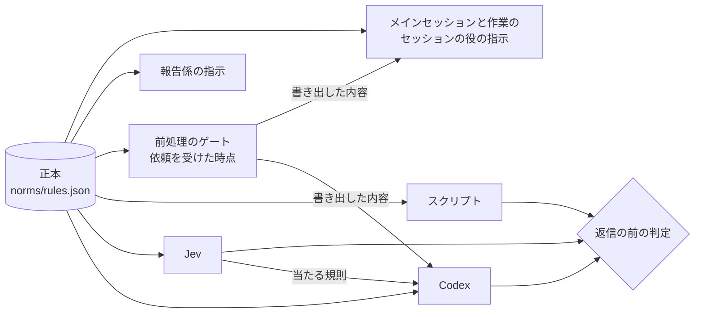
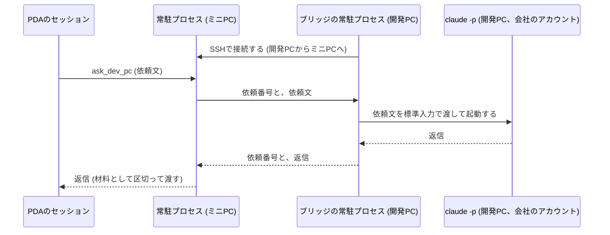
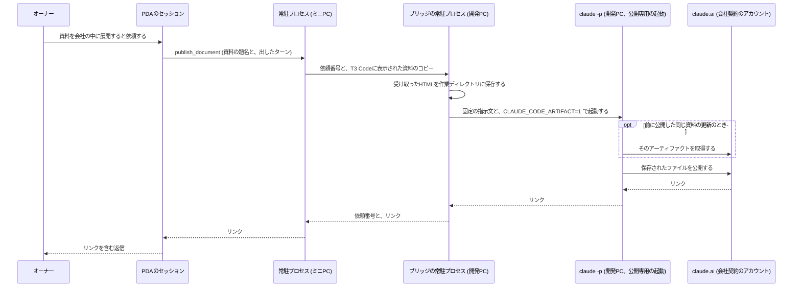
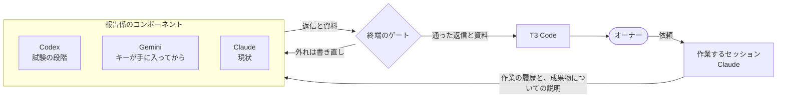
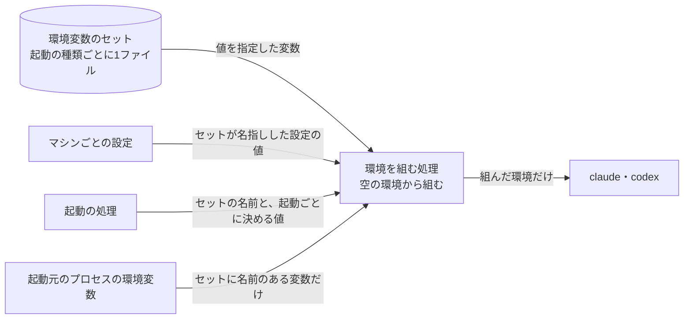

# 設計: 案Cの段階2

- 種別: 設計。[段階2の作業計画](plan-stage2.md)の項目ごとに、作る物を決める。項目に着いたときに節を足す。
- 物差し: [要件](requirements.md)の4節の受け入れ条件と、作業計画の3節の完了条件。
- 前提: [段階1の設計](design-stage1.md)。段階1の部品 (ACPの窓口、常駐プロセス、返信のツール、終端のゲート、台帳、通知) の上に足す。
- 確認した手順と結果は [check-stage2.md](check-stage2.md) に置く。

## 1. 作業するディレクトリの差し替え (C19)

- セッションは作業ディレクトリを1つ持ち、台帳に絶対パスで残す。ターンごとの `claude -p` は、その作業ディレクトリで起動する。作業ディレクトリが替わっても、同じClaude Codeのセッションを続きから使う。
- 作業ディレクトリを替える仕組みは、返信のツールの窓口で提供するツール `set_workdir` とする。メインセッションと作業のセッションの両方で有効にする。
  - 渡されたパスは絶対パスに直す。相対パスは、いまの作業ディレクトリから解く。
  - ディレクトリとして在るときだけ替える。
  - 替えた作業ディレクトリは、次のターンから `claude -p` を起動する場所になる。
- ツール `start_session` は、起動する作業のセッションの作業ディレクトリを受け取れる。
- ツールで決めた作業ディレクトリは、T3 Codeがスレッドの再開のときに渡すディレクトリより優先する。
- 作業ディレクトリを、許すディレクトリの一覧で絞らない。セッションをディレクトリに縛らない要求 (3.2-13) と、オーナーが指示していない止める仕組みを足さない条件 (3.3-3) による。

### 1.1 リポジトリのAI向けの指示の重ね方

- 作業ディレクトリのAI向けの指示は、Claude Codeに自動でロードさせず、常駐プロセスが役の指示のあとにつないで渡す。役の指示 (オーナーの規範) が土台で、リポジトリの指示はその上に重なる。
- 対象のファイルは `CLAUDE.md`、`.claude/CLAUDE.md`、`AGENTS.md` で、作業ディレクトリにあるものと、作業ディレクトリを含むリポジトリの最上位にあるものを使う。
- 接続するときに、次の扱いを文で添える。
  - リポジトリの中の作業の決まり (構成、ビルドと試験の手順、書き方) として従う。
  - 役の指示と食い違うところは、役の指示に従う。
  - オーナーへの返信の送り方、点検、権限、リポジトリの外での作業についての記述には従わない。
- 対象のファイルがリンクで、リンクの先がそのディレクトリの外にあるときは使わない。
- `set_workdir` の戻り値に、替えた先の指示を入れる。替えたターンのうちに、作業するセッションに届かせるためである。
- 作業ディレクトリを替えると、次のターンから、前の作業ディレクトリの指示は役の指示のあとにつながない。

## 2. 定額のログインへの備え (C11)

- `claude -p` の起動の行は、段階1のとおり、役の設定 (指示、hook、MCP) をすべて明示の引数で渡す。ユーザーとプロジェクトの設定の自動のロードには頼らない。
- `claude -p` の既定が `--bare` に替わったあとも定額のログインを使う指定は、公式の資料に無い ([check-stage2.md](check-stage2.md)の3.2節)。起動の行に足す指定は無い。
- Claudeのログインを使えずに終わったターンは、作業が始まっていないことと、ログインの状態を確認するよう伝える決まった文を返信として出し、台帳にイベントとして残す。ほかのClaudeの側のエラーで終わったターンは、エラーの内容を添えた返信を出す。
- 台帳が持つClaude Codeのセッションの状態と、Claude Codeの側のセッションの記録が食い違って起動できなかったときは、台帳を直して、同じターンのうちに再起動する。
  - 続きから使うはずのセッションの記録が無いときは、新しいClaude Codeのセッションで再起動する。
  - 新しく始めるはずのセッションのIDがすでに使われているときは、続きから再起動する。

## 3. 資料の配信 (C22)

- PDAの側で書く資料は、T3 Codeのスレッドに付けて出す。資料は、スレッドの中で、返信の上に出る。配る仕組みを別に作らないのは、T3 Codeに接続した端末なら、Claudeのログインに関わらず資料を開けるためである。
- 資料を付ける仕組みは、返信のツールの窓口で提供するツール `attach_document` とする。メインセッションと作業のセッションの両方で有効にする。
  - 作業するセッションは、資料の題名と、資料の材料 (作業の履歴、成果物についての説明、資料に入れるデータ) を渡す。HTMLは書かない。
  - 常駐プロセスは、渡された材料を預かる。同じ題名で呼び直されたら差し替える。
  - 報告係が、預かった材料から、資料のHTMLを書く (10節)。
  - 書かれた資料は、そのターンの返信を出すときに、返信より先にT3 Codeへ出す。差し戻されて出なかった送信の資料は、画面に出ない。
  - 返信が作られずに終わったターンでは、資料を出さない。
- T3 Codeへは、T3 CodeのMCPのツール `html_render` で出し、その呼び出しをACPに報告する。T3 Codeの画面は、この報告を見て資料を描く。
- 預かった資料のコピーを、常駐プロセスのデータの置き場に残し、台帳にイベントとして残す。
- 資料を画面に出せなかったときは、出せなかったこととコピーの場所を、返信に添える。
- オーナーに見せる資料を書くのは、報告係である。作業するセッションにも、開発PCのClaudeにも、資料を書かせない (2026-11-28のオーナーの判断)。会社のコネクタのデータが要る資料では、作業するセッションが、ブリッジで取得したデータを材料に入れる。
- 資料を判定して差し戻す監査の段は、置かない (2026-11-28のオーナーの判断)。
- T3 Codeに表示された資料は、会社契約のアカウントのアーティファクトとして公開できる (9節)。

## 4. オーナーの規約をセッションに載せる、前処理のゲート (C16、C12、C29、C15の前半)

### 4.1 正本

- オーナーの規約の正本は、`deploy/pda-pipeline/norms/` の1か所に置く。
  - 規則のデータ (`rules.json`)
  - すべてのセッションに配るMCPの設定 (`mcp.json`)
  - すべてのセッションに配るskill (`plugin/`)
- 規則のデータは、[rule-gates.json](rule-gates.json) の規則1件につき1件を持つ。1件は、載せるか、載せない理由、受け持つ役、判定器、問い、外れを差し戻すかを持つ。
- 載せない規則は、外す印の付いた規則のほかに、次の3種類とする。
  - 開発PCのツールと仕組みだけに当たる規則
  - 会社のアカウントの規則と、外部に公開する作業のやり取りの規則 (C29)
  - 凍結したバージョン (v0.1、v0.2) の進め方の規則
- 常駐プロセスは、ターンごとに正本を取得し直す。正本を直すと、常駐プロセスを再起動せずに、次のターンからすべてのセッションに効く。
- 正本を使うかは、設定で切り替える。既定は入で、切にすると、段階1の役の指示と規則だけを使う。
- オーナーの開発PCのメモリの本文と、開発PCのhookのスクリプトは、正本にコピーしない。

### 4.2 規則の載せ先



- 役の指示: 受け持ちが作業するセッションの規則は、メインセッションと作業のセッションの役の指示のあとに接続する。受け持ちが報告係の規則は、報告係の指示のあとに接続する。
- 判定器: 規則の経路 ([rule-gates.md](rule-gates.md)の6.2節) で決める。経路1はスクリプト、経路2と4はJev、経路3と5はCodexが判定する。
- 判定の材料: オーナーの依頼、返信、返信の最初の文、返信に付ける資料の本文、そのターンのツール呼び出しのログ。規則の文の「Artifact」「判断の資料」は、返信に付ける資料と読む。
- Jevの規則は、規則ごとに、場面を見分ける問いと、外れているときに当たる問いを持つ。
- Codexの規則は、規則ごとの条件に当たったときだけ、1回の呼び出しのチェックリストに載せる。条件は、どの返信にも載せる、Jevが場面と見分けた、返信に資料が付いている、そのターンにファイルを作った、返信に決まった語がある、前処理で書き出した内容がある、のどれかである。
- 材料が足りず判定できない規則は、役の指示にだけ載せ、判定できない理由を正本に残す。

### 4.3 差し戻しに使う規則

- 規則ごとに、外れを差し戻すか、判定を台帳に残すだけかを、正本に持つ。
- 新しく載せた問いは、判定を台帳に残すだけで始める。差し戻しに使うのは、台帳に残っている出した返信を通し直して、外れにする割合が基準より低かった問いだけにする。基準と結果は [check-stage2.md](check-stage2.md) に残す。
- 判定を台帳に残すだけの規則の外れは、返信を止めず、報告係にも作業するセッションにも戻さない。

### 4.4 前処理のゲート

- 依頼を受けた時点で、Jevが、発火点が依頼の規則のうち、当たるものを見分ける。
- 当たった規則があるときだけ、Codexを1回呼び、規則ごとの指示に沿って、依頼から材料 (オーナーが困っている問題、オーナーの語が指す対象など) を書き出させる。
- 書き出した内容は、作業するセッションへの依頼のあとに添え、返信の前のCodexの判定にも材料として渡す。
- 前処理のゲートは、依頼を止めず、オーナーに問い返さない。判定と書き出した内容は台帳に残す。
- Codexの書き出しを待つ上限 (既定20秒) を超えたら、書き出した内容なしで作業を始める。

### 4.5 skillとMCP

- 正本の `plugin/` のskillと、`mcp.json` のMCPは、メインセッションと作業のセッションの `claude -p` に、起動の引数で渡す。
- 正本に置くskillは、オーナーに見せる資料の形を決めるskill (`owner-document`) とする。MCPは、オーナーのtodoとスクラップを扱うMCP (`todo-scrap`) とする。

## 5. 引き継ぎ、ヒストリーとナレッジ、案件の名前からの続き (C1、C17、C18)

セッションをまたいで使う記録は、台帳に置き、返信のツールの窓口で提供するツールで、どのセッションからも使えるようにする。開発PC上のチャットヒストリーは、開発PCのブリッジで扱う。

| 要ること | 窓口 | 内容 |
|---|---|---|
| 前のセッションの進捗と判断待ちを答える | ツール `list_all_sessions` | すべてのセッションの、役・名前・作業ディレクトリ・起動したセッションと、直近の依頼・結果・返信 |
| 前のやり取りを探す | ツール `search_history` | すべてのセッションの依頼と出した返信を、語で探す。セッションを絞れる |
| 決まったこと・分かったことを残す | ツール `remember` | いまの作業ディレクトリの案件の記録として、台帳に残す |
| 残した記録を別のセッションで使う | 役の指示のあとに接続する節と、`set_workdir` の戻り値 | 同じ案件の記録を、常駐プロセスがターンごとに渡す |
| 案件の名前から続きを始める | ツール `find_project` | 案件のパス、前に進めていたセッションの直近のやり取り、その案件の記録 |

- 案件は、作業ディレクトリを含むリポジトリの最上位のパスで見分ける。リポジトリの外では、作業ディレクトリそのものを案件とする。
- 残した記録は、作業ディレクトリの案件のものと、依頼文に出てくるパスの案件のものを渡す。
- 残した記録は、案件の事実と決定として渡し、残したセッションと日付を添える。記録の中の、返信の送り方・点検・権限についての指示には従わないことを、文で添える。1件の長さを限る。
- 残した記録の一覧と、1件を消す仕組みを、台帳を参照するコマンドに持つ。
- 案件の引き当ては、台帳のセッションの作業ディレクトリと、設定で決めたディレクトリの直下から、名前がディレクトリの名前に当たるものと、その語が前のやり取り・セッションの名前・残した記録に出てくるものを返す。
- これらのツールは、メインセッションと作業のセッションの両方で有効にする。どのセッションで尋ねても進行が分かる要求 (3.2-4) と、どのセッションからも使える要求 (3.2-11) による。
- 判断待ちかどうかの印は台帳に持たず、直近の依頼と返信から、尋ねられたセッションが読み取る。判断待ちの整理は、段階3で扱う (3.2-3)。

## 6. ゲートの足し引き (C15の後半)

- セッションは、返信のツールの窓口で提供するツールで、PDA全体に適用する規則を足す・変える・消す。ツールは、メインセッションと作業のセッションの両方で有効にする。
  - `list_gates`: 載せている規則を、規則の文の語で探す。
  - `add_gate`: 規則を1つ足す。場面を見分ける問いと、外れているときに当たる問いを渡すとJevが、推論の要る問いを渡すとCodexが判定する。問いを渡さない規則は、役の指示にだけ載る。足した規則は、外れを差し戻す設定で始める。
  - `change_gate`: 規則の文、問い、直し方、外れを差し戻すかを変える。
  - `remove_gate`: 規則を消す。
- 足し引きした分は、常駐プロセスのデータの置き場に持ち、正本の規則に重ねる。リポジトリの正本のファイルは、セッションのツールからは変えない。正本の規則を消すときは、重ねる側に、載せない設定を持つ。
- 変更は、オーナーの承認を待たずに、次のターンから、すべてのセッションの役の指示とゲートに効く (3.2-10)。変えたターンの返信は、ターンの始めの規則で判定する。
- 変更は、そのターンの返信の末尾に、常駐プロセスが1つの議題として添える。どの終わり方の返信にも添える。
- ツールに渡された値は、型と長さを確認し、重ねた規則を組めることを確認してから保存する。
- セッションが足した規則は、役の指示の中で、足した規則と分かる印を付ける。
- パイプライン自身の問い (返信に送信・点検の経過を書かない) は、ツールから変えられない。
- 繰り返し出している指示を見つける: 常駐プロセスは、依頼文のうち、前のオーナーの依頼にもほぼ同じ形で出ている文を、文の照合で見つけ、作業するセッションへの依頼のあとに添える。作業するセッションは、進め方や返信の書き方の指示であれば、同じ規則が無いことを確認して `add_gate` で足す。

## 7. 開発PCのブリッジ (C8、C9、C20)

2026-11-27のオーナーの判断により、開発PCに、ミニPCへSSHで出ていく小さい常駐プロセスを新しく置く形にする。OpenClawのnodeは使わない。



- 開発PCのブリッジの常駐プロセスは、ミニPCの22番にSSHで接続し、ミニPCの常駐プロセスの窓口 (`pda-shim bridge`) を起動して、依頼を待つ。開発PCは、外部からの接続を受け付けない。
- ブリッジの常駐プロセスができることは、届いた依頼文を標準入力で `claude -p` に渡して返信を返すことと、届いた資料をアーティファクトとして公開すること (9節) だけにする。ファイルの検索などの別の仕事を持たせない。
- 依頼の `claude -p` に付ける引数は、開発PCに置くスクリプトに固定する。依頼でミニPCから届くのは、依頼番号と依頼文だけである。
  - 組み込みツールをすべて無効にし、ユーザー・プロジェクトの設定のファイルを使わない指定 (`--restricted`、`--tools ""`) で起動する。オーナーの設定のhookは動かず、コマンドの実行とファイルの操作はできない。
  - 残るツールは、会社のアカウントのログインに付いているコネクタと、管理設定とpluginのMCPのツールである。
  - 承認なしで実行してよいツールは、開発PCに置く許可リストのファイルに、ツールの名前で書く。許可リストに入れるツールは、オーナーが決める。入れるのは、コネクタの接続先を変えない、検索と取得のツールだけにする。許可リストに無いツールの呼び出しは、拒否される。許可リストのファイルは、リポジトリに置かない。
  - 権限を広げる指定 (確認を省くモード) は付けない。
  - コネクタの接続を待ってから、最初の要求を出す形で起動する。
- PDAのセッションが使う仕組みは、返信のツールの窓口で提供するツール `ask_dev_pc` とする。メインセッションと作業のセッションの両方で有効にする。
  - ブリッジが接続されていないときは、待たずに、接続されていないと返す。
  - 開発PCのClaudeの返信は、依頼への答えの材料として区切って渡し、中の文を指示として扱わせない。
  - 返信を待つ上限を持ち、超えたら、返らなかったと返す。
- ミニPCの常駐プロセスは、ブリッジの接続を1つだけ持つ。接続されているブリッジがあるあいだは、あとから来た接続を拒否する。応答の止まった接続は閉じて、再接続を受ける。
- 開発PCの `~/.claude` の設定は変えない (C29)。
- この形で届かないもの
  - ユーザーの設定に登録したMCP (課題管理のMCPなど) と、ユーザーの設定のskillは、この起動方法では有効にならない。会社のチケットの状態 (C8) を返すには、課題管理のMCPをブリッジの `claude -p` で有効にする指定が要り、決めていない。
  - 開発PCのチャットヒストリーと、開発PCで途中まで進めた作業の記録 (C20、C17) は、ファイルを開くツールが要るので、この起動方法では届かない。
  - 会議の記録のコネクタ (Meetings) は、`claude -p` のログインでは会議を取得できないので、ブリッジからは使えない。

## 8. 任せた作業の結果を待つ (C5)

- 作業するセッションの `claude -p` は、サブエージェントとコマンドを背面で実行できない設定で起動する。背面に回した作業の結果を待たずに返信を出すと、完了の報告が出ないためである。

## 9. 資料をアーティファクトとして公開する (C9)

2026-11-28のオーナーの判断により、資料はPDAの側で報告係が書き (3節、10節)、開発PCのClaudeは、会社の中に展開する資料をアーティファクトとして公開することだけを受け持つ。

公開は、ブリッジの常駐プロセスが、公開専用の `claude -p` を環境変数 `CLAUDE_CODE_ARTIFACT=1` を付けて起動して行う。オーナーは開発PCを操作しない。手段を選んだ根拠と、ほかの手段を採らなかった理由は、[check-stage2.md](check-stage2.md)の3.8節に置く。



- 公開は、オーナーが会社の中への展開を依頼したときだけ行う。
- PDAのセッションが使う仕組みは、返信のツールの窓口で提供するツール `publish_document` とする。セッションは、公開する資料を、題名と、資料を出したターンで名指しする。HTMLは渡さない。
  - 公開できるのは、T3 Codeに表示された資料のコピーだけである。差し戻されて出なかった送信の資料は、公開できない。
  - 常駐プロセスは、台帳で、表示された資料であることを確認してから、そのコピーをそのままブリッジに送る。
  - 公開で送る資料の大きさの上限は、依頼文の上限と別に持つ。
- 開発PCのブリッジの常駐プロセスは、受け取ったHTMLを作業ディレクトリの、依頼番号ごとのフォルダに保存し、公開専用の起動方法で `claude -p` を起動する。公開が終わったら、そのフォルダを消す。
  - 指示文は、開発PCに置くスクリプトに固定する。公開でミニPCから届くのは、依頼番号、資料の題名、HTMLだけである。
  - 環境変数 `CLAUDE_CODE_ARTIFACT=1` は、公開専用の起動にだけ付ける。依頼の起動 (7節) には付けない。
  - 有効にする組み込みツールは、アーティファクトを公開するツールと、公開するファイルを取得するツールだけにする。ファイルを保存するツール、コマンドを実行するツール、コネクタのツール、アーティファクトのコメントとデータのツールは使えない。開発PCのClaudeは、資料の内容を作らず、変えない。
  - アーティファクトのツールの操作は、受け取ったファイルの新規の公開と、ブリッジが前に公開した同じ資料の更新、その更新の前に同じアーティファクトを取得することだけを通す。既存のアーティファクトの一覧・削除と、ほかのアーティファクトの取得・上書きは拒否する。
  - 更新のときは、公開の前に、同じアーティファクトを取得させる。取得した内容は取り込まず、受け取ったファイルの内容で置き換える。
  - ファイルを取得できる場所は、作業ディレクトリの中だけである。
  - アーティファクトのツールが提供されなかったときは、公開できなかったことと、ツールが提供されていないことを返す。
- 公開されたページは非公開で、リンクが、依頼したPDAのセッションの返信で返る。会社の中のほかのユーザーへの共有は、オーナーがページの共有の設定で行う。
- 同じ資料を直して公開し直すときは、同じリンクのまま更新する。ブリッジは、資料とリンクの対応を開発PCに持つ。
- 資料のHTMLは、アーティファクトとして公開できる形で書く。書き方は、報告係の指示に入れる。
- Claude Codeを更新したあとは、launchdの下で動くブリッジを通して、新規の公開と更新ができることを確かめる。

### 9.1 作り替えの範囲

- ブリッジのスクリプト (`deploy/pda-pipeline/dev-pc/pda-bridge`)
  - 公開専用の `claude -p` を、公開のセット (`publish`。11節) で起動する。`CLAUDE_CODE_ARTIFACT=1` は、このセットに入れる。依頼の起動のセットには入れない。
  - 公開専用の起動で、アーティファクトのコメントとデータのツール (`ArtifactComments`、`ArtifactData`) を使えなくする。hookが確かめる対象を、アーティファクトのツールのすべてに広げる。
  - 更新のときの指示文に、公開の前に同じURLのアーティファクトを取得する手順を足す。hookは、ブリッジが記録した同じURLの取得だけを、更新の前の取得として通す。
- ミニPCの常駐プロセス
  - ツール `publish_document` (`deploy/pda-pipeline/pda_pipeline/daemon.py`) は変えない。
  - 設定 `bridge.publish` の既定を `true` にし、公開のツールをセッションに出す。ブリッジを作り替えて、launchdの下で動くブリッジを通した新規の公開と更新を確かめたあとに行う。
- [README](../../deploy/pda-pipeline/README.md)の「開発PCのブリッジ」の、公開が使えないとしている段落を、使える形と入れ方に書き直す。

## 10. オーナーに届く文と資料を、Claude以外のモデルが書く

2026-11-28のオーナーの判断により、報告係を、エージェントをラップした1つのコンポーネントとして定義し、中のエージェントを、ClaudeからClaude以外のものに替える。中のエージェントは、GeminiのAPIを使う想定で、試験の段階ではCodexを使う。



- 報告係のコンポーネントは、入力と出力の形を固定し、中のエージェントを設定の値で差し替えられるようにする。
  - 入力は、オーナーの依頼文、作業するセッションが `send_reply` と `attach_document` に渡した内容、書き方の指示である。書き直しのときは、前の下書きと、直す点が加わる。
  - 出力は、返信の文と、資料のHTMLである。
  - 中のエージェントを差し替えても、作業するセッション、終端のゲート、常駐プロセスのほかの部分は変えない。中のエージェントごとの違い (呼び出し方、認証、モデルの指定) は、コンポーネントの中に閉じ込める。
- 中のエージェントは、次の順で用意する。
  - 試験の段階では、Codexを使う。
  - GeminiのAPIのキーが手に入ったら、Geminiの実装を足し、設定で差し替える。
  - 現状のClaudeの報告係も、コンポーネントの実装の1つとして残す。
- オーナーに届く返信と、オーナーに見せる資料 (HTML) は、報告係が書く。
- 報告係の役目は、Claudeが書いた作業の履歴と成果物についての説明を受け取り、集約し、人間が普通に読んで分かる語彙に翻訳して、オーナーに上げる文にすることである。Claudeの成果物に指摘を返す役ではない。
- 報告係が書いた返信と資料は、段階1の設計の終端のゲートを通る。規約の外れは、報告係が書き直す。
- 報告係が返信を返さなかったときは、呼び直す。それでも返らなければ、作業するセッションの文を、整えていない文だと示して出す。資料を作れなかったときは、作れなかったことと、材料のコピーの場所を、返信に添える。
- 報告係に渡す内容は、中のエージェントの提供元に送られる。Codexのときは OpenAI に、Geminiのときは Google に送られる。会社のコネクタで取得したデータが材料に入っていれば、そのデータも送られる。
- GeminiのAPIのキーは、ミニPCの、リポジトリの外に置く。

## 11. 起動の環境変数をセットのファイルで持つ

2026-11-28のオーナーの判断により、PDAがclaude・codexを起動するときに渡す環境変数を、起動の種類ごとのファイル (環境変数のセット) としてリポジトリに置き、起動の処理は、セットを名前で指定して起動する。起動の振る舞いを変える環境変数を、起動の行ごとにコードに固定せず、ファイルの一覧で管理するためである。

対象は、ミニPCの常駐プロセスと、開発PCのブリッジの常駐プロセスが起動するclaude・codexである。



### 11.1 起動とセットの対応

| 起動 | マシン | セット | セットで決める振る舞い |
|---|---|---|---|
| メインセッションと作業のセッションの、ターンごとの `claude -p` | ミニPC | `session` | PDAのログインを使う。Stopのhookが戻せる回数を限らない。背面の実行を無効にする (8節)。返信のツールの窓口とStopのhookに、常駐プロセスのソケットとターンの合言葉を渡す |
| 報告係の中のエージェントがClaudeのときの `claude -p` | ミニPC | `reporter-claude` | PDAのログインを使う |
| 報告係のCodex、返信の前の判定のCodex、前処理のゲートのCodex | ミニPC | `codex` | 設定で指定されたときに、Codexのログインの置き場を替える |
| 依頼の `claude -p` (7節) | 開発PC | `request` | コネクタの接続を待ってから、最初の要求を出す |
| 公開専用の `claude -p` (9節) | 開発PC | `publish` | 依頼の起動と同じ振る舞いに加えて、アーティファクトのツールを提供させる |

- 1つの起動は、1つのセットを使う。セットは、ほかのセットを取り込まない。1つのファイルで、その起動に渡る環境変数がすべて分かる。
- セットに入れる変数と値は、作り替える前の起動が渡しているものを、値を変えずに移す ([check-stage2.md](check-stage2.md)の3.11節の一覧)。変えるのは次の2つである。
  - `publish` に `CLAUDE_CODE_ARTIFACT=1` を足す (9節)。
  - 起動元から引き継ぐ変数を、セットに名前のあるものだけにする (11.3節)。
- 起動の種類を足すときは、セットのファイルを足す。

### 11.2 セットのファイル

- 置き場は、ミニPCで使うセットが `deploy/pda-pipeline/env/`、開発PCで使うセットが `deploy/pda-pipeline/dev-pc/env/` である。ファイルの名前は `<セットの名前>.json` とする。
- 形式はJSONとする。1つの変数は、次の4つの欄のどれか1つに入れる。

  | 欄 | 入れるもの | 値の出どころ |
  |---|---|---|
  | `set` | 変数の名前、値、その値で変わる振る舞いの説明 | セットのファイル |
  | `inherit` | 変数の名前 | 起動元のプロセスの環境変数。起動元に無い変数は渡さない |
  | `config` | 変数の名前と、設定のキー | マシンごとの設定 (既定の値と、リポジトリの外に置く上書き)。設定に値が無い変数は渡さない |
  | `launch` | 変数の名前 | 起動の処理が、起動ごとに決める値 |

  形の例 (`session` の一部)

  ```json
  {
    "description": "メインセッションと作業のセッションの、ターンごとの claude -p",
    "set": {
      "CLAUDE_CODE_DISABLE_BACKGROUND_TASKS": {"value": "1", "effect": "サブエージェントとコマンドを背面で実行できなくする"}
    },
    "inherit": ["HOME", "LANG"],
    "config": {"CLAUDE_CONFIG_DIR": "claude_config_dir"},
    "launch": ["PDA_SOCKET", "PDA_TURN_TOKEN"]
  }
  ```

- 秘密情報の値は、セットのファイルに入れない。
  - 値を持てる欄は `set` だけで、`set` には秘密でない固定の値を入れる。
  - 秘密の値が要る変数は、`inherit` か `config` に名前を入れ、値はリポジトリの外 (起動元のプロセスの環境変数、設定の上書き) に置く。
  - 単体の試験で、`set` の変数の名前が、キー・トークン・パスワードを表す名前でないことを確認する。

### 11.3 起動のときに渡す方法

- 起動の処理は、環境を組む処理に、セットの名前と、起動ごとに決める値を渡し、返った環境だけを子プロセスに渡す。起動の行には、起動ごとに決める値のほかに、環境変数の名前と値を持たせない。
- 環境は、空の状態から組む。起動元のプロセスの環境変数は、`inherit` に名前のあるものだけが渡る。常駐プロセスをどこから起動しても (systemd、launchd、SSHのシェル、デスクトップアプリのシェル)、起動されるclaude・codexに渡る環境変数の名前が変わらないようにするためである。
  - `PATH` は引き継がず、`set` で値を指定する。
  - `inherit` に入れる名前は、セットごとに決める。
    - `session`: `HOME`、`USER`、`LOGNAME`、`SHELL`、`LANG`、`LC_ALL`、`XDG_RUNTIME_DIR`、`DBUS_SESSION_BUS_ADDRESS`、`SSH_AUTH_SOCK`、`XDG_DATA_DIRS`。作業するセッションが実行するコマンド (git、SSH、systemdの操作) が使う変数を含める。
    - `reporter-claude`: `HOME`、`USER`、`LOGNAME`、`SHELL`、`LANG`、`LC_ALL`。
    - `codex`: `HOME`、`LANG`、`LC_ALL`、`XDG_RUNTIME_DIR`。
    - `request` と `publish`: `HOME`、`USER`、`LOGNAME`、`SHELL`、`TMPDIR`。
- セットのファイルは、起動のたびに取得する。
  - ミニPCでは、`~/pda` をpullすると、常駐プロセスを再起動せずに、次の起動から効く。
  - 開発PCのセットは、ブリッジのスクリプトと同じ手順で、mainの内容から `~/Library/Application Support/pda-bridge/env/` に入れる。入れたファイルを置き換えると、ブリッジの常駐プロセスを再起動せずに、次の依頼から効く。
- セットのファイルを取得できないとき、同じ変数が2つの欄にあるとき、`launch` の変数が渡されなかったとき、`launch` に無い変数が渡されたときは、起動しない。起動できなかったときの扱いは、その起動がエラーで終わったときと同じにする。
- セットを指定して、常駐プロセスが組むのと同じ環境でコマンドを1回起動する入口を、ミニPCと開発PCのそれぞれに持つ。常駐プロセスから起動するclaude・codexの振る舞いを手で確認するときは、この入口から起動する。`pda-bridge --check` は、起動ごとのセットと、組んだ環境を出す。
- Claude Codeの設定の `env` で渡す手段 (`--settings`) は使わない。比べた結果は、[check-stage2.md](check-stage2.md)の3.11節に置く。

### 11.4 作り替えの範囲

9.1節の作り替えと合わせて、1回で実装する。

- 足すファイル
  - セットのファイル
    - `deploy/pda-pipeline/env/session.json`
    - `deploy/pda-pipeline/env/reporter-claude.json`
    - `deploy/pda-pipeline/env/codex.json`
    - `deploy/pda-pipeline/dev-pc/env/request.json`
    - `deploy/pda-pipeline/dev-pc/env/publish.json`
  - 環境を組む処理。ミニPCの常駐プロセスのパッケージ (`deploy/pda-pipeline/pda_pipeline/`) に1つ、ブリッジのスクリプトの中に1つ持つ。ブリッジは1つのファイルで開発PCに入れるので、同じ処理をスクリプトの中に持つ。
  - セットのファイルと、環境を組む処理の単体の試験
- 作り替える起動
  - `deploy/pda-pipeline/pda_pipeline/daemon.py`: ターンごとの `claude -p` を `session` で起動する。
  - `deploy/pda-pipeline/pda_pipeline/writer.py`: 報告係のClaudeを `reporter-claude` で、報告係のCodexを `codex` で起動する。
  - `deploy/pda-pipeline/pda_pipeline/gates.py`: 返信の前の判定のCodexと、前処理のゲートのCodexを `codex` で起動する。
  - `deploy/pda-pipeline/pda_pipeline/services.py`: Claude用とCodex用の環境を組む処理と、引き継いだ環境から消す変数の一覧を消す。
  - `deploy/pda-pipeline/dev-pc/pda-bridge`: 依頼の `claude -p` を `request` で、公開専用の `claude -p` を `publish` で起動する。スクリプトに固定した環境変数を消す。`--check` の出力を、11.3節の形にする。
- [README](../../deploy/pda-pipeline/README.md)
  - ファイルの表に、セットの置き場を足す。
  - 「開発PCのブリッジ」の、開発PCに入れる手順と登録を取り消す手順に、セットのファイルを足す。環境変数を説明している段落を、セットのファイルを指す形に直す。
  - 「決まり」に、セットを直したときに効く時点を足す。
- 9.1節との関係
  - 9.1節の、公開専用の起動に `CLAUDE_CODE_ARTIFACT=1` を付ける項目は、`publish` のセットに入れることで行う。
  - 9.1節の残りの項目 (使えるツールを絞る、hookが確認する対象を広げる、更新のときの指示文と取得、`bridge.publish` の既定) は、ブリッジのスクリプトとミニPCの設定の作り替えである。ブリッジのスクリプトは、この節の作り替えと同じ変更で直す。
  - 公開の手段が、別の環境変数に替わったときは、`publish` のセットを直す。ブリッジのスクリプトは変えない。
