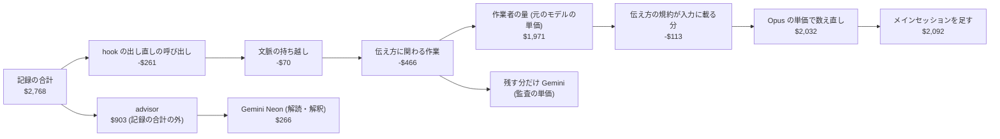

# 設計の観点: 規則の遵守を判定材料でゲートに振り分ける

- 更新: 2026-11-24 JST
- 種別: 設計の観点。開発 PC のメモリに書かれた規則を、PDA のゲートに取り込むときの振り分け方と、振り分けた一覧。
- 物差し: [Claude 一本化の要件](requirements.md) の 3.2-7 (PDA のどのセッションでもオーナーの規約が効き、守られたかが応答の終端のゲートで確かめられる)、3.2-8 (応答の終端で複数のゲートを通し、規則に外れていれば差し戻す) と受け入れ条件 C7、C16。
- 一覧のデータ: [rule-gates.json](rule-gates.json)。規則ごとに、メモリの名前 (`memory`)、範囲 (`scope`)、規則 (`rule`)、違反の見つけ方 (`check`)、型 (`type`)、照合だけで判定できるか (`pattern`)、すでにある開発 PC の仕組み (`existing`)、推論の水準による経路 (`route`、6 節)、経路の付け方の補足 (`route_note`)、発火点 (`fire`)、規則が当たるかの見分け方 (`trigger`)、受け持つ役 (`role`)、推論で扱う対象から一時的に外す印 (`exclude` と `exclude_note`) を持つ (6 節)。

## 1. 振り分ける理由

規則をメモリに書き足しても、メインモデルが守るようにはならない。開発 PC では、規則の本文は読まれないことが多く、読んでも書き手は自分の文脈のまま自分の出力を点検するので、外れたことに気づけない。

オーナーは、規則の遵守をメインモデルに判定させず、PDA の仕組みとして吸収する方針を述べている (2026-11-21)。これは、メモリの 1 つの指示ごとに小規模な推論モデルが遵守を確かめる、応答の前後にゲートを置くという聞き取りの答え ([requirements.md](requirements.md) の 2 節) と同じ方向である。開発 PC の hook とメモリは、PDA に取り込む前の残滓として扱う (同じく 2 節)。

## 2. 型

型は、遵守の判定に何が見えれば足りるかで決め、PDA でどこにゲートを置くかに対応させる。

- 型 1 出力物だけ: 最終応答・Artifact・PR の説明文・コミットメッセージ・書いたファイルを見れば判定できる。応答の後ろのゲートに置き、判定器には出力だけを渡す。
- 型 2 出力物とオーナーの発言: 出力に加えて、オーナーのそのターンの発言とそれまでのやり取りが要る。応答の後ろのゲートに置き、会話の記録も渡す。
- 型 3 ツール呼び出しの記録: 何をどの順で呼んだか、実行中の作業、操作の対象が自分で作ったものかが要る。ツール呼び出しの前後のゲートか、作業の記録を渡すゲートに置く。
- 型 4 前処理: 作業の前に問題を分析・分類して整理しておかないと、守れたかを判定できない。作業の前に推論機を置く。出した整理は、応答の後ろのゲートが照合する材料になる。
- 型 5 完了判定: 作業の記録と出力を見て、問題を正しく扱えたか、作業が終わったかを判定する。資料やコードを読み直すことがある。応答の後ろの、作業の完了判定のゲートに置き、外れていれば作業に戻す。
- 型 0 規則ではない: 環境の事実と参照情報。役の指示か参照の資料に置く。

型とは別に、推論を使わず、ツール名・コマンドの形・決まった語句の照合だけで判定できる規則に印 (`pattern`) を付ける。この印の付いた規則には判定器も要らない。

## 3. 設計の観点

### 3.1 置き場所は、判定に何が見えれば足りるかで決まる

規則の中身の種類 (伝え方か、作業の進め方か) ではなく、遵守の判定に要る材料で置き場所を決める。1 つのメモリの中にも型の違う規則が混ざるので、振り分けはメモリの単位ではなく規則の単位で行う。

### 3.2 小さい判定器で決まらない規則も、前処理か完了判定に振り分けられる

指示の理由の節を読み違えていないか、未決として返してよいか、といった規則は、出力だけを見る小さい判定器では決まらない。それでも、作業の前に問題を分析・分類する推論機 (型 4) か、作業の完了を判定するゲート (型 5) のどちらかに置ける。前処理が出した整理 (理由の節の問題、問う側の判断と変数の一覧など) を後ろのゲートに渡せば、照合そのものは、出力とオーナーの発言と前処理の整理だけを見る小さい判定器でできる。

### 3.3 「確認なしでしてよい」という許可は、許可要求の自動承認になる

コミットや検証の実行を確認なしでしてよいという常設の許可は、守らせる規則ではなく、許可要求が出たときに自動で承認するゲートになる (型 3)。

### 3.4 承認の要求は 2 か所に出るが、解き方は同じ

承認の要求は、道具が出す許可要求と、メインモデルが応答の文で尋ねる問い (「コミットしてよいですか」) の 2 か所に出る。どちらも、承認の要求を見つけ、常設の許可に当たれば許可済みとして返すゲートで解ける。違うのは検出の道具だけである。

- 道具が出す許可要求: 許可要求が出たときに動く hook が、コマンドの形の照合で判定して自動で承認する。
- 応答の文で尋ねる承認: 応答の後ろの hook で、Jev が承認を求める文かを判定し、当たれば許可済みなので続けるよう注入する。

Claude Code の Stop の hook は、止めても応答をチャットに出す。尋ねる文をオーナーに見せずに済ませるには、応答をオーナーに渡す前に通すゲートが要る。

## 4. 振り分けた結果の状態

- 規則の大半は型 1〜3 で、応答の後ろかツール呼び出しの前後に置く小さい判定器か、文字列の照合で判定できる。
- 型 4 (前処理) に入るのは、問題の理解 (指示の理由の節、オーナーの語が指すもの、原因と困っている結果の区別) と、作業の前に集めておく材料 (調査の前の判断と変数、追記先の語彙、構成の前例) の規則である。
- 型 5 (完了判定) に入るのは、未確認・要確認として返した項目が読めば確定できるものでないか、注意点や但し書きが要るものか、オーナーへの問いが出してよい問いかを、作業の記録と照らして判定する規則である。
- 開発 PC にすでにある仕組み (language-gate、reference-gate、answer-gate、comment-gate など) が判定しているのは一部の規則だけで、その多くも規則の一部しか見ていない。

## 5. 一覧

範囲の「全体」は開発 PC の `~/.claude/memory/`、「PDA」は PDA のプロジェクトのメモリを指す。各行は「規則 — 違反の見つけ方」で、照合だけで判定できる規則と、すでにある開発 PC の仕組みを末尾の括弧に書く。

### 5.1 型 1 出力物だけ

- bash_command_shape (全体)
  - Bashは1呼び出し1文で書く — Bash入力に echo 前置・&&・;・for・パイプがあるか (照合だけ、既存: bash-shape-guard（一部）)
  - コマンド作業を渡す依頼文に書き方の指示を含める — Agent呼び出しの依頼文が、コマンド実行を頼むのに書き方を含むか
- change_cost_is_set_by_own_design (全体)
  - 変更費用を理由にした記述に費用の出所を書く — 出力に「後から変えると〜作り直す」の類があり、出所が同じ文にあるか
- clean_up_own_byproducts (全体)
  - ファイル除去は trash -v 絶対パスの1文で行う — Bash入力が rm -rf か、trash に dangerouslyDisableSandbox を付けたか (照合だけ、既存: permissions.deny（一部）)
- commit_needs_no_confirmation (全体)
  - 応答でコミットの承認を求めたら、許可済みと伝えて続けさせる — 最終応答がコミットの承認を求めているか（Jev）。当たれば許可済みの文を注入する
- decision_request_as_artifact (全体)
  - 判断依頼は1つのArtifactにまとめ本文はリンクと一文にする — 判断を求める応答がArtifactリンクと決める一文だけか
  - 判断の資料の文は常体で書く — 資料の本文にです・ます調の文があるか
  - 各項目に推奨とその根拠を事実で付ける — 各項目に推奨があり、根拠が事実で同じ箇所に書かれているか
  - 項目を問い→状態→事実→選択肢→推奨→選ぶ欄の順に置く — 項目の並び順と、選ぶ欄がチェックボックスで初期未選択か
  - 見た目で違う選択肢は同じ位置の絵を並べる — 選択肢が見た目の違いなのに、絵が並んでいないか
- dev_pc_connectors_include_skills (全体)
  - GitHubはgh、DBはRedash skillと依頼文に書く — Agent依頼文・呼び出しに mcp__github__ 等のMCP道具があるか (照合だけ)
  - この Mac の道具の状態は尋ねず自分で調べる — 最終応答に、この Mac の道具の状態をオーナーに尋ねる文があるか
  - この Mac の道具のメモリは ~/.claude/memory に置く — 書いたメモリファイルのパスが ~/.claude/memory 配下か (照合だけ)
- dont_fix_unwarranted_review_findings (全体)
  - 直す理由に手間や指摘の属性を書かない — 理由に「数行で直せる」「念のため」「mustなので」があるか (照合だけ)
  - 報告に全指摘を直した/直さないと理由の組で載せる — 報告が全指摘を、判定と理由の組で並べているか
- elicit_by_offering_reading (全体)
  - 二択を選ばせず、良さ・困りごとの重みと当否を問う — 問いが「AかBか」「どちらが」の形か、読みを示す形か
- exemplar_requirement_judged_by_demonstrated_fit (全体)
  - 比較の欄は評判・機能の有無でなく実例か試行結果で埋める — 比較表の欄が評判や機能の有無だけで埋まっていないか
  - 実例も試行も無い候補は「実例なし」とし順位を付けない — 実例の無い候補に順位や推奨が付いていないか
  - 主たる変数が未検証のまま候補を推奨しない — 推奨の文があり、主たる変数が「試すまで分からない」のままか
- explain_in_why-what-how_order (全体)
  - 説明をWhy→What→Howの順で書く — 説明の冒頭がHowで始まらず、Why・What・Howの順に並ぶか
  - 曖昧な業界語を使わず具体動作を文で書く — 「合流」「フォールバック」等の語が動作の説明なしに使われたか
- explanation_is_translation_for_listener (全体)
  - 設計者が要る名前は原文のまま書き初出に持ち主を付ける — テーブル等の名前が造語に置換されていないか、初出に持ち主があるか
  - 作業の単位は番号と中身の名前を対で書く — PR・チケット等が番号だけ・名前だけ・相対位置で呼ばれているか (既存: reference-gate（一部）)
- explanation_objective_checks (全体)
  - 過去・現在・方針・評価・質問を並置せず1種類に絞る — 応答が複数種類の情報を区別せず並べているか
- gh_runs_unsandboxed (全体)
  - excludedCommands はプレフィックス指定で書く — settings.json に書いた excludedCommands が完全一致指定か (照合だけ)
- grasp_problem_before_solving (全体)
  - 副作用の評価に「増えるだけ」を書かず負担の増す場面を書く — 副作用評価に「〜が増えるだけ」「操作は増えない」の類があるか (照合だけ)
- headless_claude_inherits_hooks (全体)
  - claude -p には --setting-sources 空を付ける — Bash入力に claude -p があり --setting-sources "" を含むか (照合だけ)
  - 定期実行の定義に --setting-sources 空を入れる — 書いた launchd/cron の定義のコマンドに指定があるか (照合だけ)
- investigation_principles (全体)
  - 相手に実行を頼むコマンドを書かない — 最終応答に、相手に実行してもらうコマンドの提示があるか
  - 応答を状況と次の行動の一文から書き始める — 最終応答の冒頭が、思考過程でなく状況と次の行動を言い切る文か
- keep_technical_terms_as_katakana (全体)
  - 技術用語を日本語の別の語に言い換えない — 応答の技術用語が、片仮名・原文でなく造語に替わっていないか (既存: forbidden-word-gate（一部）)
- memory_writing_rules (全体)
  - メモリに日付・チケット番号・引用・計測値を書かない — 書いたメモリ本文に、日付・チケット番号・引用・計測値があるか
  - 発火条件に内省を示す語を書かない — 書いたルールに「感じたら」「迷ったら」などの語があるか (照合だけ)
- never_stop_only_redirect (全体)
  - 拒否の分岐に正しいやり方の場所と続行指示を入れる — 書いた hook の拒否文に、メモリのパスと書き直して続ける指示があるか
  - 「伝えて止まる」「2回目も止める」を書かない — hook やガードの記述に、ユーザーに伝えて止まる分岐があるか
- no_excessive_comments (全体)
  - コメントは why・地雷・前提条件だけに限る — コミットで足されたコメントが、why・地雷・前提条件のどれかか (既存: comment-gate)
  - コメントに計測値・経緯・チケットIDを書かない — 足したコメントに、計測値・変更経緯・チケットIDがあるか (既存: comment-gate)
  - 削除対象のコメントは相手に問わず消す — 応答に、コメントの削除を勧める・残すか尋ねる文があるか
- no_excessive_risk_caveats (全体)
  - 入力の検証を攻撃想定を理由に消さない — コード変更で、入力検証の削除が含まれていないか
- no_partial_framework_adoption (全体)
  - 外部の枠組みを一部だけ借りる案を書かない — 提案に「一部を借りる」「道具なしで考え方だけ使う」の形があるか
  - 枠組みを採らない理由に一次資料のリンクを付ける — 不採用の理由の文に、その枠組みの文書へのリンクがあるか
  - 自前の進め方の案に範囲の全体を書く — 案に対象・順序・完了判定・変更の扱いが書かれているか
- no_process_narrative_in_human_docs (全体)
  - 人間向け文書に作業過程・検証結果・ファイル一覧を書かない — PR説明等に、レビュー過程・ファイル一覧・ビルド結果の記述があるか
  - 文書に決定の日付・経緯を書かない — PR説明等に、決定日や「判明した」などの経緯の記述があるか
- no_space_between_ascii_and_japanese (全体)
  - 英字・数字と日本語の間に空白を入れない — 応答・Artifact の、英数字と日本語の境目に空白があるか(コード要素を除く) (照合だけ)
- online_resource_must_be_linked (全体)
  - チケットキー・PR番号をリンクにする — 応答に、リンクでない裸のチケットキー・PR番号があるか (照合だけ)
  - 外部ドキュメントのタイトルをリンクにする — 応答に、リンクでない外部ドキュメント・記事のタイトルがあるか
- output_language_is_japanese (全体)
  - つなぐ文は日本語で書く — 途中経過・最終応答に、識別子等以外の英語の文があるか (既存: language-gate（一部）)
  - 途中経過が英語なら最終応答で日本語に出し直す — 途中経過の英語の文のうち判断に要る内容が、最終応答にあるか
- outward_artifacts_are_users_work (全体)
  - 成果物に判断依頼・未確定の語を書かない — 成果物に「判断してください」「要確認」「未確定」の類があるか (照合だけ)
  - レビュー観点は平叙形で確定済みの判断だけにする — PRの「レビュー観点」の項目に、疑問形・依頼形があるか
- parallel_items_as_bulleted_list (全体)
  - 並列の3項目以上は箇条書きの行に分ける — 1つの文・項目に、並列の項目を区切り記号で3つ以上並べたか
  - 箇条書き不可の欄では項目を並べず状態を1文で書く — wrap_up・件名・表のセルに、並列の項目を3つ以上並べたか
- pr_create_as_draft (全体)
  - PR 作成のコマンドに --draft を付ける — ツール入力の gh pr create に --draft(MCP は draft:true) があるか (照合だけ)
  - 作成報告にリンク・ドラフト・レビュー待ちを書く — PR 作成の報告に、リンクとドラフトの旨とレビュー待ちがあるか
- prefer_tool_over_gated_bash (全体)
  - 承認が要る Bash の前に専用 tool で代替する — curl/wget の入力が、WebFetch や gh api で足りる取得か (既存: bash-shape-guard（一部）)
- reference_needs_visible_antecedent (全体)
  - 指示語は指す先が同じ段落の名詞にあるときだけ使う — 最終応答の指示語・相対位置の語の指す先が、近くの名詞にあるか (既存: reference-gate)
  - 手順の結果は記号でなく得た手順で呼ぶ — 最終応答に、手順の結果を指す記号や「そこから」があるか (既存: reference-gate（一部）)
  - Artifact・PR 説明文・問い文でも指す先を書く — Artifact 本文・PR 説明文・wrap_up の問いに、指す先の無い指示語があるか
- report_only_new_differences_as_problems (全体)
  - 問題として残す項目に 5 つの要素を書く — 問題の項目に、場所・中身・理由・新規リスク・想定可否があるか
- secret_never_typed_in_command (全体)
  - 秘密情報の値を平文で書いたコマンドを出さない — 応答のコマンドに API キー・トークン・パスワードの値があるか
  - 注意書きで済ませず安全な形で案内する — 案内の「注意して」が、形の変更で防げる事故を指しているか
- skill_orchestration_and_components (全体)
  - 段階のある skill を 2 種のスキルに分ける — 1 つの SKILL.md に、順に進む段階の見出しが複数あるか
  - コンポーネントに発火条件を書かない — コンポーネントの description・本文に「〜のとき使う」があるか
  - コンポーネントは自分の入出力だけを書く — コンポーネント本文に、他の段階への言及があるか
- subagent_findings_must_be_relayed (全体)
  - スコープ判断を結論として貼らない — 応答に「主題外」「別タスク」等が結論として断定されているか
- vocabulary_must_have_a_source (全体)
  - 関係・評価の述語は基準を同じ文に書く — 「適切」「妥当」等の述語の同じ文に、基準が書かれているか
- write_state_not_counts (全体)
  - 道具の集計を写さず、結果の状態を書く — passed/failed・ヒット数の集計を写した文があるか
  - レビュー結果は件数でなく有無と中身で書く — 「指摘 N 件」「must 0 件」の形の文があるか (照合だけ)
- write_what_to_do_only (全体)
  - 食い違いは両立しない動作を書いた箇所だけ — 「食い違い」の引用 2 つが、同じ対象の両立しない動作か
  - 文書を直す案にしないことを書き足さない — 直す案の追記に、しないことを書く文が入っているか
- writing_briefs_for_other_sessions (全体)
  - 依頼文に相手とのやり取りの規則を書かない — Agent の prompt に「拒否されたら返す」「確認する」の類があるか
  - 依頼文に報告の書き方を書かない — Agent の prompt に「報告は〜で書く」の類があるか
- no_paid_options (PDA)
  - 課金の候補は費用を冒頭に書き、無料の手段で足りない理由を添える — 出力の課金が要る候補に、費用の記述が冒頭にあるか、無料の手段で足りない理由があるか
- owner_approval_sheet_style (PDA)
  - 承認依頼は1項目1判断に分け、束ねて承認を求めない — 承認依頼の出力に「〜1式」「〜N件」のような束ねの承認項目があるか
  - 承認依頼はオーナー語彙で書き、内部のIDや実装用語を本文に出さない — 承認依頼の本文に設計判断IDや内部機構名・実装用語があるか
  - 依頼セクションには返答が要る項目だけを置き、参考情報は分ける — 承認依頼の依頼セクションに、返答が要らない参考情報の項目が混ざっているか
  - 承認の順番を意識させず、順序指示の文言を出さない — 承認依頼・通知に「1枚目を承認してから」のような順序指示の文があるか
- pda_commit_without_asking (PDA)
  - 応答でコミットの承認を求めたら、許可済みと伝えて続けさせる — 最終応答が区切りのコミットの承認を求めているか（Jev）。当たれば許可済みの文を注入する
- pda_derive_architecture_from_requirements (PDA)
  - 導いた構成が5層に満たないか横断軸が無いとき、導き直す — 構成の提案の層の数と、Claude CodeとCodexを横断する軸があるか
  - 構成を確かめてもらうときは図を先頭に置いた判断の資料にする — オーナーに構成の確認を求める資料の先頭に、図があるか
- pda_goal_operating_rules (PDA)
  - 報告は承認シートのArtifact更新とチャット数行にする — 最終応答が数行か。承認シートの内容を本文に書き込んでいないか
- pda_mask_project_names (PDA)
  - 発言の原文を記録するとき、伏せたことを記録の頭に一言書く — 案件名を伏せた原文の記録の頭に、伏せた旨の一文があるか
- pda_progress_over_stopping (PDA)
  - 止める機能を提案するとき、無いと何が起きるかとその強さを書く — 止める機能の提案の出力に、無い場合の結果と強さの記述があるか
- pda_remake_cycle (PDA)
  - 評価では不備ごとに直さず・直す・直さないのどれかを割り当てる — 評価記録の各不備に、3つの割り当てのどれかが書かれているか
  - 指示に部品ごとの受け入れ条件を書く — Codex向けの指示の出力に、部品ごとの受け入れ条件の節があるか
  - 「次の指示への反省点」だけで不備を閉じず、負債一覧に移す — 評価記録に、割り当ての無い不備や反省点だけで閉じた不備があるか

### 5.2 型 2 出力物とオーナーの発言

- artifact_audience_first (全体)
  - Artifact作成前に誰が誰に何のために見せるかを書く — 依頼文と書き出した宛先・目的を照合し、資料の形が合うか
  - 他者向け・依頼者整理用の資料に選択肢・推奨・回答欄を付けない — 依頼文から宛先が依頼者以外か自分用なら、本文に選択肢・回答欄があるか
  - 依頼者の語を題名・見出しで別の語に言い換えない — 依頼文の論点の語と、Artifactの題名・見出しの語を照合する
- change_cost_is_set_by_own_design (全体)
  - 設計が悪いとの指摘に差し替え可能な部品と受け入れ条件を書く — オーナーの指摘の後、設計文書に差し替え部品と受入条件があるか
- commit_needs_no_confirmation (全体)
  - push・PR作成・履歴書き換えは明示指示なしに実行しない — push等の呼び出しの前に、オーナーの明示指示があるか
- elicit_by_offering_reading (全体)
  - 答えを過去の発言から書ける問いは消し、読みとして記録する — 問いの答えが、オーナーの過去発言から書けるか
  - 一次回答のある事項は読みを示し当否を問う — 問いが一次回答のある事項に「補足して」を求めていないか
  - 問いは書き直す文書の節に欠ける材料から逆算する — 聞き取り前に、書き直す節と欠けた材料の一覧があるか
  - 食い違う2発言は相手に解かせず場面と前提を記録する — 食い違いを解かせる問いがないか、発言とその場面を照合
- exemplar_requirement_judged_by_demonstrated_fit (全体)
  - 見本をありふれたものと分ける性質を書き出し基準にする — 見本の発言と、設計・依頼文の基準の語を照合する
- explain_in_why-what-how_order (全体)
  - 同じ説明を2回求められたら構造を変える — 同じ説明の再要求の後、前の応答と構造が変わっているか
- explanation_is_translation_for_listener (全体)
  - コード名は消し、処理の中身を文で書く — クラス・メソッド・ファイルパス・行番号があるか。尋ねられたときを除く
  - 単位の呼び方の訂正は対に直し全箇所を直す — 訂正後の応答・資料に片方だけの呼び方が残るか
  - 現状整理の依頼に判断事項・方針案を混ぜない — 整理の依頼に対し、末尾に判断事項や方針A/Bがあるか
- explanation_objective_checks (全体)
  - 説明対象を指示文と照合して1種類に絞る — 指示文の説明対象と、応答が説明する対象が一致するか
  - 指示された対象以外の情報を混ぜない — 応答に、指示の対象外の情報・方針提案・評価があるか
  - 落としても次の判断が変わらない事実は書かない — 各事実を落としてもオーナーの次の判断が変わらないか
  - 選択・手順・可否の質問には冒頭で答える — 質問の形式に対し、応答の冒頭文が選択肢や可否で答えているか (既存: choice-question-guard（一部）)
  - 作業の報告は冒頭で完了か未完了かを言い切る — 作業の指示に対し、冒頭文が成果物の完了・未完了で書かれているか (既存: intent-gate（一部）)
  - 説明への訂正を2回受けたら説明対象の確定に戻る — 訂正の2回目以降に、問題の再特定が応答に現れているか
- grasp_problem_before_solving (全体)
  - 「試したい」依頼に選択肢・閾値・判定規則・正解ラベルを埋めない — 成果物のこれらの要素が、依頼文で確定済みか照合する
  - 観察用の成果物に集計と修正案を付けない — 観察用成果物と直後の応答に、一致率の集計や修正案があるか
  - 使いすぎの調査で相手が選んだものを削る案を書かない — 対策案に、オーナーが選んだモデル・機能・運用を削る案があるか
- ignore_auto_mode_reminder (全体)
  - 自動リマインダーを理由に確認を省かない — 確認すべき分岐で、オーナーの明示許可なく確認を飛ばして進めたか
- investigation_principles (全体)
  - 誤りの指摘を全面的に受け入れて謝罪する — 指摘直後の応答が部分肯定でなく、全面受け入れと謝罪から始まるか
- keep_technical_terms_as_katakana (全体)
  - 読みにくさを指摘されたら片仮名語を残して直す — 指摘後の再出力が、片仮名語を残した日本語に直っているか
- memory_writing_rules (全体)
  - 1タスクの個別の指示をメモリに書かない — 書いたメモリが、直近のオーナー発言の個別指示の写しでないか
- no_decision_offloading (全体)
  - 相手が前提を述べたら依存する論点を消す — 前提を述べた発言の後の応答に、その前提に依存する論点が残るか
- onset_is_not_cause (全体)
  - 原因の結論に主体と動作を書く — 原因を問われた応答の結論が、時点・環境の変化だけで終わっていないか
  - 訂正後の再調査で答えの型を前回と変える — 訂正後の応答が、前回と同じ型(相関の精緻化)になっていないか
- output_language_is_japanese (全体)
  - 言語を指摘されたら謝罪して日本語で出し直す — 指摘後の応答が、謝罪と日本語での出し直しを含むか
- outward_artifacts_are_users_work (全体)
  - 成果物の事実は外へ出す前に会話で伝える — 成果物の事実のうち、会話でオーナーに伝えていないものがあるか
- pr_create_as_draft (全体)
  - ドラフトを外すのはオーナーの指示後だけ — gh pr ready の呼び出し前に、オーナーの Ready 指示があるか
- separate_offtopic_findings (全体)
  - 主題外の発見を主題内の項目と別節に置く — 主題内のリストに、依頼の範囲外の項目が混ざっているか
- visual_spec_needs_picture (全体)
  - 画面の仕様は絵か試作で合意を取ってから指示する — 画面仕様を書いた実装指示の前に、絵の提示とオーナーの合意があるか
  - 文章だけの了承を合意とみなさない — 了承が文章へのものだけなのに「了承済み」と書いたか
  - 指定された表示の書き換えは前後の絵で問う — オーナーが名指しした表示を別の形に書いた記述に、前後の絵があるか
- vocabulary_must_have_a_source (全体)
  - 出所のある語だけを使い、造語を作らない — 定義付き・連番付き・訳語の名詞が、資料や相手の発言に実在するか
  - 訂正された語を別の対象にも使わない — 訂正された語が、後の応答・成果物に再び現れるか
- write_state_not_counts (全体)
  - 件数でなく相手の知りたい状態を書く — 件数・回数・行数が、尋ねられたか選択肢を分けるものか
- write_what_to_do_only (全体)
  - しないことでなく、することを書く — 「〜せず」「〜しない」の句が、求められたか既定を止めるものか
- pda_goal_operating_rules (PDA)
  - 承認要求は各マイルストーンのexit gateにまとめ、反映操作の一覧を添える — gate以外の途中で承認を求める文があるか。gate報告に反映操作の一覧があるか
- pda_progress_over_stopping (PDA)
  - 止める・断るための機能は、提案して承認を得てから作る — hookや仕組みに、止める・断る・承認待ちの処理を書いたか。直前にオーナーの承認の発言があるか
- pda_requirements_from_owner_words (PDA)
  - 要件の各項目に根拠となるオーナーの発言を原文で付ける — 要件の出力の各項目に、原文の引用があるか。発言との整合はオーナーの発言との照合が要る
  - 画面を決めたら、画面に求めていた内容を要件から外す — 要件の出力に、画面で決まる見せ方・一覧・操作の項目が残っているか
- pda_trial_leftovers_cleanup_without_asking (PDA)
  - 試用が残した認証の写し・設定の登録・bak・セッションは聞かずに消して記録する — 試用の残りの削除の可否をオーナーに問う文が応答にあるか

### 5.3 型 3 ツール呼び出しの記録

- askuserquestion_forbidden (全体)
  - 分岐・選択肢の確認はテキストで提示する — ツール呼び出しの名前が AskUserQuestion か (照合だけ、既存: permissions.deny)
- bash_command_shape (全体)
  - サンドボックス拒否後は excludedCommands の形に直す — 拒否の直後に dangerouslyDisableSandbox を付けた呼び出しがあるか
  - ワークツリーから本体への書き込み git は -C と無効化で実行する — 本体への git 書き込みが git -C 本体 の形で呼ばれているか
- browser_per_action_approval_sites (全体)
  - Tailscale・LAN のサイトでは常に許可できる4道具だけ使う — 対象サイトで read_page等4つ以外のブラウザ道具を呼んだか
  - システムの設定・状態はブラウザを使わず CLI で取る — ミニPCのサービスの状態取得に、ブラウザ操作が使われたか
- clean_up_own_byproducts (全体)
  - 自分が持ち込んだ副産物は自分で除去し報告に書く — 報告の除去対象のうち自作のものが除去済みか、作成履歴と照合
  - 自分の副産物の削除コマンド・「消す場合は」を報告に書かない — 報告に削除コマンドや「消す場合は」があり、対象が自作か
  - 作業前からあった相手の資源だけ確認を取る — 削除対象が作業前からあったものか、作成記録と照合する
- commit_needs_no_confirmation (全体)
  - 報告の前に未コミットの変更をコミットする — 最終応答の時点で対象リポジトリに未コミット変更が残るか
  - コミットの許可要求が出たら自動で承認する — 許可要求の対象が git commit か（push・amend・rebase は除く） (照合だけ)
- dev_pc_connectors_include_skills (全体)
  - 道具の状態報告はMCP一覧だけでなくskillとCLIも確かめる — 状態報告の前に、skill一覧とCLIログインを確かめた呼び出しがあるか
- dont_fix_unwarranted_review_findings (全体)
  - 編集の前に指摘ごとの3つの問いを1行で書く — 指摘に応じた編集の呼び出しより前に、3つの問いへの答えを書いたか
- exemplar_requirement_judged_by_demonstrated_fit (全体)
  - 見本を見ていない調査の合致評価は使わず照合し直す — 調査報告が見本を見ていない旨を含むのに、評価を使ったか
- final_response_divider (全体)
  - 最終応答の先頭行を --- にし、作業中の応答は --- で始めない — 後にツール呼び出しが続くか否かと、先頭行が --- かを照合する (照合だけ)
- gh_runs_unsandboxed (全体)
  - GitHubの情報はMCPでなくghで取る — 呼び出しの名前が mcp__github__ で始まるか、依頼文に書かれたか (照合だけ)
  - ghの呼び出しに dangerouslyDisableSandbox を付けない — gh で始まるBash呼び出しに無効化フラグが付いているか (照合だけ)
  - gh認証エラー時は excludedCommands を読んで形を直す — 認証エラーの直後に excludedCommands を読んだ呼び出しがあるか
- headless_claude_inherits_hooks (全体)
  - 出力に hook_started があれば外部へ出る hook を止める — stream出力の hook_started を見た後、hookを止める操作があるか
  - 非対話実行で作られた自分由来の状態ファイルを削除する — 実行後に増えた状態ファイルを列挙して削除したか
- investigation_principles (全体)
  - 条件を満たし済みなら止めた仕組みを通して続ける — hook に止められた後、通し方を使わずにターンを返していないか
  - 副作用のある操作は承認を得てから行う — ファイル作成・送信・PR作成の前に、オーナーの承認発言があるか
  - ツールが無いと言う前に利用可能なツールを確かめる — 「使えない」と報告する前に、ツール一覧の再確認や代替の試行があるか
- items_from_decomposition_not_from_search (全体)
  - 問いを受けたら調査の前に問う理由と変数を書く — 最初の検索系ツール呼び出しより前に、判断と変数を書いた文があるか
- memory_writing_rules (全体)
  - メモリを作ったら索引を同じ操作で更新する — メモリ新規作成のツール呼び出しと同じ操作に、索引の更新があるか
- no_answer_before_determining_work (全体)
  - 中身を返す背面作業の実行中は「作業中...」だけ出す — その作業の実行中の応答が、固定文以外を含むか (既存: answer-gate)
  - 成功か失敗だけを返す背面作業中は応答してよい — 実行中の背面作業が成功か失敗だけを返す作業か (既存: answer-gate)
- no_excessive_comments (全体)
  - レビュー対応で足したコメントの根拠を1行で書く — コメント追加の操作の前後に、該当条件を述べた1行があるか
- online_resource_must_be_linked (全体)
  - リンクのホストは参照元に現れた URL から確定する — 書いたリンクの URL が、取得したツール応答に現れた URL と合うか
- onset_is_not_cause (全体)
  - 探索を打ち切ったら打ち切った地点を書く — 探索を途中で打ち切った応答に、打ち切り地点を述べた一文があるか
- prefer_tool_over_gated_bash (全体)
  - 代替できない理由を示してから Bash を使う — 代替可能な Bash の直前の応答に、代替できない理由があるか
- report_only_new_differences_as_problems (全体)
  - 直さなかったレビュー指摘を注意点に写さない — 報告の注意点に、直さないと判断した指摘が載っているか
- respect_turn_handover_instruction (全体)
  - 停止点の指示で止まり後続の発信をしない — 停止点指示の後に、指示外の外部発信ツールを呼んだか
- sandbox_denial_looks_like_absence (全体)
  - ファイル操作の失敗を「不在」と断定しない — ENOENT 系の結果の後、応答が確認なしに「存在しない」と書くか
  - 秘密情報のパスは探索を打ち切って尋ねる — .env・認証情報・鍵のパスを探す Read/Bash が続いたか
- secret_never_typed_in_command (全体)
  - 秘密が端末に出たら履歴の確認と再発行を案内する — 秘密情報を表示した実行の後、履歴確認と再発行の案内があるか
- show_visual_pages_as_artifact (全体)
  - 画像を含むページは Artifact で見せる — 画像を含むローカル HTML をユーザーに送る呼び出しがあるか
- subagent_findings_must_be_relayed (全体)
  - サブエージェントの指摘の中身を本文に展開する — サブエージェント結果の個別の指摘が、応答本文に書かれているか
- todo_via_todo_scrap_mcp (全体)
  - todo・スクラップの読み書きは todo-scrap の道具で行う — todo 操作で ~/todo-scrap のファイルを Bash 等で直接触ったか (照合だけ)
  - 道具エラーの後にサービスの状態を読んで報告する — todo-scrap のエラー後に systemctl status があり、報告に載るか
- wait_for_approval (全体)
  - 問いを出したターンでは対象の操作を実行しない — 問いを含む応答と同じターンで、問いの対象の操作ツールを呼んだか
  - 宣言した範囲を超えず、宣言どおりに動く — 「〜します」「お待ちします」の後の呼び出しが、宣言と矛盾するか
- work_ledger (全体)
  - 複数ターンの作業は台帳 00_進捗.md を作って進める — 個別の指示を受けた未完の作業で、台帳が作られているか (既存: work-ledger（一部）)
  - 指示を受けたら応答前に守る指示へ足す — オーナーの指示の後、台帳の守る指示への書き込みがあるか
  - 判断・公開・段階完了のたびに進捗へ足す — 回答・公開・段階完了のターンで、台帳の進捗を更新したか
  - コンプレス後は台帳を全文読んでから再開する — 要約から始まった会話で、台帳の Read より前に別の作業をしたか (既存: work-ledger（一部）)
- pda_commit_run_instructions_immediately (PDA)
  - 指示ファイルや評価記録を書いたら同じターンでコミットする — docs/codex-runs等のファイルをWrite/Editした後、報告前にgit commitを呼んだか
  - 「置いた」と報告する前に、ファイルがコミットに含まれると確かめる — 「置いた」「書いた」の報告の前に、git ls-treeかgit statusを呼んだか
- pda_credit_tests_authorized (PDA)
  - クレジットを消費する検証の許可要求が出たら自動で承認する — 許可要求の対象が、live probe・E2E 検証の実行か
  - 検証用valveは終了時に本番値へ復元し、外部通知は抑止する — 検証の終了時に、valveを本番値に戻す操作を呼んだか。通知を抑止したか
- pda_goal_operating_rules (PDA)
  - ミニPCのフルスイートは直列・nice付きで、実行前にfree -hを見る — agent-nodeでのテスト実行のコマンドに、niceが付くか。直前にfree -hを呼んだか
  - 権限ブロックは代替経路2回まで、ダメなら実行コマンド案をgate報告へ集約する — 権限拒否の後の代替の試行が2回を超えたか
  - 再開時は記録を信用せず、HEADや盤面の実状態から再導出する — 再開後の最初の操作で、git log・盤面・ledgerを読む呼び出しがあるか
  - docs/status/restricted-*を開かず、反証レビューの生出力を本体へ戻さない — restricted-のファイルをRead/grepした呼び出しがあるか (照合だけ)
  - 凍結したセッションは再開せず、新規セッションで記録ファイル経由で再開する — 凍結したセッションのイベントを読み込む呼び出しがあるか
- pda_trial_leftovers_cleanup_without_asking (PDA)
  - 認証の本体とsettings.json・config.tomlは消さない — 削除コマンドの対象に、.credentials.json・auth.json・.claude.json・settings.json・config.tomlがあるか (照合だけ)
  - 権限の判定で止められたら、回り込まずオーナーに伝える — 削除が拒否された後に、別の方法で同じ対象を消す呼び出しがあるか

### 5.4 型 4 前処理

- dont_fix_unwarranted_review_findings (全体)
  - 3つの問いを満たす指摘だけを直す — レビューの指摘ごとに、実在するか・目的の内か・直した後が良いかを先に判定して整理する
- grasp_problem_before_solving (全体)
  - 理由付き指示は理由節の問題をそのまま保持して解く — 指示の理由の節を特定し、困っている問題をオーナーの語のまま書き出す。後ろのゲートは応答がその問題を解いているかを照らす
  - 相手の語は相手の世界での指示対象で束縛する — オーナーの語が、オーナーが操作・観測できる世界で何を指すかを書き出す
  - 相手の語を置き換えたら性質を保つか照合する — オーナーの語がオーナーの世界で持つ性質を書き出す。後ろのゲートは置き換えた形が性質を保つかを照らす
  - 対策の発動条件を困っている結果の事象で書く — 依頼から、原因の行為と困っている結果を分けて書き出す。後ろのゲートは発動条件が結果の事象かを照らす
- items_from_decomposition_not_from_search (全体)
  - 文書の項目は変数から作り、判断に要らない細部を載せない — 調査の前に、問う側の判断とそれを左右する変数を書き出す。後ろのゲートは各項目が変数に答えているかを照らす
- match_host_vocabulary (全体)
  - 追記は既存文書の語彙・表記に合わせる — 追記先の文書で、追記する概念がどの語・表記で書かれているかを集める。後ろのゲートは追記がそれに合うかを照らす
- outward_artifacts_are_users_work (全体)
  - 既存規約と違う構成は実装前に確認する — 実装の前に、作る構成の前例と規約を集め、外れるかを判定する。外れるならオーナーへの確認に回す
- pda_derive_architecture_from_requirements (PDA)
  - 構成は今ある実装の一覧から1:1で起こさず、要件から逆算して導く — 構成を考える前に、要件から実現すべきことを書き出し、部品の一覧ではなくそこから導く
- pda_remake_cycle (PDA)
  - リメイクの判定は触る関数の割合20%のしきい値で行う — リメイクを判定する前に、差分が触る関数の割合を数えて整理する

### 5.5 型 5 完了判定

- change_cost_is_set_by_own_design (全体)
  - 費用の出所が自分の設計なら、記述を消し部品の口を設計する — 変更の費用を理由にした記述に、出所が自分のこれから作る設計でないかを設計文書と照らす
- decision_request_as_artifact (全体)
  - 判断を求める問いは6関門を通ったものだけ出す — オーナーに出す問いごとに、6つの関門を依頼と会話の記録に照らして通す
  - 自分の成果物の欠陥を直すかは問わず、その場で直す — 問いが自分の成果物の欠陥を直すかの形なら、完了していないとして作業に戻す
  - 資料の事実は相手の選択が変わりうるものだけ載せる — 資料の各事実が、オーナーの選ぶ選択肢を変えうるかを判定する
- dont_fix_unwarranted_review_findings (全体)
  - コードから読める内容のコメント・文書を足さない — 足したコメント・文書の中身が、コードから読めるものでないかを差分と照らす
  - 足した分岐の影響を解消する問題と並べて書く — 足した分岐の壊れ方と、解消する問題が並べて書かれているかを照らす
- investigation_principles (全体)
  - 不在・不可の断定は観測してから書く — 応答の「無い・できない」の断定に、ツールの記録で観測した根拠があるかを照らす
- no_decision_offloading (全体)
  - 読めば確定できる事項を「未確認」で返さない — 「未確認」「要確認」の項目が、資料を読めば確定できるものなら作業に戻す
  - 「検証で確かめる」と書く前に推論で結論を出す — 「検証で確かめる」の項目が、推論で結論が出るものなら作業に戻す
  - 残課題には相手の判断が要る事項だけ残す — 残課題の各項目が、オーナーの前提や推論で決まるものでないかを照らす
- no_excessive_risk_caveats (全体)
  - 攻撃者だけが起こせる事象の但し書きを書かない — 攻撃者だけが起こせる事象の但し書きが、個人情報の動線のものかを判定する
- report_only_new_differences_as_problems (全体)
  - 注意点には作業が新しく生んだ差だけを挙げる — 報告の注意点の各項目が、変更前から同じ状態のものでないかを照らす
- separate_offtopic_findings (全体)
  - 自発の付け足しも本体と同じ検証を通す — 頼まれていない注意点・補足の主張に、本体と同じ根拠があるかを照らす
- work_ledger (全体)
  - 案を比べる文は守る指示の軸で書く — 比較・判断の文の軸が、台帳の守る指示の軸と一致するかを照らす
- no_paid_options (PDA)
  - 課金が要る選択肢は無料の手段が尽きたときだけ出す — 課金が要る選択肢があれば、無料の手段が尽きた理由が書かれているかを照らし、無ければ作業に戻す
- pda_c6_credit_scope (PDA)
  - AI起動の要否は出力の消費先だけで判断し、検証をコスト理由で削らない — 提案に、品質保証のAI起動をコストを理由に削る案がないかを判定する
  - オーナーが行動に使う識別子（カードID・リンク）を要約から削らない — 要約・報告から、オーナーが行動に使う識別子が元の情報と比べて落ちていないかを照らす
- pda_mask_project_names (PDA)
  - PDAの文書の案件名を[個人で受けている案件]等の伏せ字にする — 書いたファイル・コミットに、案件名の一覧に当たる固有名詞がないかを照らす
- pda_oss_capability_from_docs (PDA)
  - OSSの機能の有無は公式資料で確かめて記録し、未決に載せない — 未決・候補の一覧に、公式資料を読まずに「確かめていない」とした項目がないかを照らす
- pda_requirements_from_owner_words (PDA)
  - オーナーに問うのは機能要件だけにし、設計・実装の選択を問わない — オーナーへの問いが機能要件か、仕組み・製品の選び方の問いかを判定する

### 5.6 型 0 規則ではない

- browser_per_action_approval_sites (全体)
  - 承認カードの仕様と許可の残り方の事実
- todo_via_todo_scrap_mcp (全体)
  - 構成は deploy/todo-scrap/README.md を読む — 参照情報で、守らせる規則ではない

## 6. 推論の水準による経路 (2026-11-24)

オーナーの方針 ([README.md](README.md) の 2026-11-24) により、規則ごとに、判定に要る材料の広さと推論の強さを決め、5 つの経路のどれかで判定する。2 節の型は置き場所 (いつ判定するか) を決め、経路は判定に使う AI を決める。規則ごとの経路は [rule-gates.json](rule-gates.json) の `route` にある。

### 6.1 振り分けの基準

- 材料の広さ
  - 閉じたコンテキスト: オーナーの指示と、それに対する出力物 (返事、Artifact、PR の説明文、1 つのツール呼び出しの入力) の組で決まる。出力物は必ずオーナーの指示に対する作業の結果なので、出力物だけでは判定しない (2026-11-24 オーナー)。
  - 複数の文脈: 指示と出力物の組のほかに、会話の記録、ツール呼び出しの記録と結果、資料・コード、台帳のどれかが要る。
- 推論の強さ
  - 要らない: 語・コマンドの形・パス・ツール名の照合、ツール呼び出しの記録の順序と回数、git やファイルの状態で決まる。材料が複数の文脈にまたがっても、記録が構造のあるデータなら、ここに入れる。
  - 低い: ある形・文・操作があるかを見分ける。決定論ではないが、意味の評価までは要らない。
  - 高い: 構造・論理・指す先・根拠の性質を読み取る、またはオーナーの意図・前提・過去の発言と照らして評価する。

4 の経路は、材料集めに推論が要らないことを前提にする。この前提が成り立つのは、材料の置き場が規則ごとに決まっていて、スクリプトが場所で取り出せる場合だけである。

- 場所で取り出せる材料: そのターンのツール呼び出しの記録と結果、そのターンの途中の文、直前の返事、台帳、訂正された語の一覧、リポジトリの全文の照合。
- 場所で取り出せない材料: 過去の会話から、合意した発言や前に答えた内容を意味で探すもの。材料集めそのものに推論が要るので、5 の経路に入れる。

### 6.2 経路と割り当てる AI

どの経路にも、オーナーの指示と出力物の組を渡す。

- 1 機械的 (推論が要らない): スクリプト。
- 2 閉・低 (閉じたコンテキスト、低い推論): Jev。発火点ごとに、当たりうる規則の問いをまとめて呼ぶ。
- 3 閉・高 (閉じたコンテキスト、高い推論): Codex。モデルは `gpt-6.1-sol`、推論の強さは `low`。規則 1 件ずつではなく、発火点で当たった規則をチェックリストにして読ませ、1 回の呼び出しで判定する。5 の経路と同じ呼び出しにまとめる。
- 4 多・低 (複数の文脈、低い推論): スクリプトが場所で取り出した材料を束にし、Jev で判定する。2 の経路と同じ呼び出しにまとめる。
- 5 多・高 (複数の文脈、高い推論): 3 の経路と同じ Codex の呼び出しで判定する。渡す会話の記録は今のセッションの記録までにする。ツール呼び出しの結果を渡すので、Codex にファイルを読ませるサンドボックスは要らない。

Codex のモデルは、フルスペックのモデルはクレジットの面で続けられないというオーナーの判断 (2026-11-24) により、推論の強さを絞った Sol にした。ミニ PC の Codex 0.161.0 のモデルの一覧 (`models_cache.json`) で最も新しい Sol は `gpt-6.1-sol` (「Previous generation model for coding and everyday work」) である。2026-11-17 に出た GPT-6.2 Sol はこの一覧に無く、Codex を上げれば使える。

### 6.3 報告係と、推論で扱う対象から外す規則

オーナーへの返事を書く役 (報告係) を、作業するセッションと別のモデルに分ける (2026-11-24 オーナー)。返事の書き方の規則は、報告係の指示に入れる。規則ごとの受け持ちは rule-gates.json の `role` にあり、`reporter` は報告係、`worker` は作業するセッションである。

報告係の規則には、抽象度が高く心がけのようで、推論でも検査できない規則がある。また、遵守を判定する費用に対して、出力の精度が上がる見込みが小さい規則もある。これらは `exclude` の印を付け、推論で扱う対象から一時的に外す。外した理由は `exclude_note` にある。外した規則は次のとおりである。

- 23 過去・現在・方針・評価・質問を並置せず 1 種類に絞る
- 30 技術用語を日本語の別の語に言い換えない
- 97 同じ説明を 2 回求められたら構造を変える
- 103 落としても次の判断が変わらない事実は書かない
- 106 説明への訂正を 2 回受けたら説明対象の確定に戻る
- 116 訂正後の再調査で答えの型を前回と変える
- 202 資料の事実は相手の選択が変わりうるものだけ載せる
- 211 自発の付け足しも本体と同じ検証を通す

### 6.4 発火点と、規則が当たるかの判定

ゲートを発火させる時点は、依頼を受けたとき (`request`)、ツール呼び出しの前 (`tool`)、許可要求 (`permission`)、返事を渡す前 (`reply`) の 4 つである。規則ごとの発火点は rule-gates.json の `fire` にある。

規則の多くは、関係する場面でだけ当たる。たとえば「システムの設定・状態はブラウザを使わず CLI で取る」は、システムの設定や状態を扱うタスクのときだけ当たる。当たるかの判定そのものに推論が要る規則は、Jev が、オーナーの指示と出力物の組か、オーナーの指示と 1 つ前の返事を材料に判定する。規則ごとの見分け方は rule-gates.json の `trigger` にある。

- `script`: スクリプトが、規則の対象 (ツール呼び出し、書いたファイル、決まった語、Artifact の公開など) が出たかで見分ける。
- `jev`: Jev が、指示と出力物の組か、指示と 1 つ前の返事から、規則の場面かを見分ける。
- `always`: どの返事にも当たる。

発火点ごとに呼ぶものは次のとおりである。

- 依頼を受けたとき: スクリプト、Jev、Codex の順に通す。
  - Jev が、前処理の規則のうちどれが当たるかを判定する。
  - 当たった前処理の規則をチェックリストにして、Codex を 1 回呼ぶ。前処理の Codex をどの粒度でまとめられるかは、6.6 節の論点である。
- ツール呼び出しの前: スクリプトだけを通す。外へ出る操作と取り消せない操作 (push、PR の Ready、削除、送信、下位のセッションへの依頼、curl) にスクリプトが当たったときだけ、その呼び出しに Jev を呼ぶ。ツール呼び出しの記録で決まる規則は、返事を渡す前にそのターンの記録をまとめて判定する。
- 許可要求: スクリプト。クレジットを使う検証の実行の許可だけ Jev を呼ぶ。
- 返事を渡す前: 報告係が返事を書いたあと、スクリプト、Jev、Codex の順に通す。
  - Jev は、2 と 4 の経路の規則の判定と、3 と 5 の経路の規則が当たるかの判定をまとめて受け持つ。
  - Codex には、当たった 3 と 5 の経路の規則と、どの返事にも当たる規則をチェックリストにして 1 回で渡す。
  - そのターンに書いたファイル、公開した Artifact、コミットの内容も、ここでまとめて判定する。

差し戻した返事を判定し直すときは、スクリプトをすべて通し、Jev と Codex は不合格だった規則だけを判定し直す。Codex の判定し直しは 1 回までにし、2 回目も不合格なら止めずに通して記録に残す。

### 6.5 最も多くのゲートを通る流れのシミュレーション

規則が当たるかは場面で変わるので、呼び出しの回数は、すべての規則が当たる流れを 1 本たどって上限を見積もる。たどる流れは、オーナーの依頼 1 つから返事 1 つまでの往復 1 回である。作業の量は、このセッション (2026-11-23〜24) で最も多かった往復に合わせ、ツール呼び出しを 119 回、外へ出る操作を 6 回とする。返事は 1 回差し戻されるとする。

- 依頼を受けたとき
  - スクリプト: 1 回
  - Jev: 1 回。前処理の規則が当たるかの問いが 8 つ。
  - Codex: 1 回。チェックリストは前処理の規則 8 件まで。
- ツール呼び出しの前
  - スクリプト: 119 回
  - Jev: 6 回。外へ出る操作ごとに、その操作に関わる規則 (最大 10 件) の問い。
- 返事を渡す前 (1 回目)
  - 報告係: 1 回
  - スクリプト: 1 回
  - Jev: 問いが 120 個。2 と 4 の経路の規則の判定と、3 と 5 の経路の規則が当たるかの判定である。
  - Codex: 1 回。チェックリストは 3 と 5 の経路の規則 50 件まで。
- 返事を渡す前 (差し戻しの後)
  - 報告係: 1 回
  - Jev: 1 回。不合格だった規則だけ。
  - Codex: 1 回まで。

この流れで、往復 1 回あたりの呼び出しは次のとおりになる。

- Codex: 3 回。約 10 分に 5 回の制限 ([spike-reply-gate.md](spike-reply-gate.md) の 5.4 節) では、往復が 6 分より短い間隔で続くと制限に当たる。
- 報告係: 2 回。
- Jev: 返事の前の 120 個の問いを 1 回の呼び出しに載せられれば 9 回になる。開発 PC でこれまでに 1 回の呼び出しに載せた問いは最大 12 個で、上限は資料に無い。12 個ずつに分けると返事の前が 10 回になり、Jev は合わせて 18 回になる。

### 6.6 この割り当てで決まっていないこと

- 前処理の Codex をどの粒度でまとめられるか。依頼ごとに 1 回呼ぶか、Jev が前処理の規則に当たると判定した依頼だけで呼ぶか。
- Jev の 1 回の呼び出しに載せられる問いの数と、問いの数が増えたときの所要時間。
- `gpt-6.1-sol` の `low` で、3 と 5 の経路の規則をチェックリストで正しく判定できるか。2026-11-23 の検証で測ったのは `gpt-6-astra` だけである。
- 約 10 分に 5 回の制限が、モデルごとに数えられるか。
- 報告係に使うモデル。
- 4 の経路の材料を、スクリプトが構造のあるデータとして読める置き場。
- ほかのセッションの記録から、オーナーの発言を意味で探す仕組み。ナレッジとチャットヒストリーを集める要件 (requirements.md の 3.2-11) と同じ課題なので、そちらの設計で扱う。

### 6.7 3 と 5 の経路を Claude Code の Opus 5.5 (medium) で判定した場合の試算

6.5 節の流れで Codex を呼ぶ 3 回 (前処理、返事の前、差し戻しの後) を、`claude -p` の Opus 5.5、推論の強さ `medium` に置き換えた場合の消費を、API の料金に換算して見積もる。単価は入力 $4、キャッシュへの書き込み $5、キャッシュからの読み込み $0.20、出力 $20 (いずれも 100 万トークンあたり) である。

置いた前提は次のとおりである。

- `claude -p` は、システムプロンプト・道具・MCP・skill・メモリを読み込まない設定で起動し、固定の入力を約 5,000 トークンにする。既定の設定のままだと、このセッションの実測で約 64,000 トークンになる。
- 返事の前の判定に渡す材料は、そのターンのツール呼び出しの記録と結果、セッションのオーナーの発言と返事の文 (このセッションで約 4 万字)、チェックリスト (50 件で約 8,000 トークン) である。過去のターンのツールの結果は渡さない。
- そのターンのツール呼び出しの記録と結果の量は、このセッションの往復ごとの本体の文脈の増え方で置く。中央値は約 37,000 トークン、最大は約 282,000 トークンである。
- 出力 (思考を含む) は、前処理で 3,000、返事の前で 8,000、差し戻しの後で 4,000 トークンと置く。測ってはいない。
- 差し戻しの後の判定は、同じ材料をキャッシュから読む。

往復 1 回あたりの見積もりは次のとおりである。

- 典型 (ツール呼び出しの記録が中央値): 前処理 $0.11、返事の前 $0.61、差し戻しの後 $0.10。合わせて $0.72〜0.82。
- 最大 (ツール呼び出しの記録が最大): 前処理 $0.11、返事の前 $1.84、差し戻しの後 $0.15。合わせて $1.95〜2.10。

比べる相手として、このセッションの本体 (Fable 5.2 と Opus 5.5) の消費を同じ単価で換算すると、往復 17 回で約 $57、往復 1 回あたり平均約 $3.4 である。

- 典型の往復では、ゲートの判定が本体の約 2〜2.5 割を足す。このセッションの往復 17 回に当てはめると約 $12〜14 になる。
- `claude -p` は、定額の 5 時間枠を対話の Claude Code より約 1.8 倍速く減らすという上流の報告がある ([spike-reply-gate.md](spike-reply-gate.md) の 8 節)。報告どおりなら、5 時間枠での重みは本体の約 4 割になる。
- 返事の前の判定に、本体と同じくセッション全体の文脈 (このセッションで約 60 万トークン) を渡すと、判定 1 回が約 $3.2 になり、本体の往復 1 回とほぼ同じ消費になる。5 の経路に渡す材料をそのターンの記録と会話の文に絞ることが、Opus で判定する場合の前提になる。
- 定額の枠と API の料金の換算は公開されていない。上の数字は API の料金に換算した比で、定額の枠の何 % になるかは、試しに判定を回して枠の減り方を見ないと分からない。

### 6.8 3 と 5 の経路を Gemini の API で判定した場合の試算

6.7 節と同じ 3 回の判定 (前処理、返事の前、差し戻しの後) を Gemini の API (Gemini Developer API) で呼ぶ場合の費用を、開発 PC の直近 30 日 (2026-10-25〜11-24) の Claude Code の実際の使い方に当てはめて見積もる。

単価は [Gemini API の料金のページ](https://aistudio.google.com/docs/pricing) (2026-11-24 時点) の標準の値で、100 万トークンあたりの USD である。出力の単価は思考のトークンを含む。Gemini 4 は暗黙のキャッシュだけで、キャッシュの保存の料金は無い。

- `gemini-4-carbon`: 入力 $4.00、出力 $20.00、キャッシュの読み込み $0.20 (2026-12-01 からの値。11-30 までは半額)
- `gemini-4-argon`: Carbon と同じ
- `gemini-4-neon`: 入力 $3.00、出力 $15.00、キャッシュの読み込み $0.15
- `gemini-4-hydrogen`: 入力 $1.50、出力 $7.50、キャッシュの読み込み $0.075
- `gemini-3.8-flash`: 入力 $1.50、出力 $7.50、キャッシュの読み込み $0.15 (2027-01-01 からの値。12-31 までは半額)
- `gemini-3.5-flash-lite`: 入力 $0.30、出力 $2.50、キャッシュの読み込み $0.03

利用の量は、開発 PC の Claude Code の記録から数えた。ミニ PC には、この期間の Claude Code の記録が無かった。

- オーナーの依頼 (往復) は 30 日で 1,499 回、使った日は 28 日、1 日の中央値は 37 回。
- 往復ごとのそのターンの文脈の増え方は、中央値が約 8,200 トークン、上位 1 割の境目が約 57,000 トークン、最大が約 402,000 トークン。
- 往復の時点までのセッションのオーナーの発言と返事の文は、中央値が約 2 万字、上位 1 割の境目が約 8 万 4 千字。

判定に渡す量と出力は 6.7 節と同じに置いた。前処理は入力 1 万・出力 3,000 トークン、返事の前は入力が固定の 5,000 + そのターンの文脈の増え方 + 会話の文 (1 字を 1 トークンと数える) + チェックリスト 8,000、出力 8,000 トークン、差し戻しの後は同じ入力をキャッシュから読み、出力 4,000 トークンである。前処理はすべての依頼で呼ぶとした。返事の前の入力は、中央値で約 56,000、上位 1 割の境目で約 131,000 トークンになる。

返事 1 通 (往復 1 回) あたりと、30 日の合計の見積もりは次のとおりである。幅の下は差し戻しが無い場合、上はすべての返事が 1 回差し戻される場合である。

- `gemini-4-carbon` と `gemini-4-argon`: 1 通 $0.48〜0.57 (中央値)、$0.78〜0.89 (上位 1 割の境目)、最大 $2.11。30 日で $800〜940。
- `gemini-4-neon`: 1 通 $0.36〜0.43 (中央値)、$0.59〜0.67 (上位 1 割の境目)。30 日で $600〜700。
- `gemini-4-hydrogen`: 1 通 $0.18〜0.22 (中央値)、$0.29〜0.33 (上位 1 割の境目)。30 日で $300〜350。
- `gemini-3.8-flash`: Hydrogen とほぼ同じで、30 日で $300〜360。
- `gemini-3.5-flash-lite`: 1 通 $0.05〜0.06 (中央値)、$0.07〜0.08 (上位 1 割の境目)。30 日で $76〜94。

見積もりの前提と、使うときに効く制限は次のとおりである。

- 出力の量 (思考を含む) は測っていない。Gemini 4 は思考を切れず、思考の量の目安も資料に無い。返事の前の出力が 8,000 でなく 2,000 トークンなら、Carbon で 1 通あたり約 $0.12 下がる。
- 日本語のトークンの数え方は Claude と Gemini で違う。1 字を 1 トークンと数えた。
- 費用の大半は返事の前の入力で、その多くはセッションの会話の文である。長いセッションほど 1 通が高くなる。
- 有料の最初の段 (Tier 1) は、月の請求の上限が $250、直近 10 分の支出の上限が $10 である ([レート制限](https://aistudio.google.com/docs/rate-limits)、[請求](https://aistudio.google.com/docs/billing))。Hydrogen より上のモデルでは月の上限を超えるので、累計 $100 を払って 3 日たった後の Tier 2 (月の上限 $2,000) が要る。
- Gemini の判定の精度は試していない。

### 6.9 Claude と Codex の定額の枠に収まるか

6.8 節と同じ量 (開発 PC の直近 30 日、往復 1,499 回) の判定を、Claude と Codex の定額のログインで呼んだ場合に、7 日の枠に収まるかを見積もる。

Claude の定額の枠は次のように見積もった。

- 2026-11-24 20:00 の時点で、7 日の枠は 71% (11/21 10:00 から数え、11/28 10:00 に戻る)、5 時間の枠は 23% だった。
- 同じ期間の開発 PC の Claude Code の消費を API の料金に換算すると約 $609 になる。7 日の枠の 100% は API の料金で約 $860 にあたる。開発 PC 以外の消費 (ブラウザーのチャットなど) も同じ枠を使うので、100% にあたる額はこれより大きいことがある。
- 直近 30 日の本体の消費は、API の料金で 7 日あたり平均約 $643 で、枠の約 75% にあたる。
- 判定を Opus 5.5 の `medium` で呼ぶと、7 日あたり平均で枠の 25〜29% が増え、本体と合わせて 100〜104% になる。Sonnet 5.5 の `medium` なら 12〜14% が増え、87〜89% になる。幅の下は差し戻しが無い場合、上はすべての返事が 1 回差し戻される場合である。
- `claude -p` が対話より約 1.8 倍速く枠を減らすという上流の報告 ([spike-reply-gate.md](spike-reply-gate.md) の 8 節) のとおりなら、増える分は Opus で 45〜52%、Sonnet で 22〜26% になる。
- 直近 30 日で最も依頼の多かった 7 日間 (11/05 から) は、判定の量が平均の約 2 倍になる。

Codex (ChatGPT の prolite の定額) の枠は、ミニ PC で判定を呼んで測った。

- 枠は 7 日の 1 つだけで、5 時間の枠は無い。7 日の枠は 11/23 16:48 から数えている。この Codex のログインは、この検討の判定にしか使っていない。
- `gpt-6.1-sol` の `low` で判定を 57 回呼び、使用率は 1.0% から 2.0% に上がった。使用率は 1% 刻みで返る。2.0% に上がった時点までの入力は合わせて約 240 万トークン (11/23 の検証の分を除く) で、1% あたりの入力は約 120 万〜240 万トークンになる。幅は、返る値が切り捨てか切り上げかで分かれる。
- 必要な入力は、判定 1 回ごとに Codex 自身の指示 (約 12,000 トークン) を足して、7 日あたり平均 3,600 万〜6,400 万トークン、最も依頼の多かった 7 日間で 7,200 万〜1 億 2,900 万トークンになる。
- 7 日の枠に対しては、平均の 7 日で 15〜53%、最も依頼の多かった 7 日間で 30〜108% にあたる。
- 約 30 分のあいだ 1 分に約 3 回呼んだが、429 は返らなかった。
- 測ったのは `gpt-6.1-sol` の `low` だけで、ほかのモデルと推論の強さで枠の減り方が同じかは測っていない。

### 6.10 Codex の 429

2026-11-23 の検証 ([spike-reply-gate.md](spike-reply-gate.md) の 5.4 節) では、`gpt-6-astra` を呼ぶと約 10 分に 5 回で `exceeded retry limit, last status: 429 Too Many Requests` が返った。11-24 には同じ形の 429 が返らなかった。資料と手元の試験で分かったことは次のとおりである。

- この文言の 429 は、7 日や 5 時間の利用枠を使い切ったときの 429 ではない。Codex CLI は、利用枠の 429 (`usage_limit_reached`) を `You've hit your usage limit` と出し、それ以外の 429 をこの文言で出す ([error.rs](https://github.com/openai/codex/blob/rust-v0.172.0/codex-rs/protocol/src/error.rs)、[api_bridge.rs](https://github.com/openai/codex/blob/rust-v0.172.0/codex-rs/codex-api/src/api_bridge.rs))。
- 利用枠以外の 429 の中身は、利用者が捕まえた例では `Codex is at capacity, please try again later (code=turn_rate_limit_exceeded)` で、サーバーが数十秒〜約 10 分の待ち (`Retry-After`) を指定し、同じアカウントの別の呼び出しも同じ時刻まで待たされる ([#58883](https://github.com/openai/codex/issues/58883)、[#57073](https://github.com/openai/codex/issues/57073)、[#58906](https://github.com/openai/codex/issues/58906))。X でも、10 月中旬から下旬に、Pro の利用者から同じ 429 の報告が続いていた。
- Codex の責任者は、X で、混雑による「model at capacity」のエラーを減らす変更と計算資源の追加を 10/15 と 11/16 に知らせている ([10/15](https://x.com/thsottiaux/status/2110750421367287996)、[11/16](https://x.com/thsottiaux/status/2122206990101536852))。6 月には、頻度の制限で断られた要求は利用枠に数えない、と書いている ([6/29](https://x.com/thsottiaux/status/2071740419030053227))。9 月には、今の利用者が Astra を使い続けられるようにするため、負荷の最も大きい $200 の Pro の新規の申し込みを止めた ([9/10](https://x.com/thsottiaux/status/2098113585683808624))。
- 毎時の制限や、一定の量を超えた分だけ間隔を絞る仕組みを書いた資料と報告は見つからなかった。4〜5 件の少ない量でも絞られた報告がある (#58883)。短い時間あたりの回数の制限は、公式の資料に書かれていない。
- 11-24 に、今のログインで `gpt-6-astra` の `low` を CLI 0.172.0 と 0.161.0 でそれぞれ 7 回ずつ続けて呼んだが、429 は返らず、1 回 16〜32 秒で終わった。11-23 と違うのは、ログイン (11-23 は `~/pda/secrets/codex` の側) と日時である。CLI のバージョンとモデルは、429 の有無を分けなかった。
- 0.162.0 からの CLI は、`Retry-After` の付いた 429 を受けるとその時刻まで待って呼び直す ([PR #51440](https://github.com/openai/codex/pull/51440))。0.161.0 は WebSocket の中で返る 429 の待ちを捨て、その場で失敗にする。今の CLI では、同じ制限に当たると、判定が失敗せずに数分遅れる形で現れる。

11-23 の 429 は、混雑時に Codex がアカウントごとに呼び出しを絞る制限と読むのが資料と合う。ゲートの設計では、判定が数分遅れることがあるとして、返事の前の判定を待つ上限の時間と、上限を超えたときの扱いを決めておく必要がある。

### 6.11 hook の差し戻しによる出し直しを除いた見積もり

6.8 節と 6.9 節は、開発 PC の Claude Code の実際の消費から逆算した。その消費には、今の hook が最終応答やツールの呼び出しを差し戻し、モデルが同じ返事や操作をやり直した分が含まれている。この節では、その分を記録から数えて除き、6.8 節と 6.9 節の数字を直す。出し直しとは別に、前回の数字を動かす差が 2 つある (前回の往復の数え方の重複と、記録の合計に入っていない消費)。直した値は原因ごとに分けて示す。

#### 6.11.1 数え方

材料は `~/.claude/projects/*/*.jsonl` と、サブエージェントの記録 `~/.claude/projects/*/*/subagents/*.jsonl` である。API の料金への換算は 6.9 節と同じ単価で行った。

- Stop の hook の差し戻しは、記録に `Stop hook feedback:` で始まるユーザー側の行 (`isMeta` が真) として残る。文の先頭で hook を見分けた。prompt 型の reference-gate は判定の指示の文、intent-gate は `Agent hook condition was not met: intent-gate`、command 型の hook はそれぞれの名前か決まった文で始まる。
- 差し戻しのあと、次の Stop の判定 (`stop_hook_summary` の行) までの API の呼び出しを、その hook の出し直しと数えた。hook が無ければ、ターンは差し戻された返事で終わっていたので、この区間がそのまま増えた分になる。
- 同じターンで 2 回続けて差し戻されると、Claude Code は差し戻しを無視してターンを終える (`A hook blocked the turn from ending 2 consecutive times — overriding and ending turn`)。この 2 回目は、記録に差し戻しの行が残るが、出し直しは起きていない。
- PreToolUse の hook の拒否は、ツールの結果が `PreToolUse:<ツール名> hook error:` で始まる行として残る。拒否のあと、同じツールをもう一度呼ぶ呼び出しまで (最大 5 回) を、やり直しと数えた。拒否されたツールの呼び出しを作った呼び出しは、hook が無くても起きていたので数えない。
- やり直しで文脈に足された分 (差し戻しの文、出し直した返事、拒否の文) は、セッションのその後の呼び出しで入力として毎回読まれる。この分を、要約で文脈が切られるまで、各呼び出しの入力の 1 トークンあたりの料金で数え、「文脈の持ち越し」とした。advisor を呼んだ呼び出しは、`usage` の外側の値が複数回分の合計になるので、文脈の大きさは `usage.iterations` の最後の 1 回分で数えた。
- 分岐・再開したセッションの記録は、元の記録の行を同じ `uuid` のまま写して持つ。費用はメッセージの ID で、差し戻し・拒否・依頼の行は `uuid` で重複を除いた。

#### 6.11.2 出し直しの分

6.8 節・6.9 節と同じ期間 (2026-10-25 23:59〜11-24 20:00) の結果は次のとおりである。

- 記録の合計は、数え直すと $2,768 だった (6.9 節の時点では $2,757。そのあとに書き足された記録の差)。
- 出し直しの分は $331 で、合計の 11.9% にあたる。内訳は次のとおりである。
  - Stop の差し戻しのあとの出し直し: $155。差し戻しの行は 1,547 件で、そのうち出し直しが起きたのは 934 件である。区間を差し戻しの直後の 1 回の呼び出しだけに絞ると $122 になる。
  - PreToolUse の拒否のあとのやり直し: $106。拒否は 825 件。
  - 文脈の持ち越し: $70。
- 出し直しを除いた 30 日の合計は $2,438 になる。

直近 30 日 (2026-10-29〜11-28 16:00) では、記録の合計が $3,301、出し直しの分が $436 (13.2%) で、内訳は Stop が $203、PreToolUse が $144、文脈の持ち越しが $90 である。hook ごとの内訳は次のとおりである。件数は差し戻し・拒否の行の数と、そのうち出し直しが起きた数、額は出し直しの呼び出しと文脈の持ち越しの合計である。

- Stop の hook
  - reference-gate (prompt 型、指示語の指す先): 1,756 件、出し直し 1,060 件、$226
  - intent-gate (agent 型、Opus 5.5 による達成の判定): 29 件、出し直し 25 件、$23。差し戻しの文が advisor を呼ぶように指示しているので、ほかに advisor の消費が $27 ある。出し直しには、同じ返事の出し直しではなく、実際の直しの作業が含まれる。
  - answer-gate (実行中の作業の結果の先出し): 46 件、出し直し 23 件、$2
  - language-gate (英語の最終応答): 5 件、出し直し 3 件、$5
  - forbidden-word-gate: 37 件、出し直し 9 件、$1
  - unverified-gate: 11 件、出し直し 6 件、$2
  - read-write-gate: 10 件、出し直し 3 件、$0.2
- PreToolUse の hook
  - bash-shape-guard (サンドボックスを外す実行): 697 件、やり直し 638 件、$91
  - scratchpad-write-guard (scratchpad への保存): 140 件、やり直し 127 件、$31
  - forbidden-word-gate: 105 件、やり直し 99 件、$29
  - read-write-gate: 39 件、やり直し 34 件、$14
  - Claude Code のアプリの、worktree の外への書き込みを止める hook: 13 件、やり直し 10 件、$5
  - comment-gate: 12 件、やり直し 12 件、$3
  - その他: 24 件、$6

reference-gate の出し直しは 1 回あたり平均約 $0.19 で、件数が多いので Stop の分の大半を占める。額の大きい区間には、差し戻しのあとにモデルが残りの作業まで続けた例があり、Stop の分は多めに出ている。下限は上の「直後の 1 回だけ」の値である。

#### 6.11.3 hook の判定そのものの消費

モデルを呼ぶ hook は、Stop の reference-gate (prompt 型) と intent-gate (agent 型、`model` は `claude-opus-5-5`) の 2 つである。command 型の hook (answer-gate・language-gate・unverified-gate・read-write-gate) の判定は Jev で行い、Claude の枠を使わない。

- 2 つとも、判定の呼び出しは記録に残らない。reference-gate の既定のモデルは、Claude Code が裏の処理に使うモデル (Anthropic の API では Haiku 5.5) だが ([hooks](https://code.claude.com/docs/en/hooks.md)、[model-config](https://code.claude.com/docs/en/model-config.md))、記録の中の Haiku 5.5 の行は 30 日の判定の回数 (2,471 回) に遠く及ばず、ほとんどがサブエージェントの行である。intent-gate の判定の指示の文は、親のセッションの記録の差し戻しの行にしか現れず、サブエージェントの記録は無い。
- 定額の枠を使うかは、資料に書かれていない。Claude Code の費用の資料は、サブエージェントの呼び出しも利用枠を使うと書いており ([costs](https://code.claude.com/docs/en/costs.md))、agent 型の hook はサブエージェントを起こして判定する ([hooks](https://code.claude.com/docs/en/hooks.md))。同じログインで呼ぶので、枠を使うと見るのが自然である。
- reference-gate は、入力が判定の指示と最終応答の数千トークンで、小さいモデルなので、30 日で $1 前後にとどまり、無視できる。
- intent-gate は 30 日で 2,294 回動いた (11-04 から)。所要時間は 3 秒未満と 3 秒以上の 2 つの群に分かれ、3 秒未満の 1,126 回は記録を読まずに返した判定、3 秒以上の 1,168 回は判定用の記録 (平均約 3 万 4 千字) を読んで判定したものと読める。1 回の費用を、前者で $0.03〜0.04、後者で $0.14〜0.23 と置くと、30 日で $197〜314、6.9 節の 7 日の枠の期間 (11/21 10:00〜11/24 20:00) で $46〜73 になる。1 回の費用は、記録が無いので、エージェントの固定の入力を約 5,000 トークン、記録を 1 字 0.7〜1 トークン、出力を 300〜1,000 トークンと置いた仮定の幅である。

ほかに、advisor の消費が記録の合計に入っていなかった。advisor の呼び出しは、記録の `usage` の外側の値には含まれず、`usage.iterations` の `advisor_message` にだけ残る。6.9 節の換算はこの値を数えていない。同じ単価で換算すると、30 日で $903、6.9 節の 7 日の枠の期間で $155 になる。

#### 6.11.4 前回の往復の数え方の重複

6.8 節の往復 1,499 回には、分岐・再開したセッションの記録に写された同じ依頼の行が含まれていた。`uuid` で重複を除くと、同じ期間の依頼は 902 回で、使った日は 28 日のまま、1 日の中央値は 26 回になる。費用の合計はメッセージの ID で重複を除いていたので、この重複の影響を受けていない。影響を受けるのは、往復の数から積み上げた判定の費用である。

#### 6.11.5 直した値

7 日の枠の 100% にあたる額は、出し直しを除いても変わらない。11/24 の 71% は、出し直しを含む実際の消費に対する値だからである。この額を動かすのは、枠を使うのに記録の合計に入っていない消費 (6.11.3 節) である。

- 7 日の枠の 100% にあたる額
  - 記録の合計だけ (6.9 節と同じ数え方。数え直した $620 で): $874
  - advisor も枠に数えられる場合: $1,092
  - advisor と intent-gate の判定も数えられる場合: $1,157〜1,195
  - 11/21 10:00〜11/28 10:00 の枠は、オーナーがリセットを使った週なので、6.12.5 節でリセットの記録の無い 9/26 の週の読み取りから決め直した。
  - 満了した 7 日の枠 (11/21 10:00〜11/28 10:00) の消費は、記録の合計で $1,306、advisor を足すと $1,639 で、上のどの額よりも大きい。開発 PC の Claude Code のログインは超過利用が有効なので (6.12.5 節)、枠を超えても作業は止まらず、エラーも出ない。この期間に枠を超えたかは記録からは決まらない。枠を超えていなかったなら、71% から逆算した額は実際より小さく、100% にあたる額は少なくとも $1,306 (記録の合計だけ)、$1,639 (advisor も数える場合) になる。この額に対しては、本体が約 44〜47%、Opus 5.5 の判定を足して約 52〜57%、Sonnet 5.5 で約 48〜53% になる (往復の重複と出し直しを除いた値)。下の割合は 71% から逆算した額に対する値で、上限の側の見積もりである。
- 本体の消費 (30 日の平均を 7 日あたりにした値)
  - 6.9 節: $643、枠の約 75%
  - 出し直しを除くと $569 で、$874 に対して 65%
  - advisor を本体に含め (出し直しに伴う分は除く)、100% にあたる額にも advisor と intent-gate を足すと、$770 で 64〜67%。どちらの数え方でも約 65% になる。
- 判定を足したときの 7 日の枠の割合 (6.9 節と同じ式。幅の下は差し戻しが無い場合、上はすべての返事が 1 回差し戻される場合で、上には本体の出し直し 1 回あたり $0.19 を足した)

  出し直しだけを除いた場合 (往復は 6.8 節と同じ数え方):
  - Opus 5.5 の `medium`: 判定は 7 日あたり $188〜220。100% を $874 とすると枠の 22〜25% で、本体と合わせて 87〜98%。advisor と intent-gate も数えると 80〜91%
  - Sonnet 5.5 の `medium`: 判定は $94〜110。枠の 11〜13% で、本体と合わせて 76〜85%

  往復の重複も除いた場合:
  - Opus 5.5 の `medium`: 判定は 7 日あたり $112〜131。100% を $874 とすると枠の 13〜15% で、本体と合わせて 78〜85%。advisor と intent-gate も数えると 74〜81%
  - Sonnet 5.5 の `medium`: 判定は $56〜65。枠の 6〜8% で、本体と合わせて 72〜77%。advisor と intent-gate も数えると 69〜76%
  - 6.9 節の値は、Opus で 100〜104%、Sonnet で 87〜89% だった。
  - `claude -p` が対話より約 1.8 倍速く枠を減らすという報告のとおりなら、Opus の判定の分は 23〜27% になり、本体と合わせて 88〜97% になる (100% を $874 とした場合)。
  - 最も依頼の多かった 7 日間の判定の量は、平均の約 1.5 倍になる (6.9 節では約 2 倍)。
- Codex の 7 日の枠 (6.9 節と同じ式)
  - 出し直しだけを除くと、7 日あたり平均 3,060 万〜5,340 万トークンで、枠の 13〜45%。最も依頼の多かった 7 日間で 24〜85%
  - 往復の重複も除くと、1,810 万〜3,170 万トークンで、枠の 8〜26%。最も依頼の多かった 7 日間で 11〜40%
  - 6.9 節の値は、平均の 7 日で 15〜53%、最も依頼の多かった 7 日間で 30〜108% だった。
- Gemini の API の 30 日の費用 (6.8 節と同じ式、往復の重複と出し直しを除いた値)
  - 返事の前の判定の入力は、中央値で約 42,000、上位 1 割の境目で約 90,000 トークンになる (6.8 節では約 56,000 と約 131,000)。往復の重複を除いたセッションの会話の文の中央値は約 1 万 7 千字で、出し直した返事の文を除くと約 1 万 3 千字に減る。
  - `gemini-4-carbon` と `gemini-4-argon`: 1 通 $0.43〜0.51 (中央値)、$0.62〜0.72 (上位 1 割の境目)。30 日で $420〜500 (6.8 節では $800〜940)
  - `gemini-4-neon`: 30 日で $320〜380 (6.8 節では $600〜700)
  - `gemini-4-hydrogen` と `gemini-3.8-flash`: 30 日で $160〜190 (6.8 節では $300〜360)
  - `gemini-3.5-flash-lite`: 30 日で $42〜52 (6.8 節では $76〜94)
  - Tier 1 の月の上限 $250 は、Hydrogen と 3.8 Flash なら収まり、Neon より上では超える。

### 6.12 最終構成で要る週あたりの量と、収まるプラン

PDA の最終構成が実現したときの週あたりの量 (トークン量・セッション数・対話のターン数) を、今の開発 PC の Claude Code の消費から、最終構成で行わなくなる分を除いて見積もり、Claude と ChatGPT のどの定額プランに収まるか、Gemini の API に月いくら要るかを出す。

最終構成の役と、量を割り当てる先は次のとおりである。

- 進行管理役のメインセッションと作業者: Claude Opus 5.5、Claude の定額
- 実装のレビューと批判的な観点: Codex、ChatGPT の定額 (今は prolite)
- 抽象度の高いハイコンテキストの解読・解釈 (今 advisor に任せている内容): Gemini 4 Neon、API
- オーナーへのエスカレーションと報告資料のライティングの監査: Gemini 4 Neon・Hydrogen・3.5 Flash-Lite のどれか、API
- スクリプトと Jev で判定する規則のゲートは残すが、Claude と Gemini の消費には入らない。今の hook の判定 (intent-gate など) の消費は量から除く。

#### 6.12.1 数え方

期間は 6.8 節・6.9 節と同じ 2026-10-25 23:59〜11-24 20:00 (以下「前回の期間」) と、2026-10-29〜11-28 16:00 (以下「直近 30 日」) の 2 つである。記録の合計 (API の料金に換算) は、前回の期間で $2,768、直近 30 日で $3,307 である。ここから次の順に除いた。

図の額は前回の期間の 30 日の値である。前回の期間の増減は次のとおりである。

- 記録の合計: $2,768
- hook のやり直し: $331
  - 出し直しの呼び出し: $261
  - 文脈の持ち越し: $70。作業者の量に含まれていた $54 と、伝え方に関わる作業に含まれていた $16 の合計である。
- 伝え方に関わる作業 (文脈の持ち越しを除く): $466
  - 伝え方の指摘による直し: $64
  - コミュニケーションルールの改善作業: $275
  - 判断資料の修正指示に応じた作業: $127
- 作業者の量 (元のモデルの単価、文脈の持ち越しを除く): $1,971
- 伝え方の規約が入力に載る分 (元のモデルの単価、6.12.7 節): $113
- 規約の分を除いた作業者の量 (元のモデルの単価): $1,858
- Opus の単価で数え直した作業者の量: $2,032 (Sonnet の分は Opus の単価で約 2 倍になり、Fable の分は約半分になる)
- メインセッションを足した Opus の量: $2,092 (メインセッション $60)
- advisor の消費 (記録の合計の外): $903。出し直しに伴う $41 を除いた $862 を、入力から規約の分を除いて Neon の単価に直すと $266 (287 回)

数え方は次のとおりである。

- hook のやり直しは、6.11 節の数え方で除いた。出し直しの呼び出しは呼び出しごと除き、文脈の持ち越しは、その後の呼び出しの入力のトークンから除いた。
- advisor の消費は、記録の `usage.iterations` の `advisor_message` から呼び出しの回数とトークン量を取り、Gemini Neon の解読・解釈の量に移した。
- 伝え方に関わる作業は、オーナーの発言ごとに Jev で「作業の依頼 / 伝え方の指摘 / コミュニケーションルールの改善の依頼 / 判断資料の修正指示 / そのほか」に分け、その発言から次の発言までの呼び出し (同じセッションのサブエージェントの呼び出しを含む) を、分けた種類に割り当てた。分ける材料は、直前の返事の末尾 1,500 字と発言の 2,500 字である。分けた発言は、前回の期間の始まりから直近 30 日の終わりまでの 1,016 件である。
- セッションの全体が改善作業のもの (指摘の振り返り、意味の通じない語の記録、伝え方の規約・メモリ・skill の書き直し、伝え方を点検する hook を作るセッション) は、最初の依頼を目で見て、セッションごと「改善作業」にした。Jev が最初の依頼を改善の依頼と分けたものと合わせて、期間の中の 41 のセッションが当たる。伝え方を点検する hook に数えたのは、forbidden-word-gate・reference-gate・unverified-gate・最終応答の区切り線・簡体字の検査・PR の説明文の書き方の hook と skill である。bash-shape-guard・scratchpad-write-guard・comment-gate・work-ledger・intent-gate は数えていない。
- 伝え方の規約が入力に載る分 (6.12.7 節) は、作業者の呼び出しの入力のトークンから除いた。最終構成では、作業者に伝え方の規約を載せない。
- 除いた残りを作業者の量にした。Fable・Sonnet で動いた呼び出しも、トークン数をそのまま Opus 5.5 の単価で数え直した。
- 週の値は、30 日の値を 7 日あたりに直した平均の週と、依頼 (オーナー側の発言) がいちばん多かった 7 日間 (2026-11-05 18:00〜11-12 18:00) の 2 つで出した。

Jev の分け方の精度は、各種類から抜き出した発言を目で見て確かめた。

- 伝え方の指摘: 10 件のうち 8〜9 件が当たり。外れは説明を求める作業の依頼だった。
- 改善の依頼: 10 件のうち 10 件が当たり。
- 判断資料の修正指示: 30 件のうち 20 件が当たり。外れは、Backlog のチケット・PR の説明文の直し、設計の中身の訂正、質問への回答だった。
- 作業の依頼のうち、伝え方を思わせる語を含む 41 件から 12 件を見ると、3 件が伝え方の指摘か改善の依頼だった。作業の依頼に残った伝え方の作業は、往復の 1〜2% ほどと読める。

対話のターン数は、記録のオーナー側の発言で数えた。別のセッションからの依頼文、セッション間のメッセージ、レビューの依頼文 (30 日で 39 件) も含む。別のセッションから起こされ、最初の行が `<system-reminder>` で始まるセッションは、発言として数えていないが、消費は作業者の量に入っている。

#### 6.12.2 役ごとの量の置き方

- 作業者: 記録の呼び出しのトークン量を、Opus 5.5 の単価 (入力 $4、キャッシュへの書き込み 5 分 $5・1 時間 $8、キャッシュからの読み込み $0.20、出力 $20) で数えた。
- メインセッション: 今の記録では作業と分かれていないので、作業の依頼とそのほかの往復ごとに、次の値を置いて足した。
  - 呼び出しは 3 回 (受け渡し、報告の受け取り、オーナーへの返事)
  - 文脈は、指示と規則の 10,000 トークンに、そのセッションのオーナーの発言と返事の文 (出し直しを除く。1 字を 1 トークン) を足した量。キャッシュから読む。
  - 呼び出しごとに、足される入力 2,000 トークン (キャッシュへの書き込み) と出力 700 トークン
- Codex: 作業者の量のうち、コードのファイル (拡張子が py・ts・js・sh・go・php・sql・tf・yaml・json など) に書き込んだ往復を数え、往復ごとにレビューを 1 回呼ぶとした。入力は、Codex 自身の指示 12,000 トークン、変更の周りのファイル 20,000 トークン、書き込んだ文字数を 3.5 字 1 トークンで数えた量の合計、出力は 3,000 トークンと置いた。
- 監査: 作業の依頼とそのほかの往復の返事 1 通ごとに 1 回呼ぶとした。入力は、監査の指示とチェックリスト 61,000 トークン (/co で取得する規約の全件 91,473 字の 3 分の 2)、オーナーの発言、返事の文、会話の文 (上限 2 万字) の合計 (1 字を 1 トークン)、出力は 2,000 トークンと置いた。Gemini の暗黙のキャッシュは当たらないとした。
- 解読・解釈: 今の advisor の呼び出しの回数とトークン量を、Neon の単価 (入力 $3、出力 $15) に移した。入力からは、その呼び出しの文脈に載っていた伝え方の規約の分 (6.12.7 節) を除いた。今の advisor の入力は、1 回あたり平均約 29 万トークンで、キャッシュから読んでいない。Neon の文脈の上限は 1,048,576 トークンで、20 万トークンを超えたときの割増は無い。
- 伝え方に関わる作業は、最終構成で残る比率を 0%・25%・50% の 3 通りに置き、残る分は Opus に戻さず、そのトークン量を監査の Gemini の単価で数えた。

#### 6.12.3 Claude Opus (メインセッションと作業者) の量

平均の週は、前回の期間と直近 30 日の 2 つの値を「〜」でつないだ。

- 対話のターン数: 平均の週で 210〜211 回、うち作業の依頼とそのほか 154〜156 回。いちばん多かった週で 326 回、うち 239 回。
- 作業者のセッション数: 平均の週で 105〜116 (うちトップのセッション 44〜47、残りはサブエージェント)。いちばん多かった週で 153 (トップ 91)。
- 作業者のトークン量 (平均の週): キャッシュからのリード 10 億 2,300 万〜11 億 9,400 万、キャッシュへの保存 2,890 万〜3,160 万、出力 360 万〜410 万。キャッシュを通らない入力は 1 万程度。いちばん多かった週は、リード 12 億 9,300 万、保存 3,190 万、出力 440 万。
- メインセッションのトークン量 (平均の週): 読み込み 1,400 万〜1,450 万、書き込み 90 万、出力 30 万。
- API の料金に換算した額: 平均の週で作業者 $477〜538、メインセッション $14、合わせて $491〜552。いちばん多かった週で $592〜593 (作業者 $570〜571、メインセッション $22)。

除いた伝え方に関わる作業の量 (Opus の単価、平均の週) は次のとおりである。

- 伝え方の指摘による直し: 10.5〜11.3 往復、$16〜23
- コミュニケーションルールの改善作業: 18.8〜18.9 往復 (セッションごとのものを含む)、$64〜68
- 判断資料の修正指示に応じた作業: 23〜27 往復、$30〜33。精度から見た当たりの分は $20〜22
- 合わせて $109〜124。いちばん多かった週は、順に $42、$74、$48 で、合わせて $165

#### 6.12.4 Codex・Gemini の量

- Codex のレビュー: 平均の週で 23.5〜24 回、入力 79 万〜81 万トークン。いちばん多かった週で 31 回、入力 102 万トークン。
- Gemini Neon の解読・解釈: 平均の週で 67〜74 回、入力 1,820 万〜2,080 万トークン、出力 51 万〜59 万トークン、$62〜71。いちばん多かった週で 99 回、入力 2,810 万トークン、$95。
- Gemini の監査: 平均の週で 154〜156 回、入力 1,140 万〜1,160 万トークン、出力 31 万トークン。額は Neon $39、Hydrogen $19〜20、Flash-Lite $4。いちばん多かった週で 239 回、入力 1,790 万トークン、Neon $61、Hydrogen $30、Flash-Lite $7。
- 伝え方に関わる作業を残す分 (平均の週): 25% で Neon $17〜19・Hydrogen $8〜10・Flash-Lite $3、50% で Neon $34〜39・Hydrogen $17〜19・Flash-Lite $6〜7。

#### 6.12.5 プランへの当てはめ

Claude は次のように当てはめた。

- 開発 PC の Claude Code のログインは、アカウントの表示 (`~/.claude.json` の `oauthAccount`) で、Team プランの席 (`seatTier: team_tier_1`)、利用量の段 `default_claude_max_5x`、超過利用が有効 (`hasExtraUsageEnabled: true`) である。
- 今の席の 7 日の枠の 100% にあたる額は、Opus だけで使った場合に換算して $954〜1,241 と置いた (決め方は下の「7 日の枠の大きさの決め方」)。
- ほかの段の 100% は、今の席に対する比で置いた。比は、公式の資料と過去の実測の両方で幅を取った。
  - Max ($100): 今の席の 0.8〜1.0 倍。資料では、Team の Premium の席が Pro の 6.25 倍、Max が Pro の 5 倍で 0.8 倍になる ([Team プラン](https://support.claude.com/en/articles/9266767-what-is-the-team-plan)、[料金](https://claude.com/pricing))。2026-09 の調査では、Premium の席の 7 日の枠を Max の 1.0〜1.25 倍と置いており、0.8〜1.0 倍になる。
  - Ultra ($200): 今の席の 1.4〜2.0 倍。資料では、週で Pro の 10 倍 (Max の 2 倍) である。旧い段の Max 20x の 7 日の枠が Max 5x の約 3.5 倍 (4 倍に届かない) だった実測 ([DevelopersIO](https://dev.classmethod.jp/articles/claude-max-20x-weekly-limit-not-4x/)) と同じ割合で届かないとすると、Max の 1.75 倍になる。Max の幅と掛けて 1.4〜2.0 倍。
  - Team の Standard: 今の席の 0.2 倍 (資料で Pro の 1.25 倍)。
  - Pro: 今の席の 0.16〜0.2 倍 (資料の 1/6.25 と、Max の 1/5 の幅)。
  - 段の倍率は、Team の席は 1 回のセッションあたりの値しか資料に無く、週の枠も同じ倍率と置いた。Ultra は、認証済みなら 5 時間の枠が無い ([Claude Code の利用枠](https://support.claude.com/en/articles/11145838-use-claude-code-with-your-pro-or-max-plan))。

Opus の量 (平均の週 $491〜552、いちばん多かった週 $592〜593) が 7 日の枠の何 % になるかは次のとおりである。幅の下は、量の小さいほうを枠の大きいほうで割った値、上は、量の大きいほうを枠の小さいほうで割った値である。

- 今の席 (Team の Premium): 100% は $954〜1,241。平均の週 40〜58%、いちばん多かった週 48〜62%
- Max ($100): 100% は $763〜1,241。平均の週 40〜72%、いちばん多かった週 48〜78%
- Ultra ($200): 100% は $1,336〜2,482。平均の週 20〜41%、いちばん多かった週 24〜44%
- Team の Standard: 100% は $191〜248。平均の週 198〜289%、いちばん多かった週 239〜310%
- Pro: 100% は $153〜248。平均の週 198〜362%、いちばん多かった週 239〜388%

今の席、Max、Ultra は、幅の上でも平均の週といちばん多かった週の両方で 100% に収まる。Standard と Pro は、幅の下でも収まらない。

7 日の枠の大きさの決め方は次のとおりである。

- 2026-11-21 10:00〜11-28 10:00 の枠は、オーナーがこの週に 1 回リセットを使っているので、根拠から外した。6.11.5 節で使った 11/24 の 71% と、この週の消費 ($1,306) が当たる。リセットを使った時刻は、記録から読み取れなかった。
- その前の 11/14 10:00〜11/21 10:00 の枠は、使用率の読み取りが記録に無い。usage-check の出力 (`usage-refresh: five_hour=NN% seven_day=NN%`) は 9/06〜10/02 と 11/24 にしかなく、オーナーが枠の表示を書き写した発言も無い。`~/.claude/usage-snapshot.json` は最後の値 (11/24) だけを持つ。
- そこで、記録に読み取りが残っていて、リセットを使った記録の無い 9/26 10:00〜10/03 10:00 の枠を使った。10/02 の 4 回の読み取り (88%・89%・89%・90%) と、枠の始まりから読み取りの時刻までの記録の消費を組にすると、100% にあたる額は、記録の合計だけで $874〜881、advisor の消費も枠に数えると $1,068〜1,073 になる。この週の消費のモデルの構成は、Opus が約 79%、Sonnet が約 15%、Fable が約 6% である。
- 最終構成は Opus だけなので、Opus だけで使った場合の 100% に換算した。2026-09 の調査で、同じ定価 1 ドル分でも Fable が Opus の 2.4〜4 倍の速さで枠を減らしていたので、Fable の消費をその倍率で Opus の額に直すと、100% は記録の合計だけで $954〜1,048、advisor 込みで $1,148〜1,241 になる。この幅の両端を取って $954〜1,241 と置いた。Sonnet は Opus と同じ減り方と置いた。
- 同じ読み取りから出したほかの週の値と、過去の調査の値を並べる。
  - 9/19 10:00〜の枠 (9/25 の 70%): 記録だけ $842、advisor 込み $1,046。Fable が約 36% と多く、Opus だけに換算すると $1,261〜1,943 になる。
  - 9/26 10:00〜の枠の始まりの読み取り (9/27 の 8%): 1% 刻みの読み取りの誤差が大きいので使わない。
  - 2026-09 の調査の値 (同じ席、9/14 からの水準に換算): 9/5 の週が $1,087〜1,101、9/19 の週が $1,179〜1,195。置いた幅 $954〜1,241 の中にある。
  - 外した 11/24 の 71% から同じ計算をすると、記録だけ $857、advisor 込み $1,068 で、9/26 の週とほぼ同じ値になる。

ChatGPT の Codex は、6.9 節の測り方 (prolite の 7 日の枠の 1% が入力 120 万〜240 万トークン) で、平均の週で 0.3〜0.7%、いちばん多かった週で 0.4〜0.9% である。今の prolite で足りる。ChatGPT の Pro は $100・$200・$500 の 3 段で、5 時間の枠は無い ([料金](https://learn.chatgpt.com/docs/pricing.md)、[利用枠の管理](https://help.openai.com/en/articles/20001516-managing-usage-with-gpt-6-astra-in-work-and-codex))。

Gemini の API の月の額 (平均の週の 30/7 倍) は次のとおりである。左から、伝え方に関わる作業を残す比率が 0%・25%・50% の値である。

- 監査を Neon にした場合: $436〜472、$509〜555、$581〜637
- 監査を Hydrogen にした場合: $352〜389、$388〜430、$424〜472
- 監査を Flash-Lite にした場合: $286〜324、$298〜338、$310〜352
- このうち解読・解釈の Neon が $267〜306 を占める。監査の指示に規約の 3 分の 2 を置いたので、監査を Neon にすると監査だけで $166〜169 になる。毎週がいちばん多かった週と同じなら、$434〜892 になる。

どの組み合わせでも、有料の最初の段 (Tier 1) の月の上限 $250 を超えるので、Tier 2 (累計 $100 を払って 3 日たった後。月の上限 $2,000) が要る。解読・解釈の分だけでも $250 を超える。

#### 6.12.6 前提と、測れていない値

結果を大きく動かす順に並べる。

- 今の席の 7 日の枠の 100% にあたる額: 9/26 の週の読み取りから $954〜1,241 と置いた。幅は、advisor の消費が枠に数えられるかと、Fable の減り方の倍率 (2.4〜4 倍) から来る。11/28 10:00 からの枠で、リセットを使わない週の使用率を、週の終わり近くで usage-check で読み取り、同じ期間の記録の消費と組にすれば、Opus が中心の今の使い方での値を確かめられる。
- 週の枠の段ごとの倍率: Team の倍率は 1 回のセッションあたりの値しか資料に無い。Max と Ultra の比は、資料の倍率と過去の実測の両方で幅を取った。
- 5 時間の枠: 見積もっていない。
- 解読・解釈の量: advisor の入力をそのまま Neon に移した。日本語のトークンの数え方は Claude と Gemini で違い、Neon の暗黙のキャッシュが当たれば安くなる。Gemini の月の額の大半を占める。
- 伝え方に関わる作業の分け方: 判断資料の修正指示の 3 分の 1 は相手に渡す文書の直しで、作業者に戻すと Opus が週 $10〜12 増える。作業の依頼に残った伝え方の作業もある。
- メインセッションの置いた値: 週 $14 で、Opus の 2〜3% である。倍にしても割合は 1〜2 ポイントしか動かない。
- 監査の置いた値: 1 回の入力は平均約 7 万 4 千トークンで、そのうち 6 万 1 千トークンが、/co の規約の 3 分の 2 として置いた指示とチェックリストである。監査を Neon にした場合の月の額を大きく動かす。
- Codex の置いた値: 変更の周りのファイルの量は測っていない。10 倍にしても prolite の枠の 10% に届かない。prolite が ChatGPT の Pro の $100 の段にあたるかは確かめていない。Codex の枠は `gpt-6.1-sol` の `low` でしか測っていない。

#### 6.12.7 伝え方の規約が入力に載る分

最終構成では作業者に伝え方の規約を載せないので、今の記録で規約が入力に載っている分を数え、作業者の量と Neon の入力から除いた。載り方は次の 3 つである。

- /co: skill `co` を起動すると、スキルの本文、索引 `communication-index.md`、索引が列挙するメモリ (今は 40 本) を取得する。取得した量は、起動した呼び出しから、メモリの取得を終えた次の呼び出しまでの文脈の増え方で数えた。同じセッションで 2 回目以降に起動すると、変わっていないファイルの Read の結果が短く返るので、量は小さくなる。
- 常に載る索引: `~/.claude/CLAUDE.md` が取り込む `communication-index.md` は、トップのセッションと `general-purpose` のサブエージェントの、すべての呼び出しに載る。`general-purpose` のサブエージェントの最初の呼び出しの文脈は、CLAUDE.md を取り込まない Explore のサブエージェントより 2 万 5 千〜3 万トークン大きい。索引の大きさは、`~/docs` の git の履歴で、11/01 の約 5,400 字から 11/28 の約 8,200 字に増えている。
- hook の文: UserPromptSubmit の hook が、オーナーの発言ごとに 280 字の「[コミュニケーション規約]」の文を足す。

どれも、要約で文脈が切られるまで、その後の同じセッションの呼び出しに載るとして数えた。額は、各呼び出しの入力の Opus の単価 (キャッシュへの保存とキャッシュからのリードの割合を含む) で数え、1 字を 1 トークンとした。

前回の期間の 30 日の結果は次のとおりである。

- /co: 起動は 126 回 (うちサブエージェントで 5 回)。1 回で取得した量は、中央値で約 1 万 1 千トークン、平均で約 2 万 8 千トークン、上位 1 割の境目で約 7 万 6 千トークン。取得した規約は、その後の 7,618 回の呼び出しに載り、合わせて 2 億 2,350 万トークン、$71 (記録の合計の 2.6%) である。
- 常に載る索引: 18,807 回の呼び出しに、1 回あたり約 5,400〜8,200 トークン載り、合わせて 1 億 2,320 万トークン、$59 (2.1%) である。
- hook の文: 2,135 回足され、その後の 13,713 回の呼び出しに載り、合わせて 4,110 万トークン、$13 (0.5%) である。
- 合わせて $142 で、記録の合計の 5.1% である。トークンで見ると、キャッシュへの保存が 930 万、キャッシュからのリードが 3 億 7,840 万で、ほとんどがキャッシュからのリードの単価 (Opus で 100 万トークンあたり $0.20) で載っている。
- 作業者の量 (伝え方に関わる作業を除いた往復) に載っていた分は、Opus の単価で $118 (/co $60、索引 $48、hook の文 $11)、元のモデルの単価で $113 である。
- 作業者の呼び出しの文脈は、1 回あたり平均約 30 万トークン (中央値約 25 万トークン) である。/co の規約が載った呼び出しでも、規約の分は平均約 2 万 9 千トークンで、文脈の 1 割ほどにとどまる。

### 6.13 Google AI の定額のプランで Neon を使い倒す場合

PDA を作らず、Google AI の定額のプランで Antigravity (アプリと CLI の `agy`) から Gemini 4 Neon を使う場合に、オーナーの利用量が枠に収まるかを見積もる。最上位の段でも収まらないなら PDA の構成を進める理由になり、収まるなら PDA を凍結する選択肢が出る (2026-11-28 のオーナーの問い)。

#### 6.13.1 段と枠の決まり方

資料は 2026-11-28 時点の公式のページと利用者の報告である。

- 段と月額: Google AI Pro ¥2,900 ($19.99)、Google AI Ultra 5x ¥14,500 ($99.99)、Google AI Ultra 20x ¥32,000 ($200)。Neon を Antigravity で使えるのは Pro 以上である。無料と Google AI Plus では使えない。
- 段の間の倍率: Ultra は Pro の 5 倍と 20 倍 ([Google One のプラン](https://one.google.com/intl/ja/about/google-ai-plans/)、[Gemini のプラン](https://gemini.google/subscriptions/))。
- 枠の形: 5 時間ごとに回復し、週の上限で止まる。Gemini のモデル全体で 1 つの枠で、API の料金に従って減る ([公式ブログ 2026-05-19](https://blog.google/products-and-platforms/products/google-one/google-ai-subscriptions/) の "drawn down according to API pricing")。Claude と GPT のモデルは別の固定の枠である。
- 枠の絶対値は公開されていない。Google の担当者は、枠は API の料金に換算した固定の額に結び付いていないと答えている ([開発者フォーラム](https://discuss.ai.google.dev/t/google-ai-pro-paid-student-plan-antigravity-gemini-4-neon-quota-71-below-expected-120-month-api-equivalent-vs-420/205982))。
- 利用者の実測は 1 件である。Pro で Neon High を既定のエージェントで使うと、週の枠は Neon の API の料金で約 $120 にあたった (同じスレッド)。同じ測定で、$0.562 分の作業が週の枠の 0.469%、5 時間の枠の 1.87% を使っており、5 時間の枠は約 $30 にあたる。自作のエージェントは同じ作業で枠を約 4 倍速く減らす ([antigravity-cli の Issue #1890](https://github.com/google-antigravity/antigravity-cli/issues/1890))。X では、週の枠を 5 時間の枠の 4 回分で使い切ったという報告が Pro と Ultra の両方にあり、5 時間の枠が週の枠の約 4 分の 1 という比と合う。
- Gemini CLI は 2026-06-18 に Pro と Ultra への提供が終わり、定額のプランで使う CLI は `agy` である。
- PDA と組み合わせて使うときの規約上の扱いは、オーナーが解釈済みである ([README.md](README.md) のオーナーの判断の記録、2026-11-28)。

以上から、段ごとの枠を Neon の API の料金で次のように置いた。週の枠は Pro の実測 $120 に、5 時間の枠は Pro の実測 $30 に、それぞれ倍率を掛けた値である。

- Pro: 週 約 $120、5 時間 約 $30
- Ultra 5x: 週 約 $600、5 時間 約 $150
- Ultra 20x: 週 約 $2,400、5 時間 約 $600

#### 6.13.2 オーナーの利用量を Neon の料金に直した値

開発 PC の Claude Code の直近 30 日 (2026-10-29〜11-28 16:00) の記録の呼び出しを、トークン量はそのままに Neon の API の単価 (入力 $3、キャッシュからのリード $0.15、出力 $15) で数えた。キャッシュへの保存は入力の単価で数えた。advisor の呼び出しも、Neon が行うものとして含めた。

- 今の使い方そのまま: 平均の週 約 $577 (うち advisor の分 約 $81)、いちばん多かった 7 日間 約 $1,026 (11/19〜11/26)、いちばん多かった日 約 $279、いちばん多かった 5 時間 約 $279。使い始めから 5 時間ずつ区切った区間では、中央値 約 $32、上位 1 割の境目 約 $90 である。
- 純粋な作業 (6.12 節の数え方): 作業者とメインセッションの Opus の量 (平均の週 $491〜552、いちばん多かった週 $592〜593) を、同じトークンの組み合わせで Neon の単価に直すと約 0.72 倍になる。解読・解釈の分 (6.12.4 節の $62〜71、いちばん多かった週 $95) を足して、平均の週 約 $420〜470、いちばん多かった週 約 $520 になる。いちばん多かった 5 時間は、今の使い方そのままの値に同じ比を掛けて 約 $220 と置いた。

#### 6.13.3 当てはめ

週の枠に対する割合は次のとおりである。

- Pro: 平均の週で 350〜480%、いちばん多かった週で 430〜860%。収まらない。
- Ultra 5x: 平均の週で 70〜96%、いちばん多かった週で 87〜171%。平均の週は収まるが、多い週は今の使い方そのままでは週の上限に当たる。いちばん多かった 5 時間 ($220〜279) は 5 時間の枠 ($150) を超え、5 時間ずつの区間の上位 1 割 ($90) は収まる。
- Ultra 20x: 平均の週で 18〜24%、いちばん多かった週で 22〜43%。いちばん多かった 5 時間も 5 時間の枠の 37〜47% で、どの量も収まる。

月額で並べると、Ultra 20x は ¥32,000 ($200) である。6.12 節の PDA の最終構成は、Claude の席に加えて、Gemini の API に月 $286〜637 と ChatGPT の prolite が要る。

#### 6.13.4 前提と、測れていない値

- 枠の絶対値は、利用者 1 人の Pro の実測 1 件からの推定である。Issue #1890 の起票者は、既定のエージェントで週の枠の 1% あたり約 $6.00 と測っており、Pro の実測の約 5 倍にあたる。起票者のプランは書かれておらず、Ultra 5x の値なら倍率と合う。
- 枠の大きさは動いている。11/20 からのキャッシュの改善で、同じ枠でできる作業が約 75% 増えたという報告がある。
- 日本語のトークンの数え方は Claude と Gemini で違い、Antigravity のハーネスでの呼び出しの回数と文脈の大きさも Claude Code と違う。どちらも測っていない。
- Neon の能力の評価は、Google の発表とベンチマークの公開値 (Artificial Analysis の Intelligence Index で Neon 62、Opus 5.5 59、Fable 5.2 65。長い文脈の GraphWalks で Neon が上) と、利用者の試用の報告である。日本語の出力の質を独立に測った評価は見つからなかった。

#### 6.13.5 推論の部分を Neon の API でなく `agy` への入力で扱う場合

6.12 節の最終構成で Neon の API に任せていた 2 つの役を、オーナーが `agy` に入力する形に替えた場合に、オーナーの手で入力する回数と、収まるプランを見積もる。入力 1 回は、PDA が書いたプロンプトをオーナーが `agy` に送り、答えを確かめてから PDA に取り込ませる 1 往復である。

量の元は次のとおりである。

- 解読・解釈 (今の advisor の役): 直近 30 日の advisor の呼び出しは 339 回で、Neon の API の料金で 1 回あたり約 $1.0 (伝え方の規約の分を除くと約 $0.9)。平均の週は 67〜74 回・$62〜71 (6.12.4 節)。1 日の回数は中央値 12 回、最大 44 回。いちばん多かった 5 時間は 33 回・約 $33、いちばん多かった 7 日間は 122 回・約 $124 (規約の分を含む値)。
- 報告資料の作成: オーナーへの返事 1 通ごとに 1 回で、平均の週 154〜156 回、いちばん多かった週 239 回。1 回あたり約 $0.25、平均の週 $39、いちばん多かった週 $61 (6.12.4 節の監査の値で置いた)。

2 つの組み合わせで、手で入力する回数と枠に対する割合は次のとおりである。週の枠と 5 時間の枠は 6.13.1 節の値 (Pro は週 $120・5 時間 $30、Ultra 5x はその 5 倍) で置いた。

- 解読・解釈だけを `agy` で扱う場合
  - 手での入力: 平均の週 67〜74 回 (1 日約 10 回)、多い日 44 回、多い 5 時間 33 回。
  - Pro: 平均の週は週の枠の 52〜59%、いちばん多かった 7 日間は 79〜103%。いちばん多かった 5 時間 ($33) は 5 時間の枠 ($30) をわずかに超える。
  - Ultra 5x: 平均の週 10〜12%、いちばん多かった 7 日間 16〜21%、いちばん多かった 5 時間 22%。
- 解読・解釈と報告資料の作成の両方を `agy` で扱う場合
  - 手での入力: 平均の週 221〜230 回 (1 日約 32 回)、いちばん多かった週 約 340 回 (1 日約 48 回)。オーナーへの返事のたびに手での入力が 1 回入る。
  - Pro: 平均の週 84〜92%、いちばん多かった週 130〜154%。収まらない週がある。
  - Ultra 5x: 平均の週 17〜18%、いちばん多かった週 26〜31%。

Neon の API で扱う場合 (6.12.5 節) と比べて、判断の材料は次のように変わる。

- 費用: 解読・解釈だけなら Pro (¥2,900) で平均の週は収まり、Gemini の API の月 $267〜306 が要らなくなる。両方を扱うなら Ultra 5x (¥14,500) が要る。
- オーナーの手間と待ち: 入力のたびにオーナーの操作が入り、その間 PDA の作業は進まない。両方を扱うと、オーナーへの返事がすべて手での入力を待つ。
- 文脈の大きさ: 今の advisor の入力は 1 回平均約 29 万トークンある。Antigravity は約 25 万トークンで文脈を自動で圧縮するという Google の社員の回答 (2026-11-06、Neon の公開前) があり、今の Neon で同じかは資料に無い。圧縮が起きるなら、PDA が書く解読・解釈のプロンプトを 25 万トークンより小さく絞る必要がある。
- 枠の減り方: 自作のエージェントは枠を約 4 倍速く減らすので、`agy` は既定のエージェントで使い、役の指示は AGENTS.md・GEMINI.md・skill で渡す必要がある。Antigravity のハーネス自身の指示が入力に足される分は測っていない。
- 枠の大きさは動いている。Google は 11/20 からの 5 日間で、キャッシュとハーネスの改善により同じプランで使える Neon が約 75% 増えたと伝えており、11/21 と 11/26 に全員の枠を戻している。X では、Gemini アプリの Task のモードと Google AI Studio は Antigravity と別の枠で、Task のモードでは Neon の枠がほとんど減らないという利用者の報告がある。公式のページ ([Gemini のプラン](https://gemini.google/subscriptions/)、[Gemini アプリの利用上限のヘルプ](https://support.google.com/gemini/answer/16275805)、2026-05-19 の公式ブログ) には、Gemini アプリと Antigravity と Google AI Studio の枠が共通か別かの記述が無い。ヘルプは、Gemini アプリの枠を計算量で決まり 5 時間ごとに回復して週の上限で止まると書き、追加で買えるクレジットは Gemini アプリと Antigravity を別々の製品として挙げている。
