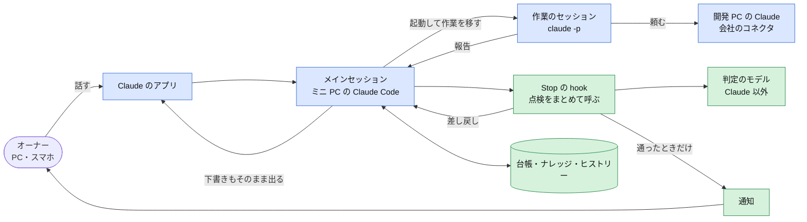
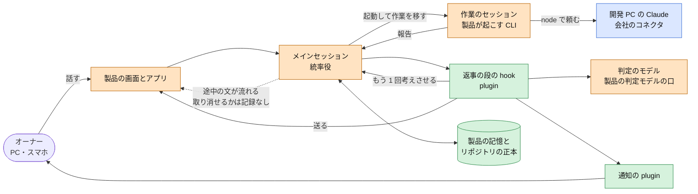
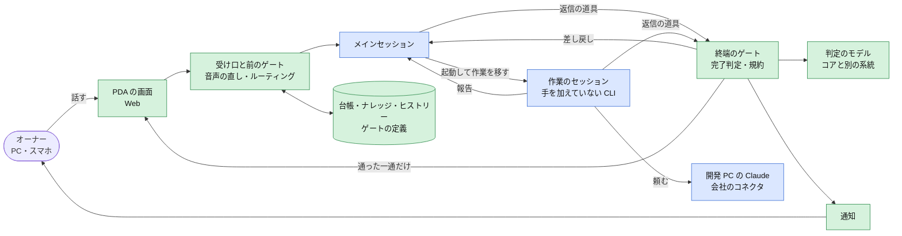
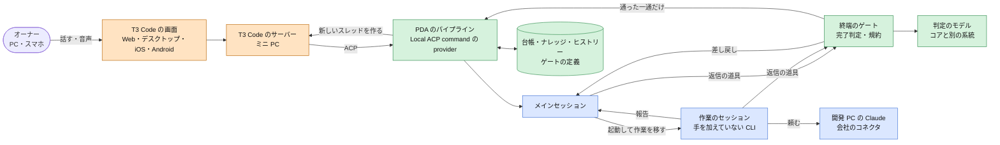
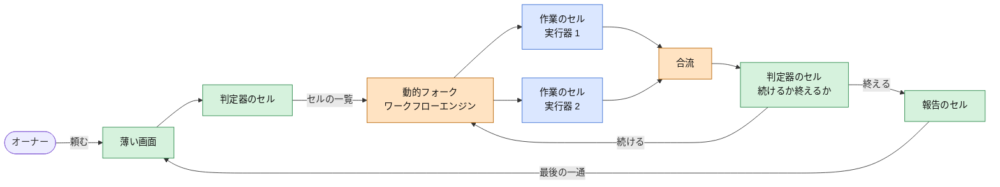

# 解決策の検討: PDA の要件に合う構造の案

- 更新: 2026-11-23 JST
- 種別: 検討の記録。設計・実装・製品選定の宣言ではない。どの案で設計に進むかは、オーナーが提案の資料で決める。
- 位置付け: [提案の資料](https://claude.ai/artifact/5HQzSFfvjBXLiBBgxUADH3) の導出の根拠 (要件の項目との対応、採ったナレッジと出典、見直した棄却の理由、各案の検討の詳細) を置く。物差しは [requirements.md](requirements.md) の 3 節と 4 節。
- 範囲: 案の比較と推奨まで。入口の画面に使う製品、入口のアカウント、ゲートに差し込むモデルは、要件の 3.7 のとおり設計で選ぶ。

## 1. オーナーの依頼と、要件の読み方

2026-11-23 の発言 (オーナーの文のまま)。

- 「この要件に対して、どのようなソリューションで解決すべきかを検討していきたい。（中略）検討結果レポートとして、ユーザーが判断可能な資料で提案できるようにせよ。ここで論点とするのは、どのようにユーザーの問題を解決するかという幅広く抽象的な課題であり、特定のプロダクトを前提に立つような制約を設けないものとする。最低でも4つ案を出し、ユーザーの持つ課題に対する解決と、最終的な PDA のビジョンの実現計画として、検討できる形で提案しろ。」
- 「最新の要件と、スクラップに集約してある注目するに値するナレッジを入力に含めること。」
- 「基本的に私、プロンプトとして、クロードへの統合を考えてたという前提を強く継承しすぎないようにしてほしい。最終的に私の求める要件に合致する最終的な構造が成立することが要求であって、これまでの検討、棄却した内容については、よりフラットな視点で評価することを要求したい。」

この発言に従い、requirements.md の次の項目は、Claude への一本化を前提にした部分を要求として扱わず、求めている中身で読む。

- 1 節の「一本化してよいかの条件」、3.3-4、C13: Claude・OpenClaw・Codex のどれを使うかは要求にしない。条件の中身 (応答のライフサイクルを観測し変えられる、定額で動かす、起動したセッションに役の規則を割り当てられる) は要求として残す。
- 3.3-1: モデルを従量課金の API キーで動かさず、定額の契約で動かすこと。
- C2: 起動したセッションが、入口とは別のセッションとして記録に残ること。
- 3.1-8 の「コアは Claude で動かし」と 3.2-22: コアは強い推論モデルで動かし、ゲートの判定にはコアと別の系統のモデルを差し込めること。
- 3.1-6、3.1-7、3.2-5、3.2-17 の「開発 PC の Claude」: 会社のコネクタと会社のアカウントのアーティファクトが開発 PC の Claude にしかないことは環境の事実で、どの案でも前提にする。

### 1.1 画面についての条件 (2026-11-23 に追加)

案の比較を見たあとの発言 (オーナーの文のまま)。

- 「CLI を Web でラップしただけの画面は、SP 表示で非常に可視性が悪くて、またウィンドウサイズ変えたりした時にも簡単に崩れるため、これは使わない。例えば MUX をラップしただけのサードパーティーがいくつかあるが、これはどれも非常に体験が悪くて、この形を踏襲することはない。」
- 「いくつか試して実体験として絶対に使わないぞと決めていることなんだが、Telegram や LINE といった、えSNS 系の、メッセージングサービスをフロントに置く形は使わない。なぜならば、これはメッセージを読む、短いメッセージのやり取りをするためのアプリケーションであって、私が今まさに扱っているような高度なパラグラフや、長文の設計文章を読むための UI には一切なっていないためである。非常に可読性が低い。全く使い物にならない。」
- 「これを踏まえて、明らかに棄却するべき計画があるので、棄却してください。」

この発言から、入口の画面を選ぶ条件を 2 つ足す。

- 端末で動く CLI を Web で包んだだけの画面 (tmux などの端末の出力をそのまま映すもの) は使わない。
- メッセージングサービス (Telegram、LINE、Discord、Slack など) を入口の画面にしない。

この条件により、案 D を棄却する (5.4 節)。案 C の画面は、CLI の出来事を構造のあるデータとして受けて描く画面にする (5.3 節)。

## 2. オーナーが下す判断と、判断を動かす変数

判断は「PDA をどの構造で設計に進めるか」である。判断を動かす変数は次の 4 つで、3 節以降はこの変数を埋めるために書く。

1. 必須 (MVP) の要件を満たせるか。とくに、オーナーに届く一通を出す時点を握れるか (3.3-5、3.2-9)、コアと別の系統のモデルで点検できるか (3.2-22)、定額で動くか (3.3-1)、ランタイムの機能に 1 週間以内に追従できるか (3.3-7)。
2. オーナーの今の困りごとが解けるか。
3. 最終的な要件 (3.4、3.2-2) に届く形が狭まらないか。
4. 作る手間と続ける手間、依存するもの、外れたときに引き返せるか。

## 3. 案の分け方

### 3.1 軸

案は製品ではなく、次の 2 つの置き場所で分ける。

- 頭と口の境目: 担い手が考えている途中の出力 (頭の中) と、オーナーに届く一通 (口に出すもの) を分ける場所を、誰の仕組みが握るか。3.2-9 の「頭の中ですることと、口に出して言うことを区別する」と、3.3-5 の「応答のライフサイクルを観測し変えられる」は、この境目を握れるかで決まる。
- 画面: オーナーが話しかけ、最後の一通を受け取る画面を、誰から借りるか。

### 3.2 5 つの案

- 案 A ベンダーのアプリに載せる: 入口・担い手・ゲートを Claude Code の中に置く。画面は Claude のアプリ。境目は無く、セッションの記録がそのまま画面に出る。Claude を中心にした構造に当たる。
- 案 B エージェントゲートウェイ製品に載せる: 入口・セッションの管理・画面を第三者のゲートウェイ製品に借り、ゲートをその plugin に置く。境目は製品の返事の段の hook。部品の例は OpenClaw (v0.3 の形)。
- 案 C 自前の応答パイプラインと自前の画面: リクエストを受けてから一通を返すまでの流れ (ルーティング、コアの起動、返信、終端のゲート) を PDA の常駐のプログラムが持ち、モデルのランタイムは手を加えていない CLI を担い手として起こす。境目は自前の返信の道具。画面も自前の薄い Web の画面。
- 案 D 自前の応答パイプラインとチャットアプリの画面: 流れは案 C と同じで、画面をチャットアプリ (bot) に借りる。2026-11-23 にオーナーが棄却した (1.1 節)。4 節と 5.4 節の記述は、比べた記録として残す。
- 案 E ワークフローエンジンのコア: 作業の進め方 (フロー) まで自前のコアが持ち、モデルのランタイムをセルとして交換可能に扱う (v0.2 の形)。

案 A は、hook に外の点検を呼ばせる最も強い形で比べる (5.1 節)。

### 3.3 根拠の区分

4 節と 5 節の判定には、根拠がどの種類かを付ける。作っていないものの「満たせる」を、確かめたものの「満たす」と同じに読まないためである。

- 【手元】: リポジトリの記録にある、手元の試用・測定・オーナーの体験。
- 【資料】: 公式の資料かソースの記述 (リポジトリの調査記録が引用したもの)。
- 【記録なし】: リポジトリの記録からは決まらない。
- 【設計】: まだ作っていない。部品があることまでが根拠で、動くことは確かめていない。

## 4. 必須 (MVP) の要件との対応

案ごとの差が出る項目だけを並べる。

### 4.1 応答のライフサイクル (3.3-5、3.2-8、3.2-9、C7、C14)

- 案 A
  - 差し戻した応答はチャットに出る【資料】。[rule-gates.md](rule-gates.md) の 3.4 節と、requirements.md の 2 節の 2026-11-10 の回答 (「hookで止めてもチャットは出力される」)。3.2-9 と C7 は満たせない。
  - 連続の差し戻しは既定で 8 回までで、`CLAUDE_CODE_STOP_HOOK_BLOCK_CAP` で変えられる【資料】([research-parts-rules.md](research-parts-rules.md) の 4.3 節)。複数の hook の結果を待ち合わせる仕組みは無いが、1 本の command 型の hook の中で複数の点検を順に呼べば、待ち合わせと回数は作れる【設計】。
  - prompt 型の hook は、点検する側の誤りで応答を通す【手元】(同 2 節の T2)。
- 案 B
  - plugin の hook に返事の段がある (`before_agent_reply`、`before_agent_finalize`、`message_sending`、`reply_dispatch`)【資料】([findings.md](../research/front-door-oss-2026-09-27/findings.md) の 14.1 節)。
  - 手元で動きを確かめた hook は `before_tool_call`、`before_prompt_build`、`agent_end`、`before_agent_run` で、返事の段の hook は試していない【手元】([v0.3-openclaw-evaluation.md](../reports/v0.3-openclaw-evaluation.md) の R3 の節)。
  - 途中の文は画面に順に届く【手元】(同評価の結論)。返事の段の hook で、画面に届いた途中の文を取り消せるか、差し戻しの回数に上限があるかは【記録なし】。3.2-9 を満たすかは決まらない。
- 案 C、案 D
  - 一通を出す時点を自前のプログラムが決める【設計】。差し戻しは、同じセッションへの次の指示として送る。`claude -p --resume` で同じ会話に指示を足せることは【手元】([research-parts-judge.md](research-parts-judge.md) の問い 4)。
  - 口を道具にする形の公開の例は Neutron で、返信の道具を呼ばずにターンを終えようとすると Stop の hook が差し戻す【資料】(research-parts-rules.md の 7 節)。cccc も、端末の出力は誰にも届かず、伝えるには道具でメッセージを送る約束にしている【資料】(findings.md の 13.1 節)。
  - ゲートを通るまで一通を保留する実装の公開の例は【記録なし】。保留と差し戻しの繰り返しは自前で作る。
- 案 E
  - 報告のセルが最後に一通を作る【資料】([docs/requirements.md](../requirements.md) の 2 節の 2026-09-25 の発言の流れ)。出す時点はコアが決める【設計】。

### 4.2 コアと別の系統のモデルによる点検 (3.2-22、C32)

- 案 A: command 型の hook から外のモデルを呼べる【設計】。Claude Code の hook に置いた Jev の判定は動く【資料】(findings.md の 9 節)。prompt 型と agent 型の hook は Claude のモデルしか使えない【資料】。
- 案 B: plugin の hook から判定モデル (TypeSafe の Jev と Kev、ONNX の分類器) を呼ぶ口がある【資料】(findings.md の 14.2 節)。`before_prompt_build` の中から Jev を呼べた【手元】(評価の Jev の節)。2026.10.1 では、鍵の点検が `credentialReady=false` で、呼べるかは確かめていない【手元】。
- 案 C、案 D、案 E: ゲートが自前のプロセスなので、どのモデルも呼べる【設計】。Jev は HTTP の API と SDK を持つ【資料】(findings.md の 9 節)。Codex CLI はミニ PC に個人の契約でログイン済み【手元】([mini-pc.md](../environment/mini-pc.md) の 4 節)。

Claude のモデルに判定させた hook が応答を通してしまう実測がある。確信度を判定する Stop の hook は、オーナーが約 2 回に 1 回訂正した週に、判定した返答の 95% を通した【手元】([correction-load の記録](../research/correction-load-2026-11-09/README.md) の 3.1 節)。

### 4.3 定額で動かす (3.3-1、C11)

- どの案も、手を加えていない CLI にオーナーの契約でログインして動かす形にできる【資料】(findings.md の 6 節、[research-entry-and-spawn.md](research-entry-and-spawn.md) の V0)。
- 案 B、案 C、案 D、案 E に共通の依存: `--bare` は定額のログインを読まず、`claude -p` の既定になる予定である【資料】(research-parts-rules.md の 3.2 節)。起動の行で役の設定を明示して渡す形にしておく必要がある。
- 案 E の v0.2 の実行器は、Claude Code と Codex を ACP のアダプタで包む設計だった【資料】([increment-1.md](../design/increment-1.md) の 6.2 節)。2026-09-28 のオーナーの決定 (Agent SDK か ACP のアダプタでしか Claude を動かさない形を外す。[plan-v0.3.md](../plan-v0.3.md) の 8 節) に当たるので、CLI を直接起こす形に替える必要がある。

### 4.4 ランタイムの機能への追従 (3.3-7、C28)

- 案 A: ベンダーの製品そのものなので当たらない。
- 案 B: 2026-09-15 から 10-10 の新しいモデル 5 件のうち、4 件は 1〜2 日で使えるようになり、GPT-6.1 Sol は主の系列で 9 日、長期保守の系列で 3 日かかった【手元】(findings.md の 12.3 節)。これとは別に、Claude Code の振る舞いの変化に結びついた不具合が、報告から 9〜18 日開いたままだった例がある (前景の Bash を背景に回すと返事がチャットに届かない #157647 は 16 日)。この調査は 5 日の線で測ったもので、1 週間の線で読むと、新しい機能の遅れは 1 件、不具合は別の扱いになる。
- 案 C、案 D、案 E: 手を加えていない CLI を起こすので、新しいモデルと道具は CLI を上げた日から使える【設計】。モデルの一覧を製品が持たない cccc が同じ構えで、新しいモデルに製品の対応が要らなかった【手元】(findings.md の 12.6 節)。自前のプログラムが CLI に触れる面 (起動の引数、stream-json の出来事、返信の道具) が変わったときの直しは、PDA の側の作業になる。

### 4.5 役の割り当てが技術的に解決していること (3.3-8、C6)

- 案 A、案 C、案 D: `claude -p` の起動の引数で、指示・記憶・hook・skill・MCP を役ごとに分けられる【手元】(research-parts-rules.md の 2 節の T1〜T8)。Remote Control の server が作るセッションには起動の引数を渡せない【資料】(同 3.4 節)。
- 案 B: 統率役・作業者・監査役で、指示・skill・MCP の道具・plugin の hook を分けられた【手元】(評価の R3 の節)。
- 案 E: type ごとの事前プロンプトで分ける【資料】([basic-design-proposal.md](../design/basic-design-proposal.md) の 2.3 節)。

### 4.6 入口・起動・報告 (3.1-2〜3.1-4、3.2-1、3.2-3、C1〜C5)

- 案 A: `claude -p` の入れ子は 3 段まで動き、結果は起こした側に返る【手元】([research-parts-tree.md](research-parts-tree.md) の 2 節)。`-p` で起こしたセッションは、資料の上では Claude のアプリに出ない【資料】(同 Q5)。オーナーが入って話しかけるには、対話の `--remote-control` で起こす必要がある。親子の台帳は公式の機能に無い【資料】(同 Q2)。
- 案 B: `sessions_spawn` で仕事を渡せ、渡した先の途中の出力を見られた【手元】(評価の T9)。Claude Code で動く統率役が 2 回目以降の依頼で仕事を渡せなくなる不具合 (#158550) は、決定の報告 (2026-10-11) の時点で上流が未解決だった【手元】([v0.3-decision.md](../reports/v0.3-decision.md) の R2)。ミニ PC はその後プレリリース (2026.10.10-beta.5) で動かしている【手元】(mini-pc.md の 4 節)。
- 案 C、案 D: 起動と親子の台帳、報告の戻し先を自前で持つ【設計】。同じ役の公開の実装に、Kai の `runs` の表、overstory の SQLite、Neutron の起動の記録がある【資料】(research-parts-tree.md の 5 節)。
- 案 E: セルは、事前プロンプトと前段の出力を入力にして動く単位で、オーナーが入って対話を続ける相手ではない【資料】(basic-design-proposal.md の 2.3 節)。3.2-1 の「オーナーはそのセッションに入って直接話しかけられる」に合わない。

### 4.7 画面でオーナーができること (3.2-15〜3.2-21、C21〜C27)

- 3.2-15 音声で話した内容が正しく取り込まれる
  - 案 A: Claude の音声入力を使える。オーナーは「音声入力とかの品質はいい」と述べた【手元】。
  - 案 B: オーナーは OpenClaw の組み込みの音声入力を「かなり厳しかった」と述べた【手元】([interview-2026-11-10.md](interview-2026-11-10.md) の「OpenClaw の音声入力の経緯」)。その後、OS の音声入力を使う形を探し、マイクのボタンのプラグインを足した。そのあとの評価は【記録なし】。
  - 案 C、案 D、案 E: Claude の音声入力は使えない。材料は、OS の音声入力 (オーナーは Mac のものを「聞き漏らしがひどい」と述べた【手元】)、ミニ PC の音声認識サーバー (`~/v03/asr`【手元】、mini-pc.md の 3 節。オーナーの評価は記録に無い)、聞き取りの構想にある入口のミドルウェア (フィラーや変換ミスを直す) である。
  - Claude のアプリの外で、オーナーが満足した音声入力の経路は【記録なし】。案 B、案 C、案 D、案 E に共通で、この項目では案 B と案 C に差は無い。必須の項目のうち、案 A 以外で最も危ない。
  - 案 C の画面を T3 Code に借りる形では、T3 Code の音声入力を使える。話している間に文字が出るモデル、フィラーの除去、モデルによる整形を持つ【資料】(6 節の T3 Code の項)。ミニ PC の CPU で日本語のモデルが動き、合成の音声の 13 秒を約 3 秒で文字にした【手元】([spike-t3code-screen.md](spike-t3code-screen.md) の 3.6 節)。人の声でのオーナーの評価はまだ無い。
- 3.2-16 アーティファクトがアカウントの混線で見られなくならない
  - 案 A: スマホのアプリを個人の契約でログインすると、会社のアーティファクトを見られない【手元】(interview の「入口の形ごとの良さと困りごと」)。
  - 案 B: OpenClaw の画面で HTML の資料を開けるかは【記録なし】。
  - 案 C: PDA のセッションが作る資料を自前で配る【設計】。Claude のアプリを入口に使わないので、アプリとブラウザを会社の契約でログインしたままにできる。
  - 案 D、案 E: 資料は自前のページへのリンクで開く【設計】。
- 3.2-17 開発 PC の Claude Code と並べて話しかけられる、3.2-18 今どのセッションにいるかが分かる、3.2-19 スマホで一段深い操作なしに新しいセッションを立てる
  - 案 A: 3 つとも、オーナーが試して困った項目である【手元】(interview の同節。Desktop を 2 つ立てられない、どのセッションにいるか混乱する、リモートデバイスの選択から始める)。
  - 案 B: 画面とアプリが Claude のアプリと別なので並べられる。スマホからの操作をオーナーが評価した記録は無い【記録なし】。
  - 案 C、案 D、案 E: 画面が別なので並べられる。セッションの名前と新しいセッションの立て方は自前で決める【設計】。
- 3.2-20 コマンドと出力を会話の中で追える、3.2-21 ワンボタンの承認でそのまま実行に移せる
  - 案 A: Claude のアプリが持つ。
  - 案 B: 途中の文とツールの実行が届く【手元】。承認の通知と承認の画面がある【手元】([pda-ntfy の README](../../plugins/pda/pda-ntfy/README.md))。
  - 案 C: stream-json の出来事を画面に描き、権限の確認を外へ渡す口 (`--permission-prompt-tool`、`PermissionRequest` の hook) にボタンをつなぐ【設計】。ツールの呼び出しを 1 件ずつ見せる画面の公開の例は Kai【資料】([research-prior-art.md](research-prior-art.md) の 3 節)。画面を T3 Code に借りる形では、ACP の口が報告したコマンドと出力が会話の中に出て、承認の要求は会話の中のボタン 1 回で続きが動いた【手元】([spike-t3code-screen.md](spike-t3code-screen.md) の 3.3 節)。
  - 案 D: 進み具合を hook でスレッドに写す公開の例 (claude-hub)、通知のボタンで承認に答える公開の例 (claude-remote-approver) がある【資料】。表示の形はチャットアプリの形に限られる。
  - 案 E: v0.2 の薄い画面 (pda-view) を作り直す【設計】。

### 4.8 通知は最後の一通だけ (3.2-6、C10)

- 案 A: 点検を通ったときだけ送る hook を書けば絞れる【設計】。今は、指示語を点検する Stop の hook の差し戻しがループし、通知が連発した【手元】(correction-load の 3.2 節)。
- 案 B: 通知のプラグインは返事ごとに送る【手元】(pda-ntfy の README)。差し戻しを返事の段の hook で行ったときに最後だけにできるかは【記録なし】。
- 案 C、案 D、案 E: 通知は、ゲートを通った一通を出すときにだけ送る【設計】。

### 4.9 会社のコネクタの経路 (3.1-6、3.1-7、3.2-5、C9)

- 案 B: 開発 PC を node としてつなぎ、開発 PC の `claude -p` を呼ぶ経路が動いている【手元】([deploy/claude-remote-control/README.md](../../deploy/claude-remote-control/README.md))。
- 案 A、案 C、案 D、案 E: 開発 PC の `claude -p` に `--tools ""` を付けると、組み込みの道具が外れて会社のコネクタだけが残る【手元】([research-parts-entry.md](research-parts-entry.md) の 2.2 節)。SSH で入ったときに会社のログインを読めるかは確かめていない【記録なし】(同 2.3 節)。案 B の node は開発 PC の GUI のログインの中で動くので、同じ条件の常駐を自前で置く形もとれる【設計】。

### 4.10 セッションをリポジトリやディレクトリに縛らない (3.2-13、3.3-6、C19)

- 案 A: Claude のアプリからミニ PC の環境を選んで始めたセッションは、ミニ PC の `/home/user` で始まる【手元】(mini-pc.md の 3 節)。作業するディレクトリの差し替えと、リポジトリの AI 向けの指示をオーナーの規範の上に重ねる扱いは、運用で作る【設計】。オーナーは、Claude Code それ自体の制約ではなく運用の考え方で満たせると述べている (requirements.md の 3.3-6)。
- 案 B: セッションは役ごとの作業フォルダーに付き、役の指示はそのフォルダーの `AGENTS.md` に置く【手元】(deploy/openclaw/README.md)。Claude Code は `--setting-sources user` で起こされ、リポジトリの `.claude/settings.json` の hook は効かない【資料】(findings.md の 9 節)。セッションの途中で作業するディレクトリを差し替えられるかは【記録なし】。
- 案 C、案 D: 起動の行を自前で組むので、中立の場所で起こし、作業するディレクトリを足し、リポジトリの指示を外して上から重ねる形にできる【設計】。部品は確かめてある。`--setting-sources` でプロジェクトを外すと、そのディレクトリの `CLAUDE.md` は読まれない【手元】(research-parts-rules.md の 2 節の T7)。`--add-dir` は起動の引数にある【資料】(research-parts-tree.md の Q1)。
- 案 E: 作業のボリュームは全実行器で共有し、仕事ごとのサブディレクトリはセルに作業の場所を渡すために切る【資料】(basic-design-proposal.md の 10.1.1 節)。

### 4.11 正本を 1 か所に置いて配る (3.3-2、C12)

- 案 A、案 C、案 D: 手元のパスから足した marketplace の plugin は、その場から読み込まれ、元のディレクトリを直すと次のセッションの開始で効く【資料】(research-parts-rules.md の 5.1 節)。plugin は `CLAUDE.md` と役ごとの記憶を運べないので、起動の引数で渡す (同 5.2 節)。
- 案 B: skill と MCP の定義は 1 か所から配れた。全エージェントに共通の指示は製品の設定だけでは配れず、小さな plugin を作って配った。役ごとの指示は、各エージェントの作業フォルダーへ写して配る【手元】(評価の R3 の節、deploy/openclaw/README.md)。
- 案 E: type の一覧、事前プロンプト、判定器の問いの集合をリポジトリで管理する【資料】(basic-design-proposal.md の 6 節)。

### 4.12 どの案でも自前で作るもの

次の項目は、どの案でも既製の部品が無く、自前の仕組みになる。案の差にはならない。

- 3.2-4 開発物の進行がどのセッションで尋ねても分かる、3.2-11 ナレッジとすべてのチャットヒストリーが集まる、3.2-12 案件の名前を話すだけで続きから始まる: 進行の台帳、ヒストリーの集約、案件とリポジトリの対応を置く場所。
- 3.2-14 開発 PC で進めた作業を PDA へ持っていく: セッションの記録は機械ごとのディスクにあり、別の機械をまたぐ `--resume` は確かめていない (research-parts-judge.md の 7 節)。
- 3.2-10 ゲートを足す・消す・変える: ゲートの定義をファイルに置き、エージェントが書き換え、完了報告の議題にする仕組み。

## 5. 各案の検討

図の色は持ち主を表す。青はモデルのベンダーの製品、橙は第三者の製品、緑は PDA が自前で持つもの。

### 5.1 案 A ベンダーのアプリに載せる

- 構成: ミニ PC の Claude Code をメインセッションにし、Claude のアプリから Remote Control で入る。起動は `claude -p`。ゲートは Stop の hook 1 本にまとめ、その中で Claude 以外のモデルの点検を順に呼ぶ。通知は点検を通ったときだけ送る。
- 満たせない必須
  - 3.2-9、C7: 差し戻した応答がチャットとヒストリーに残る (4.1 節)。
  - 3.2-17、3.2-18、3.2-19 (C23〜C25): オーナーが試して困った操作がそのまま残る (4.7 節)。
  - 3.2-16 (C22): アプリのログインを個人にすると会社のアーティファクトを見られない (4.7 節)。
- 今の困りごと
  - 規約の点検を Claude 以外のモデルに替えられ、通知は絞れる。
  - 差し戻し前の応答が出ること、入口の操作の深さ、アカウントの混線は解けない。この案は、オーナーが 2026-11-10 に「使いづらい」と述べた形に、外の点検を足したものである。
- 実現計画
  - 段階 1: 点検を 1 本の hook にまとめて Claude 以外のモデルを呼ぶ。通知を点検の通過のときだけにする。進行の台帳をファイルに置く。
  - 段階 2: `claude -p` の起動の包みと親子の台帳、開発 PC の橋、ヒストリーの集約。
  - 段階 3: 最後の一通だけを出すこと (3.2-9) は、ベンダーが hook の段を増やすまで実現しない。
- 手間と依存
  - 作る量は 5 案で最も少ない。画面、音声入力、承認、コマンドの表示はベンダーの製品が持つ。
  - 依存は Claude Code の hook の仕様と Remote Control。ミニ PC のログインは約 29 日で切れる (mini-pc.md)。
  - 引き返しは容易で、今の運用に近い。
- 効くナレッジ: 7 節のナレッジ 1、ナレッジ 3、ナレッジ 4。

### 5.2 案 B エージェントゲートウェイ製品に載せる

- 構成: v0.3 の形を続ける。入口・セッションの管理・画面・アプリは製品が持ち、PDA は plugin (共通の指示、通知、ゲート) と役の指示を持つ。部品の例は OpenClaw。スクラップにある [mainplane](https://github.com/mainplane-ai/mainplane) も、サーバー機に常駐し、任意のモデルと定額の契約の枠を使う同じ種類の製品である (README による。試していない)。
- 満たせるか決まらない必須
  - 3.2-9、C7、C14: 返事の段の hook はあるが、画面に届いた途中の文を取り消せるか、Claude Code で動くエージェントで効くかが記録に無い (4.1 節)。稼働中のミニ PC の OpenClaw に試しの plugin を置けば、オーナーの新しい登録や課金なしに確かめられる。
- 実績に外れた例がある必須
  - 3.3-7 (C28): 新しいモデル 5 件のうち 1 件が、主の系列で 9 日かかった (長期保守の系列では 3 日。4.4 節)。
- 危ない必須
  - 3.2-15 (C21): 組み込みの音声入力はオーナーが試して否定的だった。ほかの経路の評価が無い点は案 C と同じである (4.7 節)。
- 今の困りごと
  - 役の割り当て、起動と受け渡し、会社のコネクタの橋、承認の通知は動いている。
  - オーナーは OpenClaw を「あんまり感触が良くなくてすぐに使うのをやめてしまった」と述べ、Dreaming は使われていない (requirements.md の 1 節、interview)。
  - 製品が自分のツールの定義を常に読み込ませるので、統率役の約 100 個のツールの定義がどの会話にも最初から入り、間に中継を置いて減らしている ([openclaw-tool-defer の README](../../deploy/openclaw-tool-defer/README.md))。
- 実現計画
  - 段階 1: 返事の段の hook に終端のゲートを置く試しの plugin を書き、差し戻した文が画面とヒストリーに残るかを確かめる。残らなければ、完了判定と伝え方の規約のゲートを載せる。
  - 段階 2: ゲートの定義のファイル、判断待ち、ナレッジ (製品の記憶の機能を使う)、音声入力の手当て。
  - 段階 3: 役ごとのゲート、推論ゲート、判断待ちの整理。
- 手間と依存
  - 作る量は案 A の次に少ない。
  - 続ける手間: 本体を上げるたびに、保存データの移行と、バージョンを固定したプラグインの入れ直しが要る (mini-pc.md の 4 節)。上流の不具合の追跡が要る。
  - 依存は製品の plugin の API と画面。境目を握る hook の動きが製品の変更で変わりうる。
  - 引き返し: 規約と役の指示はリポジトリが正本 ([deploy/openclaw/README.md](../../deploy/openclaw/README.md)) なので持ち出せる。会話の記録は製品の形式で残る。
- 効くナレッジ: 7 節のナレッジ 1、ナレッジ 5、ナレッジ 10。

### 5.3 案 C 自前の応答パイプラインと自前の画面

- 構成: オーナーの構想 (interview の「Web フレームワークの形を推論モデルで置き換える」) の段を、PDA の常駐のプログラムが持つ。メインセッションと作業のセッションは、手を加えていない CLI を定額のログインで起こす。担い手がオーナーに返すときは返信の道具を呼び、道具の中で終端のゲートを通す。通らなければ道具が差し戻しの理由を返し、通った一通だけが画面と通知に出る。セッションの記録は頭の中として残り、オーナーはセッションに入ればコマンドと出力を追える。
- 自前で作るものと、CLI に任せるもの
  - 作る: 受け口と画面、起動の行の組み立てと親子の台帳、返信の道具と終端のゲートの実行、ゲートの定義と判断待ちと進行の置き場、開発 PC の橋、通知。
  - 任せる: エージェントのループ、道具、サブエージェント、圧縮、skill・hook・MCP の読み込み、モデルの切り替え。
  - v0.2 との違い: 誰が次に何をするかのフローをコアが持たず、作業をセルに分けない。2026-09-27 のオーナーの問題提起 (ベンダーのループが既に持つ仕組みを作り直している) に当たる部分を持たない。
  - v0.2 から引き継ぐ: ランタイムを包んで起こす考え、判定を作業と別のモデルに切り出す考え、報告を専門に作って最後に出す流れ。v0.2 の実行器のコード ([deploy/executors/](../../deploy/executors/)) は ACP のアダプタを前提にしているので使わない (4.3 節)。
- 満たせない必須: 記録の上で満たせないと決まる項目は無い。画面を T3 Code に借りる形の画面と ACP の口は【手元】で確かめたが、ゲートと担い手の流れ (返信の道具、差し戻し、判定のモデル) の根拠は【設計】である (4 節、6 節の T3 Code の項)。
- 危ない必須
  - 3.2-15 (C21): Claude の音声入力を使えず、代わりの経路でオーナーが満足した記録が無い (4.7 節)。
  - 画面の出来: v0.2 で最初の画面のモックは、オーナーから「何の機能も動線も設計されていない」と評価された (docs/requirements.md の 2 節の 2026-09-25 の発言)。
- 今の困りごと
  - 規約が無視される、Claude 同士で通してしまう: 点検はコアと別の系統のモデルが行い、通るまでオーナーに出ない。
  - hook で止めると全体が止まる、通すと押し通す: 差し戻しは道具の戻り値として担い手に返り、オーナーの画面と通知には出ない。作業が終わっていない応答は完了判定のゲートが突き返す。
  - 通知が絞れない、差し戻し前の応答が出る: 口がゲートの後ろにしかない。
  - 入口の操作の深さ、Desktop を 2 つ立てられない、どのセッションにいるか分からない、アカウントの混線: 画面が Claude のアプリと別になるので起きない。
  - 開発 PC への指示の調整: 橋の包みが起動の形を固定する。
- 実現計画
  - 段階 1 (頭と口を分ける): 常駐の受け口、最小の画面 (チャット、セッションの一覧、通知)、メインセッション、返信の道具、終端のゲート 2 つ (完了判定、伝え方の規約。判定は Claude 以外のモデル)、起動と報告の台帳。C7、C10、C14、C32 が成り立つかをここで確かめる。
  - 段階 2 (MVP の残り): 承認のワンボタンとコマンドの表示、資料の配信、音声の取り込み、開発 PC の橋、ヒストリーとナレッジの集約、案件の名前からの続き、ゲートの足し引き。
  - 段階 3 (最終的): 役の割り当て、返し先・作業の範囲・本文か資料かを決める推論ゲート、判断待ちの整理、記憶の整理、プロジェクト固有のゲート、開発 PC の hook の撤去、コアのモデルの差し替え。
- 手間と依存
  - 作る量は案 A、案 B より多い。最も大きいのは画面である。
  - 続ける手間: CLI の更新で、起動の引数、stream-json の出来事、返信の道具に変更があれば PDA の側で直す。
  - 依存: `claude -p` の振る舞い (既定が `--bare` になる予定)、定額のログインの期限。
  - 引き返し: セッションは Claude Code の記録のままなので、案 A の形に戻れる。ゲートの定義と規約はファイルなので、案 B や案 D の口へ持っていける。画面は返信の道具の先に付くので、別の画面に替えてもコアは変わらない。
- 画面の条件 (1.1 節)
  - 端末の出力を映す画面にしない。CLI を `-p` の stream-json で起こし、メッセージ・ツールの呼び出し・ツールの結果・権限の確認を構造のあるデータとして受けて、画面の部品として描く。スマホの幅と、ウィンドウの大きさの変化で崩れないことを、画面の受け入れ条件にする。
  - メッセージングサービスを画面にしない。長文の報告と設計の文章を読める画面にする。
  - 画面を一から作るか、公開の製品の画面を借りるかは設計で選ぶ。
- 画面を T3 Code に借りる形 (2026-11-23 に追加。根拠は 6 節の T3 Code の項)

  - T3 Code には手を加えない。PDA のパイプラインを ACP を話す実行ファイルにし、T3 Code の設定で provider として足す。T3 Code のスレッド 1 つが、PDA のセッション 1 つに当たる。
  - 画面に出るのは、PDA のパイプラインが ACP で報告したものだけである。ゲートを通る前の下書きは報告しない。コマンドと出力、承認の要求は、報告すれば T3 Code の画面に出る。どれも最小の ACP の口をつないで確かめた【手元】([spike-t3code-screen.md](spike-t3code-screen.md))。
  - メインセッションが起動したセッションは、PDA のパイプラインが T3 Code のスレッドとして作る (`t3 thread start` か MCP)。オーナーは T3 Code の画面でそのスレッドに入って話しかけられる。
  - 自前で作る画面は無くなり、作るものは ACP の口になる。画面の必須の項目 (3.2-15〜3.2-21) の出来は、T3 Code の出来に依存する。
- 先行例が示す範囲
  - Kai は、手を加えていない CLI を子プロセスで包む常駐、ブラウザの画面、ツールの呼び出しが見える画面、委譲をそろえている【資料】。ゲートを通るまで返事を保留することは示していない。今の公開のコードは `--bare` で起こしており、定額のログインで動くかに疑いがある (research-parts-tree.md の 4.1 節)。
  - Neutron は、返信を道具で送らせ、Stop の hook で強制する【資料】。画面は Telegram で、画面の形は採らない。採るのは、返信を道具で送らせる仕組みだけである。
- 効くナレッジ: 7 節のナレッジ 1〜ナレッジ 9、ナレッジ 11。

### 5.4 案 D 自前の応答パイプラインとチャットアプリの画面 (棄却)

- 棄却 (2026-11-23、オーナー): メッセージングサービスを入口の画面にする形は使わない。短いメッセージのやり取りのための画面で、長文の設計文章を読む画面にならない (1.1 節)。以下は棄却の前に書いた比べの記録である。
- 要るもの: Telegram か Discord などのチャットアプリのアカウントと、bot のトークン (オーナーの新しい登録)。登録なしの手段は案 C の自前の画面で、それでも要件は満たせる。案 D を選ぶ理由は、画面を作る手間を省けることだけである。
- 構成: 案 C の図の「PDA の画面」をチャットアプリの bot に替える。話題やスレッドを 1 つのセッションに結ぶ。
- 公開の例【資料】(research-prior-art.md の 3 節と 4 節)
  - Neutron: Telegram の 1 つの話題を 1 つのセッションに結び、スマホから 20 余りのセッションを動かす。
  - claude-hub: Discord のスレッドごとにセッションを立て、hook で進み具合をスレッドに写す。
  - 公式の Channels: 動いているセッションに Telegram・Discord・iMessage を流し込む (研究プレビュー)。
- 満たしにくい必須と重要の項目
  - 3.2-20 (C26): コマンドと出力はスレッドへの写しになり、表示の形を変えられない。
  - 3.2-16 (C22): 資料はリンクで自前のページを開く形になる。
  - 3.5-1 (資料にコメントを付けてレビューする)、3.5-5 (hook が差し込んだプロンプトを見る): チャットアプリの中では作れない。
  - 3.2-15: 案 C と同じく危ない。
- 今の困りごと: 案 C と同じ。通知はチャットアプリのものがそのまま使える。
- 実現計画: 段階は案 C と同じで、段階 1 の画面を bot に替える。
- 手間と依存: 画面を作らないぶん案 C より少ない。チャットアプリの表示と bot の制限に依存する。引き返しは案 C と同じで、bot を自前の画面に替えられる。
- 効くナレッジ: 案 C と同じ。

### 5.5 案 E ワークフローエンジンのコア

- 構成: v0.2 の基本設計 (basic-design-proposal.md)。判定器が次のセルの一覧を決め、ワークフローエンジン (Conductor) がセルを並べて走らせ、合流のあと報告のセルが一通を作る。
- 満たせない必須
  - 3.2-1 (C2): セルはオーナーが入って対話を続ける相手ではない (4.6 節)。「議論の深掘りなど モデルのコンテキストをフルパワーで使わないといけない場面においては、セッションに入って操作する必要がある」に合わない。
  - 3.1-8: 聞き取りでオーナーは、どのように作業するかはメインの強い推論モデルに任せ、推論の強さを決める処理は不要と述べた (interview の構想)。判定器が作業を分けてモデルを選ぶ形は、この後の発言と合わない。
- 今の困りごと: 最後の一通だけを出すことと、別のモデルによる点検は構造として持つ。入口の操作と画面の項目は自前で作る。
- 実現計画: 段階 1 で凍結した構成を起こし直し、実行器を CLI を直接起こす形に替える (4.3 節)。段階 2 以降は案 C と同じ項目に加え、フローの画面が要る。
- 手間と依存: 5 案で最も多い。ワークフローエンジン一式の常駐が要る。Conductor OSS 3.32.4 は入出力のスキーマを検査しないので、検査は包みの側で持つ (basic-design-proposal.md の 11 節)。
- 効くナレッジ: 7 節のナレッジ 2 (グラフ)。

## 6. 見直した棄却の理由

当時の理由が今の要件でも成り立つかを見直した。

- v0.2 の設計 (判定器とワークフローエンジン)
  - 当時の理由: ベンダーのループが既に持つ仕組みを作り直している。可視化層の厚さとベンダーの変更への追従の速さが決め手になった (plan-v0.3.md の 2 節)。
  - 今も成り立つ部分: フローをコアが持つ形は、3.1-8 と 3.2-1 に合わない (5.5 節)。
  - 成り立たなくなった部分: 「作業と別のモデルに判定を切り出す」「報告を専門に作って最後に出す」「実行器を包んで交換可能にする」は、3.2-22、3.2-9、コアの差し替えにそのまま当たる。案 C の部品として扱い直す。
- 自前の画面を持たないこと (v0.3 で可視化層を第三者の OSS に借りると決めた)
  - 当時の理由: 可視化層を自分で作ると厚くなる。v0.2 の最初の画面のモックは厳しく評価された。
  - 今の要件での見直し: v0.3 が画面に求めた見渡し、画面からの起動と停止、成果物の一覧は、要件から外れた (requirements.md の 3.6 節)。今の画面の必須は 3.2-15〜3.2-21 で、決め手は可視化から応答のライフサイクルの制御 (3.3-5) に移った。v0.3 の選別は、返事を画面に出す前に点検して差し替えられるかを物差しにしていない。
  - 残る懸念: 画面の出来は、作って見せるまで分からない。案 C の危ない点として残す (5.3 節)。
- OpenClaw (v0.3 で選び、Claude 一本化の検討でやめる候補にした)
  - やめる理由として挙がったもの: 使いづらさ、Dreaming が使われていない、Claude Code Desktop のほうが使い勝手がよい (requirements.md の 1 節)。
  - 見直し: 返事の段の hook と判定モデルの口を資料の上で持ち、役の割り当て・受け渡し・会社のコネクタの橋が動いている。3.3-5 を満たす可能性が記録の上で残る唯一の既製の製品である。案 B として残す。
  - 残る理由: 組み込みの音声入力と画面の感触は、オーナーが試して否定的だった。1 週間を超えた追従の例がある。
- Codex (作業の担い手としてやめる候補にした)
  - やめる理由: 「最近正直性能がしょぼい」(requirements.md の 2 節)。
  - 見直し: 作業の担い手としての評価は変えない。ミニ PC に定額でログイン済みの Claude 以外のモデルなので、ゲートの判定に差し込むモデルの候補になる (3.2-22)。どれを差し込むかは設計で選ぶ。
- Orca、jean、cccc (v0.3 の候補)
  - Orca: エージェントを端末で動かす製品で、設定はエージェントの種類ごと (v0.3-shortlist.md)。起動したセッションに役の規則を割り当てる条件 (3.3-8) に合わない。棄却は今も成り立つ。
  - jean: 作業がリポジトリ単位。3.2-13 と 3.3-6 が必須になったので、棄却の理由は強まった。
  - cccc: チャットには連絡だけが出て、作業の様子は端末に出る。3.2-20 に合わず、グループが作業するフォルダに結びつく。棄却は今も成り立つ。「端末の出力は届かず、道具で送ったものだけが届く」という約束は、案 C の頭と口の境目の先例として採る。
- T3 Code (v0.3 の候補。2026-09-28 に棄却)
  - 当時の理由: 主のエージェントが Agent SDK で Claude を動かす (findings.md の 6 節)。オーナーが 2026-09-28 に、Claude を Agent SDK か ACP のアダプタでしか動かさない製品を外すと決めた条件 (H7) に当たった (plan-v0.3.md の 6.3 節と 8 節)。ほかの条件 (定額のログイン、常駐と遠隔操作、途中で止める、途中の出力) は合格だった (findings.md の 5.4 節)。
  - 記録にある中身 (2026-09-27 時点): Web の画面と iOS・Android のアプリを持ち、常駐のサービスとして動く。ライセンスは MIT で、自分で配ることを認めている。エージェントのスレッドはそれぞれ自分のブランチに書く。委譲とワークフローの定義は見つからなかった (findings.md の 5.2 節)。
  - 見直し: 棄却の理由は「製品が Claude をどう動かすか」で、画面の出来とは別である。端末を包む画面でもメッセージングサービスでもないので、1.1 節の条件に当たらない。案 C の画面を借りる先の候補として扱い直す。初版の検討では、当時の棄却を見直さずに引き継ぎ、スクラップの投稿 (リモートアクセスの方法) も評価に使わなかった。
  - 今の資料で確かめたこと (2026-11-23。ソースは `main` の [21b5287](https://github.com/pingdotgg/t3code/tree/21b52875ea5621174638436b6074edfe2fd10590)、最新の安定版は v0.1.11)。どれも【資料】である。このうち provider の口、スレッドと外からの口、資料の表示、音声入力は、同じ日にミニ PC で動かして確かめた (下の「試験で確かめたこと」)。
    - Claude の動かし方は今も Agent SDK で、手を加えていない CLI を直接起こす経路は無い (`apps/server/src/orchestration-v2/Adapters/ClaudeAdapterV2.ts`)。T3 Code の Claude の provider をそのまま使う形は、2026-09-28 の条件 (H7) に今も当たる。T3 Code 自身は、利用規約の範囲内だと述べている ([faq.md](https://github.com/pingdotgg/t3code/blob/21b52875ea5621174638436b6074edfe2fd10590/docs/user/faq.md))。
    - 返事を画面に出す前に、利用者のコードで書き換える・保留する・差し戻す hook や plugin は無い。T3 Code の中にゲートを置くことはできない。
    - provider を外から足す口がある。設定の「Local ACP command」で、ACP を話す任意の実行ファイルを provider にでき、サーバーの作り直しは要らない ([providers-acp.md](https://github.com/pingdotgg/t3code/blob/21b52875ea5621174638436b6074edfe2fd10590/docs/user/providers-acp.md))。ACP のエージェントが報告したメッセージ、コマンドと出力、承認の要求、モデルと設定の選択肢、コンテキストの使用量を、T3 Code は画面に出す。
    - スレッドはプロジェクトに属さなくてよく、その場合は `~/.t3/scratch` の下の自分のフォルダで動く。プロジェクトのフォルダは Git のリポジトリでなくてよく、worktree は選択である。スレッドの途中で作業の場所を任意のディレクトリへ移す機能は無い ([thread-sidebar.md](https://github.com/pingdotgg/t3code/blob/21b52875ea5621174638436b6074edfe2fd10590/docs/user/thread-sidebar.md))。
    - 外からスレッドを作る・メッセージを送る口がある。ホストの上の `t3 thread start`・`send`・`show` と、環境の `/mcp` の MCP サーバーである ([outside-agents.md](https://github.com/pingdotgg/t3code/blob/21b52875ea5621174638436b6074edfe2fd10590/docs/user/outside-agents.md))。
    - 画面: iOS と Android のアプリはストアで配っている。モバイルのアプリは、スマホ・タブレット・大きさを変えられるウィンドウの 3 つの幅の段で作り分けている ([mobile-layout.md](https://github.com/pingdotgg/t3code/blob/21b52875ea5621174638436b6074edfe2fd10590/docs/internals/mobile-layout.md))。Web の画面をスマホの幅のブラウザで使う場合の不具合が開いている (iOS の Safari でキーボードが入力欄を隠す [#19512](https://github.com/pingdotgg/t3code/issues/19512) ほか)。
    - 資料の表示: エージェントが作った HTML のページを、どの provider でも、Web・デスクトップ・モバイルのスレッドの中に表示する ([html-renders.md](https://github.com/pingdotgg/t3code/blob/21b52875ea5621174638436b6074edfe2fd10590/docs/user/html-renders.md))。
    - 音声入力: モバイルは端末の上で文字にする。Web とデスクトップは、文字にする場所 (サーバーの機械に置くモデル、macOS の音声認識、外部のサービス) を選ぶ。話している間に文字が出るモデル、フィラーの除去、モデルによる書き起こしの整形がある ([voice-input.md](https://github.com/pingdotgg/t3code/blob/21b52875ea5621174638436b6074edfe2fd10590/docs/user/voice-input.md))。
    - 通知: スマホへの push は T3 Connect (T3 のアカウント) が要り、Tailscale の直接の接続だけでは届かない ([mobile-notifications.md](https://github.com/pingdotgg/t3code/blob/21b52875ea5621174638436b6074edfe2fd10590/docs/user/mobile-notifications.md))。
    - 追従: Claude の新しいモデル (Opus 5.5、Sonnet 5.5、Haiku 5.5、Fable 5.2) は、発表と同じ日に取り込まれている。GPT-6.2 Sol と Astra (2026-11-17) を足す [PR #38288](https://github.com/pingdotgg/t3code/pull/38288) は 11-23 時点で開いたままである。安定版は 2〜6 日おきに出ている。
    - 離れた機械との接続の不具合が多く開いている (Tailscale の接続を張り直して不安定になる [#24516](https://github.com/pingdotgg/t3code/issues/24516) ほか)。
  - 評価: T3 Code を製品としてそのまま使う形 (Claude の provider を使う) は、ゲートを置けず H7 にも当たるので採らない。案 C の自前のパイプラインを「Local ACP command」の provider として T3 Code につなぐ形なら、T3 Code に手を加えずに画面とアプリを借りられ、何を画面に出すかは自前のパイプラインが決める (5.3 節)。この形では、T3 Code は Claude を動かさないので H7 に当たらない。
  - 試験で確かめたこと (2026-11-23、ミニ PC、v0.1.11。記録は [spike-t3code-screen.md](spike-t3code-screen.md))。どれも【手元】である。自前のパイプラインの代わりに、内部で「下書き → 差し戻し → 下書き → 通過」を模して通過した一通だけを ACP で報告する最小の実行ファイル (stub) をつないだ。
    - 画面と保存された履歴には、stub が ACP で報告した一通だけが残り、下書きと差し戻しは stub の記録にだけ残った (3.2-9、C7)。stub が 150 秒黙って考えても依頼は切れず (それより長い待機は試していない)、差し戻しは stub の中で回るので回数は T3 Code に限られない (C14)。
    - stub が報告したコマンドと出力は会話の中で追え、承認の要求は会話の中のボタン 1 回で続きが動いた (3.2-20、3.2-21)。承認の要求が画面に出るのは、スレッドの権限が Supervised か Auto-accept edits のときだけで、既定の Full access では自動で許可される。
    - stub が T3 Code の MCP の道具 `html_render` を呼ぶと、HTML の資料がスレッドの中に出た (3.2-16)。
    - `t3 thread start`・`t3 thread send` と、stub の中からの MCP の `t3_thread_launch` で、プロジェクトに属さないスレッドを外から作り、メッセージを送れた (3.1-3、3.2-13)。
    - Web の画面はスマホの幅でも崩れなかった。
    - 音声は、ミニ PC の CPU で日本語のモデル (Fun-ASR Nano Multilingual) が 13 秒の音声を約 3 秒で文字にした。合成の音声で、「PDA」「T3 Code」は辞書を渡しても正しく書けなかった。
  - 残る点
    - 自前のパイプラインに要る作り: T3 Code が依頼の前に付ける自前の指示文から依頼を取り出すこと、T3 Code を起動し直したあとに古いスレッドを続けるための ACP の `session/load` を持つこと (無いとスレッドが失敗する)。T3 Code はスレッドごとに provider の処理を 1 つ起こして残すので、ACP の口は軽く作る【手元】。
    - tailnet の規則が T3 Code のポート (18900) を通していないため、開発 PC とスマホから tailnet の URL で開くことは確かめていない。規則に足すのはオーナーで、そのあとの画面とアプリの見え方と、人の声での音声入力はオーナーが見て決める。
    - push の通知は T3 のアカウント (T3 Connect) が要るので、今の ntfy を使う形にする必要がある【資料】。
- 端末で動く CLI を Web で包んだ画面、メッセージングサービスの画面 (2026-11-23 にオーナーが使わないと指定)
  - v0.3 の候補のうち、エージェントを端末で動かす製品 (Orca、luvus、herdr と collie) と、作業の様子が端末に出る cccc は、当時の理由で外れており、この指定とも合う。
  - 先行事例のうち、入口を Telegram・Discord・Slack にするもの (Neutron、claude-hub、CCBot、公式の Channels) は、画面の形としては採らない。
- Agent SDK で Claude を動かす形
  - 当時の理由: 第三者の製品が定額のログインを提供する形は規約が認めない (findings.md の 6 節)。
  - 見直し: オーナーが自分のためだけに動かす形を名指しで認める文も禁じる文も無い (research-entry-and-spawn.md の V0)。案 C と案 D は、規約が明記して妨げないとする「手を加えていない CLI に自分の契約でログインする形」だけを使う。
- Claude のアプリを入口の画面にする形 (2026-11-03 に決め、11-10 に見直した)
  - 見直した理由: 応答の終端を制御できない、入口の操作が一段深い、アカウントの混線 (interview)。
  - 今も成り立つ。案 A として同じ基準で比べ、満たせない必須を 5.1 節に書いた。

## 7. 採ったナレッジと出典

スクラップのうち、案の評価と計画に使ったもの。

- ナレッジ 1 守らせたい規則は、文章の説明と、回避できない検査の両方で書く。強制は少数に絞る。
  - [Harness, Loop, Graph](https://x.com/0xwhitemon/status/2119430401701621865)、[Harness Engineering](https://x.com/mirku21/status/2098836008468992471)、[Your coding agents made you a manager](https://x.com/addyosmani/status/2119332146485891501)、[ハーネスエンジニアリングを有名 OSS から読む](https://gibberishlab.com/blog/oss-ai-agent-harness-philosophy)
  - 使った所: 規約をメモリに書き足す形から、終端のゲートに移す方針 (全案)。
- ナレッジ 2 ゲートは失敗した単位だけを、判定・理由・証拠を付けて差し戻す。確信度ではなく証拠で回す。人は取り消しの代償が大きい 1 点に置く。
  - [Loops and Graphs](https://x.com/hanakoxbt/status/2091515787366306154)、[Harness, Loop, Graph](https://x.com/0xwhitemon/status/2119430401701621865)
  - 使った所: 終端のゲートの差し戻しの形、判断待ちをオーナーに上げる基準 (案 C、案 D、案 E)。
- ナレッジ 3 完了は証拠で決め、作る側と検証する側を分ける。モデル自身に自分の出力を評価させない。
  - [Unlock Opus 5.5: The Harness Guide](https://x.com/0xtrackmind/status/2113644871529418857)、[The Harness Is the Machine](https://x.com/marfinxx/status/2118313633381745064)
  - 使った所: 完了判定のゲートと、コアと別の系統のモデルによる点検 (3.2-8、3.2-22)。
- ナレッジ 4 生成の量が確認できる量を超えると、確認は期待になる。人の側の認知負荷が大きい。
  - [Critical thinking when agents do the work](https://x.com/addyosmani/status/2117512471930167377)、[AI に時間と脳のリソースを奪われない設計](https://x.com/inoino65536/status/2118711196954284356)
  - 使った所: オーナーに届くものを最後の一通と判断待ちに絞る要求 (3.2-3、3.2-6、3.2-9) の重み。
- ナレッジ 5 細かい判断を判定の API に出し、分岐の設定を Git で管理する。
  - [細かい判断系を Jev/Decisions API に](https://x.com/u1/status/2118892074313646464)
  - 使った所: ゲートの定義をファイルに置き、エージェントが足す・消す・変える仕組み (3.2-10)。
- ナレッジ 6 失敗の原因はモデルより周りの仕組みで、直す層を見極めて外側の層から直す。効くのはツール・ミドルウェア・長期記憶で、システムプロンプトではない。
  - [Prompt → Context → Harness → Loop → Graph](https://x.com/l1vsun/status/2116519560631205914)、[Context vs Prompt vs Loop vs Harness Engineering](https://x.com/beamnxw/status/2119806541821776215)
  - 使った所: 規約を指示の文に足すより、応答の前後のミドルウェアに置く構造 (案 C)。
- ナレッジ 7 サブエージェントに渡す要約は欠落する。統率だけを行うエージェントか、過去のセッションから検索できる長く生きるエージェントが代案になる。
  - [Subagents are the biggest cause of AI failures](https://x.com/alezander9/status/2118517491798606140)
  - 使った所: メインセッションを起動と進行の管理に絞り、作業のセッションにオーナーが直接入れる形 (3.1-2、3.2-1)、ヒストリーの集約 (3.2-11)。
- ナレッジ 8 個人のハーネスは、規約・台帳・文脈・記録・検査の置き場を決め、エージェントが自分で読み書きできる形にする。始めるのは規約の正本 1 枚、薄い入口、タスクと原本の場所、訂正の置き場から。
  - [自分の代わりに動く Agent へ](https://zenn.dev/nttdata_tech/articles/9562962cc181a1)
  - 使った所: 段階 1 の範囲、進行の台帳とヒストリーの置き場 (3.2-4、3.2-11)。
- ナレッジ 9 知識は取り込みのときにまとめ直し、以後はそれを土台にする。置き場は Markdown と frontmatter で足りる例がある。
  - [The Second Brain Is Not a Storage System](https://x.com/rvaniaaaa/status/2090512486738845784)、[agent の永続メモリー](https://x.com/about_hiroppy/status/2096748974522908917)、[Memory と dreaming](https://x.com/anthropicai/status/2118814753154064501)
  - 使った所: 段階 3 の記憶の整理 (3.4-1、3.4-2)。
- ナレッジ 10 エージェントの自己改善は、最初の設計に引きずられて小さな直しに留まる。評価の質が方向を決め、成功の条件は人が評価に落とす。学ぶ対象をモデルの外の部品にしてバージョンを管理する。
  - [AI エージェントの自己改善をどう設計するか](https://speakerdeck.com/22mi/how-to-design-self-improvement-for-ai-agents)、[Open-Sourcing Hermit](https://x.com/haizhong_zheng/status/2114768121705775463)
  - 使った所: ゲートをエージェントが足す・消す・変える仕組みに、ゲートの出来を測る手順を付ける必要 (3.2-10、3.4-3)。測り方の手元の例は [vocabulary-habit の記録](../research/vocabulary-habit-2026-11-22/README.md)。
- ナレッジ 11 定額の契約と API の課金の境目。`claude -p` をプランのサインインで動かすとプランの利用枠から引かれる。
  - [Max・Ultra・Team の毎月の API クレジット](https://support.claude.com/en/articles/17154008-monthly-api-credits-for-max-ultra-and-team-plans)
  - 使った所: 4.3 節。

評価に使わなかったもの。

- [Self-hosted Claude Managed Agents](https://x.com/claudedevs/status/2120938988165091693): 条件を満たす組織向けの private beta で、Managed Agents は API キーでの利用である (research-entry-and-spawn.md の V4)。3.3-1 に合わない。
- [T3 Code のリモートアクセス](https://x.com/gosrum/status/2123700242990395765): 初版では、T3 Code が Agent SDK で Claude を動かすことを理由に評価から外した。2026-11-23 に、案 C の画面を借りる先の候補として扱い直した (6 節)。投稿が示すのは、T3 のアカウントでつなぐ方法と、Tailscale などで直接つなぐ方法の 2 つがあることである。
- [Claude Project の所感](https://x.com/cursorvers/status/2124004884517167605): Projects は取りまとめの会話が claude.ai の上にあり、個人のプランのベータである (research-entry-and-spawn.md の V1)。案 A の入口の部品の候補にとどまる。
- [Which Claude model should you build with?](https://x.com/claudedevs/status/2119898687803621427)、[Opus 5.5 + GitHub の講座](https://x.com/0xchasetm/status/2109980695787454803): モデルの選び方と役の分け方で、案の差にならない。

## 8. 推奨と根拠

推奨は案 C (自前の応答パイプラインと自前の画面) である。

根拠 (事実)。

1. 3.2-9 と C7 を、案 A は満たせないと資料で決まっており、案 B は記録の上で決まらない。一通を出す時点を自前で握る案 C・案 D・案 E は、構造としてこの要件を外さない。ただし案 C の根拠は【設計】で、段階 1 で確かめる。
2. オーナーが 2026-11-10 に述べた入口の困りごと (操作の深さ、Desktop を 2 つ立てられない、どのセッションにいるか分からない、アカウントの混線) は、Claude のアプリを画面にする限り残る。画面を別にする案 B・案 C・案 D・案 E では起きない。
3. 案 B の画面は、オーナーが試して使うのをやめた。案 B には、新しいモデルへの対応に 9 日かかった例、本体の更新のたびの移行の手間、ツールの定義を常に読み込ませる重さがあり、境目を第三者の製品が握る。
4. 案 D は、2026-11-23 にオーナーが棄却した (1.1 節)。
5. 案 E は、3.2-1 と 3.1-8 に合わない。
6. 案 C の形は、オーナーの構想 (Web フレームワークの形) と、規則をゲートに振り分けた一覧 (rule-gates.md) にそのまま対応する。手を加えていない CLI を包む常駐とブラウザの画面をそろえた公開の例 (Kai) と、返信を道具で送らせる公開の例 (Neutron) がある。

案 C の弱い点。

- 画面を T3 Code に借りる形の画面と ACP の口は、最小の口で動くことを確かめた【手元】。ゲートと担い手の流れ (返信の道具、差し戻し、判定のモデル) は【設計】で、動くことは確かめていない。
- 3.2-15 (音声) は、5 案のうち案 A だけが確かに満たす。案 C では代わりの経路を作って、オーナーの評価を受ける必要がある。この項目で案 C は案 B より良いとは言えない。
- 画面を自前で作る場合は、v0.3 で可視化層を借りると決めた方針を、要件の変化を理由に変えることになる (6 節)。画面を T3 Code に借りる形 (5.3 節) なら、この弱い点は「T3 Code の出来と接続の安定に依存する」に替わる。
- 作る量が案 A、案 B より多い。画面を T3 Code に借りれば、画面のぶんは減る。

推奨が依存する点。

- この推奨は、案 B の決まっていない 1 点 (返事の段の hook で、画面に届いた途中の文を取り消せるか) に一部依存する。
- 「できない」と分かれば、案 B は 3.2-9 を満たせず、外れる。
- 「できる」と分かれば、案 B は作る量が少なく、役の割り当て・受け渡し・会社のコネクタの橋が動いているぶん有力になる。その場合に案 C を推す根拠は、根拠 3 に絞られる。
- 確かめる作業は、稼働中のミニ PC の OpenClaw に試しの plugin を置けば、オーナーの新しい登録や課金なしにできる。提案の資料の選ぶ欄に、先に確かめてから決める選択肢を置いた。

## 9. 記録で決まらなかったこと

- 案 B: 返事の段の hook が Claude Code で動くエージェントで効くか、画面に届いた途中の文を取り消せるか、差し戻しの回数に上限があるか。稼働中のミニ PC の OpenClaw で、試しの plugin を置けば確かめられる。
- 案 C、案 D: Claude のアプリの外で、オーナーが満足する音声入力の経路。ミニ PC の音声認識サーバーと入口のミドルウェアの組み合わせを段階 2 で作り、オーナーの評価を受ける。
- 案 A、案 C、案 D、案 E: SSH で入ったときに、開発 PC の `claude` が会社のアカウントのログインを読めるか。読めない場合は、開発 PC の GUI のログインの中で動く常駐を置く。
- 全案: 開発 PC のセッションの記録を、ミニ PC で `--resume` できるか (3.2-14)。
- 案 C: 画面を T3 Code に借りる形の見え方と、T3 Code の音声入力の出来。自前のパイプラインの代わりの最小の ACP の口をつないだ試験で、通過した一通だけが画面と履歴に残ること、コマンドと出力と承認の要求、HTML の資料、外からのスレッドの作成は確かめた ([spike-t3code-screen.md](spike-t3code-screen.md))。残るのは、tailnet の規則にポートを足したあとに、オーナーがスマホのアプリと PC のブラウザで見え方と人の声での音声入力を見ることである。T3 Code と試験の口は、ミニ PC で動かしたまま残してある (同記録の 6 節と 7 節)。
- 案 B、案 C、案 E: 定額の 5 時間の枠の減り方。T3 Code の issue [#24649](https://github.com/pingdotgg/t3code/issues/24649) (2026-10-25 作成、11-02 に閉じた) は、同じトークンで、Agent SDK と `claude -p` の通信が、対話の Claude Code より 5 時間の枠を約 1.6〜1.7 倍速く減らすと記録している。T3 Code は v0.1.7 以降は同じ率に戻ったと書いているが、`claude -p` の今の扱いは確かめていない。`claude -p` で担い手を起こす案に共通の依存である。
