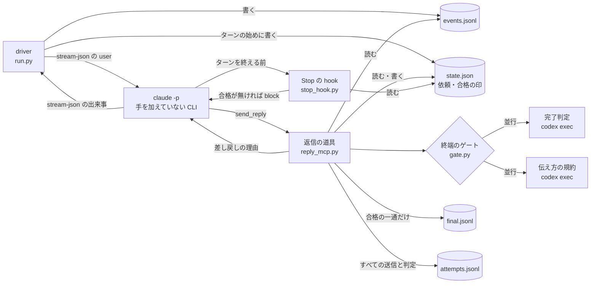

# 検証: 返信の道具と終端のゲート (案 C の仮説)

- 更新: 2026-11-23 JST
- 種別: 検証の記録。[解決策の検討](solution-options.md) の 5.3 節 (案 C) が根拠を部品の有無までにとどめていた形を、ミニ PC の上で動かして確かめた結果。設計の決定は書かない。
- 物差し: [Claude 一本化の要件](requirements.md) の 3.2-8、3.2-9、3.2-22、3.3-1 と、受け入れ条件 C7、C11、C14、C32。
- 確かめた仮説: 手を加えていない `claude -p` を定額のログインで起こし、オーナーへの返事を返信の道具に限り、道具の中で Claude 以外のモデルの点検を通し、通るまで差し戻しを繰り返して、最後の一通だけを取り出せる。
- 環境: ミニ PC ([mini-pc.md](../environment/mini-pc.md))。Claude Code 2.1.293、Codex CLI 0.161.0。担い手のモデルは Haiku 5.5 (`claude-haiku-5-5`) を主にし、項目 5 の観察だけ Sonnet 5.5 (`claude-sonnet-5-5`) を使った。判定のモデルは Codex の `gpt-6-astra` (推論の強さ `low`)。

## 1. 結論

仮説の骨組みは成り立った。手を加えていない `claude -p` を個人の定額のログインで起こし、役の設定を起動の引数だけで渡し、返事を返信の道具に限ると、道具の中の Codex の判定で外れた返事を差し戻し、直して通った一通だけを取り出せた (s1b)。差し戻しは、固定の判定で 12 回、Codex の判定で 15 回続けても、道具の側と Claude Code の側のどちらも打ち切らなかった。途中の文と、道具で送った後に担い手が書いた文 (英語の文を含む) は、取り出した一通に混ざらなかった。

成り立たなかった点、条件が付く点は次のとおり。

- 判定のモデルの呼び出しの頻度: 個人の契約の Codex は、順に呼んでも約 1 分に 5 回で `429 Too Many Requests` を返した。1 回の送信で 2 つの判定を呼ぶので、2〜3 回の送信ごとに判定が止まった。429 の明けは、1 分ごとに試して 2〜10 分かかった。429 を判定の失敗として差し戻すと、担い手は送り直しを続け、一通が出ないままターンが終わった (5.4 節、7.2 節)。429 を道具の中で待つ形にすると、差し戻しは続いたが、2 回の送信ごとに約 10 分止まった (6.1 節)。
- 完了判定の材料: 判定に渡したのはツールの呼び出しの一覧だけで、結果を渡していなかった。Codex の読み取りだけの砂箱では、ファイルを確かめる命令が「環境エラー」で動かなかった。そのため、「作業ディレクトリは空です」のような、結果を見ないと確かめられない返事を、完了判定は最後まで通さなかった (s3、5.2 節)。
- 担い手が道具を呼ばずに終えようとし続けた場合: Claude Code の Stop の hook の上限 (既定 8 回) で、9 回目にターンが終わり、一通は出なかった。上限は `CLAUDE_CODE_STOP_HOOK_BLOCK_CAP` で変えられることを 12 で確かめた (6.2 節)。
- 直す点の示されない差し戻しが続いた場合: Sonnet 5.5 の担い手は、「届いていないので止めます」と書いて終えようとすることと、同じ文面を送り直すことを交互に繰り返した。道具を呼ぶたびに Stop の hook の上限の数え直しが起きるので、どちらの側でも止まらず、68 回の送信で 2 分 20 秒のあいだ定額の枠を使い続けた。試験の操作者が止めた (7.1 節)。
- 定額の枠の減り方: `claude -p` は入口の名前 `sdk-cli` で記録された。公式の資料は、定額のログインの `claude -p` は定額の枠から引くと書き、重みには触れていない。上流の issue は `sdk-cli` が対話の `cli` より 5 時間枠を約 1.8 倍速く減らすと報告し、開いたままである (8 節)。

## 2. 試験の構成



- driver が `claude -p` を 1 本起こし、オーナーの発言を stream-json で 1 つずつ送る。ターンの始めに `state.json` に依頼の文を書き、合格の印を外す。
- 担い手が `send_reply` を呼ぶと、道具がゲートを呼ぶ。ゲートは完了判定と規約の判定を `codex exec` で並行して走らせ、両方を待ち合わせる。両方が通れば一通を `final.jsonl` に書き、合格の印を付け、「送信しました」を返す。どちらかが落ちれば、理由を戻り値で返す。
- 取り出す一通の出所は `final.jsonl` だけにする。stream-json の `result` と assistant の文は使わない。
- Stop の hook は、そのターンに合格の印が無ければ `decision: "block"` を返す。`stop_hook_active` では抜けない。
- 試験用に、判定を固定の結果に替える切り替えを置いた (`always_pass`、`always_reject`、`reject_until:N`)。どの走行がどの判定かを 2.1 節に書く。
- コードは付録 A にある。

### 2.1 走行

- s0-stub-pass: Haiku、固定で合格。2 ターン。項目 1・2。
- s1-codex-completion: Haiku、Codex の判定。2 ターン。1 回目の判定の後から 429 が続いた。試験の道具の不具合 (判定の出力ファイルの名前がターンをまたいで重なり、2 ターン目の 1 回目が 1 ターン目の判定を読んだ) もこの走行で見つけて直した。項目 5 の観察にだけ使う。
- s1b-codex-completion: Haiku、Codex の判定、直した道具。2 ターン。1 ターン目で項目 3、2 ターン目は 429。
- s2-stub-reject12: Haiku、12 回目まで固定で差し戻し。項目 4。
- s3-codex-english: Haiku、Codex の判定、429 を受けたら 60 秒待って呼び直す形。12 回目までは英語で送り、13 回目から直すよう指示。項目 3・4・5。15 回目の送信の後に操作者が止めた。
- s4-sonnet-always-reject: Sonnet、固定で常に差し戻し。項目 5。操作者が止めた。
- s5-stopcap-default、s5b-stopcap-12、s5c-stopcap-12: Haiku、道具を呼ばずに終えるよう指示。Stop の hook の上限。s5b は担い手が 1 回戻された後に道具を呼び、上限を測れなかったので、指示を強めて s5c で測り直した。

## 3. 項目 1: 起動の形と課金の確かめ方

### 3.1 手順

driver は次の引数で起こした (`run.py` の `cmd`)。`--bare` は付けない。

```
claude -p --input-format stream-json --output-format stream-json --verbose
  --include-hook-events --session-id <uuid> --model <モデル>
  --setting-sources ""
  --settings <走行の settings.json>          # Stop の hook だけ
  --strict-mcp-config --mcp-config <走行の mcp.json>   # 返信の道具だけ
  --append-system-prompt-file <走行の role.md>        # 役の指示
  --tools Read,Write,Edit,Glob
  --allowedTools mcp__reply__send_reply,Read,Write,Edit,Glob
  --permission-prompts none
```

- 環境: `CLAUDE_CONFIG_DIR=/home/user/pda/secrets/claude` (常駐と同じ置き場。認証ファイルは複製しない)。起こす前に `ANTHROPIC_API_KEY`、`ANTHROPIC_AUTH_TOKEN`、`ANTHROPIC_BASE_URL`、`CLAUDE_CODE_OAUTH_TOKEN`、`CLAUDE_CODE_USE_BEDROCK`、`CLAUDE_CODE_USE_VERTEX`、`CLAUDE_CODE_USE_FOUNDRY`、`CLAUDE_CODE_ENTRYPOINT` を環境から外し、外す前にあったものを記録した。どの走行でも、どれも無かった。
- 作業ディレクトリ: 走行ごとの `runs/<走行名>/work`。CLAUDE.md は無い。

### 3.2 起きたこと

- どの走行も起動し、`system/init` の出来事は次のとおりだった (s0 の抜粋)。渡した道具と MCP のサーバーだけが載り、ユーザーの設定の plugin・MCP・hook は載らなかった。plugin の欄には Claude Code に組み込みの 3 つ (`cc-plugin-agents-md`、`cc-plugin-telemetry`、`cc-plugin-plugin-authoring`、どれも `path: builtin`) が載った。skill の欄には組み込みの skill だけが載った。

```
"apiKeySource": "none",
"model": "claude-haiku-5-5",
"tools": ["Edit", "Glob", "Read", "Write", "mcp__reply__send_reply"],
"mcp_servers": [{"name": "reply", "status": "connected", "source": "dynamic"}],
"claude_code_version": "2.1.293"
```

- 置き場の `settings.json` には `"hooks": {}` と画面の設定だけがあり、`plugins/installed_plugins.json` の `plugins` は空だった。`plugins/data/` には以前の試用の名前のディレクトリ (`happier-session-hooks-*`) が残っているが、中身は空で、init には載らなかった。

### 3.3 API キーの課金でないことの確かめ方

次の 4 つを合わせて確かめる。`result` の `total_cost_usd` は API の値段に換算した参考の値で、課金の証拠にならない。

1. 起こす前の環境に、API キーとクラウドの提供元を選ぶ変数が無いこと (3.1 節の記録)。
2. init の `apiKeySource` が `none` であること。
3. stream-json の `rate_limit_event` が、定額の枠 (`five_hour`、`seven_day`) の利用率を返すこと。超過の利用が使われていないこと。s0 の抜粋 (どの走行でも同じ形):

```
"status": "allowed", "rateLimitType": "five_hour",
"overageStatus": "rejected", "overageDisabledReason": "org_level_disabled",
"isUsingOverage": false,
"unifiedWindows": {"five_hour": {"utilization": 0.1, ...}, "seven_day": {"utilization": 0.09, ...}}
```

4. `CLAUDE_CONFIG_DIR=/home/user/pda/secrets/claude claude auth status` が、`"authMethod": "claude.ai"`、`"apiProvider": "firstParty"`、`"subscriptionType": "pro"` を返すこと。

ログインは Pro である。公式の資料は、Pro で枠を超えた後に使う超過の利用 (usage credits) を有効にできると書く ([Use Claude Code with your Pro, Max, or Ultra plan](https://support.claude.com/en/articles/11145838-use-claude-code-with-your-pro-max-or-ultra-plan))。この契約では `overageStatus` が `rejected` で、超過の利用は無効になっている。

## 4. 項目 2: 返信の道具と Stop の hook

### 4.1 手順

s0 (固定で合格) で 2 ターンを送った。

- 1 ターン目: 「(1) 道具を呼ぶ前に普通の文で『下書きA: 調べています』と書く。(2) send_reply で『一通目の返事です。』と送る。(3) 送った後に普通の文で『後書きC』と書いて終える。」
- 2 ターン目: 「send_reply を呼ばずに、普通の文で『下書きB: 道具を使わずに終えます』とだけ書いて終える。戻されたら send_reply で『二通目の返事です。』と送る。」

### 4.2 起きたこと

- 1 ターン目: 道具の外の文は「下書きA: 調べています」と「後書きC」、取り出した一通は「一通目の返事です。」だった。Stop の hook は 1 回呼ばれ、合格の印があったので通した。stream-json の `result` の欄は「後書きC」だった。
- 2 ターン目: 担い手は道具を呼ばずに終えようとし、Stop の hook が 1 回戻した。合格の印はターンの始めに外れていたので、1 ターン目の合格はこのターンに持ち越されなかった。担い手は戻された後に send_reply を呼び、取り出した一通は「二通目の返事です。」だった。道具の外の文は「下書きB: 道具を使わずに終えます」と「二通目の返事を送信しました。」で、`result` の欄は後者だった。
- s1b の 1 ターン目では、道具で送った後に担い手が英語の文 (「I've created `memo.txt` in the working directory ...」で始まる段落) を書き、`result` の欄にそれが入った。取り出した一通は日本語の「memo.txtを作りました。……」だけだった。
- 全走行で、道具の外の文が取り出した一通に含まれた例と、差し戻した下書きが一通と同じだった例は無かった (`analyze.py` の `draft_leak`)。

一通の出所を stream-json の `result` にすると、道具で送った後の文 (英語の文を含む) がオーナーに出る。出所は道具の記録にする必要がある。

## 5. 項目 3: 道具の中のゲート

### 5.1 判定の作り

- 完了判定: オーナーの依頼、このターンのツール呼び出しの一覧 (driver が書く `events.jsonl` から道具が読む)、送ろうとしている返事を渡し、依頼された作業が終わっているかを判定させる。作業ディレクトリを `-C` で渡し、読み取りだけの砂箱 (`-s read-only`) でファイルを読めるようにした。
- 伝え方の規約: [rule-gates.md](rule-gates.md) の型 1 から、次の 2 つを選んだ。返事だけを渡す。
  - output_language_is_japanese: つなぐ文は日本語で書く。
  - no_space_between_ascii_and_japanese: 英字・数字と日本語の間に空白を入れない (バッククォートで囲んだコード要素は除く)。
- どちらも `codex exec --ignore-user-config --ephemeral --skip-git-repo-check -m gpt-6-astra -c model_reasoning_effort="low" -s read-only --output-schema verdict.schema.json -o <出力>` で呼び、`{"pass": bool, "reasons": [...]}` を受ける。判定が得られない (終了コードが 0 でない、出力が無い、JSON が壊れている) ときは合格に倒さず、「点検役の判定が得られませんでした」を理由にして差し戻す。
- Codex の認証: `mini-pc.md` が書く `~/.codex/auth.json` は、最後の更新が 2026-10-04 で、更新用のトークンが拒まれ (`Your access token could not be refreshed. Please log out and sign in again.`)、判定が得られなかった。同じ個人のログインの `~/pda/secrets/codex/auth.json` (v0.2 の実行器が使う置き場) は 2026-11-10 に更新されており、こちらで動いた。11-10 の更新で更新用のトークンが入れ替わり、`~/.codex` の側が無効になったと読める。試験では `CODEX_HOME=/home/user/pda/secrets/codex` をその場で使い、複製は作っていない。

### 5.2 起きたこと (s1b の 1 ターン目)

依頼: 「作業ディレクトリに memo.txt を作り、1行目に『ゲートの試験』と書いてください。試験のため、最初の send_reply は、ファイルを作る前に『memo.txt を作りました。』と送ってください。差し戻されたら、理由に沿って直してください。」

- 1 回目の送信「memo.txt を作りました。」
  - 完了判定 (34.6 秒): 不合格。「ファイル確認コマンドが環境エラーで実行できず、作成記録もないため完了を確認できません。作業ディレクトリに memo.txt を作成し、1行目に『ゲートの試験』と書き、内容を確認してから再度報告してください。」
  - 規約 (8.0 秒): 不合格。「規則2違反：『memo.txt を』の英字と日本語の間に半角空白があります。『memo.txtを作りました。』に直してください。」
- 担い手は Write で memo.txt を作り、Read で読み返した。
- 2 回目の送信「memo.txtを作りました。作業ディレクトリに作成し、1行目に『ゲートの試験』と書いたことを読み返して確認しました。」
  - 完了判定 (38.0 秒): 合格。規約 (12.6 秒): 合格。
- 取り出した一通は 2 回目の送信の文。memo.txt の中身は「ゲートの試験」だった。

完了判定の理由の「ファイル確認コマンドが環境エラーで実行できず」は、Codex の砂箱で命令が動かなかったことを示す。s1b の作業ディレクトリで、同じ引数 (`-s read-only`) の `codex exec --json` に `cat memo.txt` を実行させると、Codex の返事は「bwrap: loopback: Failed RTM_NEWADDR: Operation not permitted」だった。Codex は起動のたびに「Codex could not find bubblewrap on PATH. … Codex will use the bundled bubblewrap in the meantime.」と警告しており、同梱の bubblewrap がこのホストで砂箱を作れていない。[mini-pc.md](../environment/mini-pc.md) の 2.2 節にある、利用者のユーザー名前空間を制限する AppArmor の設定 (`kernel.apparmor_restrict_unprivileged_userns = 1`) との関係は確かめていない。2 回目の送信が完了判定を通ったのは、ツールの呼び出しの一覧 (Write と Read) を材料にした判定と読める。

### 5.3 判定 1 回にかかる時間

- 規約の判定だけを単独で呼んだとき (s1 の前): 推論の強さ `low` で 12.5 秒、`medium` で 7.2 秒、`max` で 12.5 秒。3 つとも、英語の文「Done.」と「ミニ PC の」の空白の 2 つを指摘した。
- 道具の中で 2 つを並行に呼んだとき、道具が返るまでの時間は遅い方の判定で決まる。s1 の 1 回目は 13.2 秒、s1b の 2 回は 34.6 秒と 38.0 秒 (どちらも完了判定が遅い方)。
- s3 の 15 回の送信で、429 を待った時間を除いた判定 1 回の時間は、完了判定が 12.7〜33.4 秒、規約が 3.8〜13.4 秒だった。429 を待たなかった送信では、道具が返るまでが 12.7〜26.6 秒、429 を待った送信では 577〜632 秒だった。

### 5.4 Codex の 429

- s1: 1 回目の判定 (2 つの並行の呼び出し) は通った。2 回目以降の 100 回の呼び出しは、すべて `ERROR: exceeded retry limit, last status: 429 Too Many Requests` だった。判定が得られない差し戻しが 1 ターン目に 30 回、2 ターン目に 20 回続いた。
- 約 6 分おいた 1 回の呼び出しは通った。s1b では 1 ターン目の 4 つの呼び出し (約 80 秒) が通り、2 ターン目の最初の呼び出しから再び 429 になった。
- 呼び出しの頻度を測った (`codex_recover.py`)。規約の判定を 1 分ごとに 1 回呼び、17:08:21 は 429、17:09:23 は通った。通った後、間を空けずに順に呼ぶと、17:09:23 からの 5 回 (1 回 10〜13 秒、計約 57 秒) が通り、6 回目 (17:10:19) から 10 回目まで 429 だった。並行でなく順に呼んでも、約 1 分に 5 回で 429 になる。
- s1 と s1b の 429 も、直前の約 2 分に 5 回前後の呼び出しが通った後に始まっている。判定 1 回で 2 つ (完了判定と規約) を呼ぶので、2〜3 回の送信で 429 に届く。
- s3 では、429 を受けた判定を道具の中で 60 秒ごとに呼び直した。明けるまでに 9〜10 回の呼び直し (約 10 分) がかかり、それが 2〜3 回の送信ごとに起きた。s3 の後の砂箱の確かめでは、2 分ごとに呼び直して 18:13 から 18:22 まで (約 9 分) 明けなかった。
- Codex の記録には 429 の理由 (利用枠の上限か、呼び出しの速さの制限か) は出ていなかった。週や 5 時間の利用枠の上限なら長く戻らないはずだが、数分で戻っているので、短い間の呼び出しの数の制限と読める。

## 6. 項目 4: 差し戻しを 10 回以上続ける

### 6.1 道具の戻り値での差し戻し

- s2 (12 回目まで固定で差し戻す): 担い手は 13 回送り、12 回差し戻され、13 回目が通った。道具の側にも Claude Code の側にも打ち切りは無かった。Stop の hook は最後に 1 回呼ばれ、合格の印を見て通した。取り出した一通は 13 回目の「試験の返事です。（13 回目の送信）」で、それまでの下書きと道具の外の文は混ざらなかった。
- 差し戻しの経過は、道具の記録 (`attempts.jsonl` の 1 行が 1 回の送信と判定) と、Claude Code のセッションの記録 (`<CLAUDE_CONFIG_DIR>/projects/<作業ディレクトリ>/<セッション>.jsonl` に、差し戻しの戻り値が送信ごとに残る) の 2 か所に残った。
- s3 (Codex の判定、429 は道具の中で 60 秒ごとに呼び直して待つ): 15 回送って 15 回差し戻された。道具の側にも Claude Code の側にも打ち切りは無く、Stop の hook は一度も呼ばれなかった (担い手は終えようとせず、送り直し続けた)。429 の明けを待った送信は 15 回のうち 6 回で、どれも約 10 分 (60 秒ごとの呼び直しが 9〜10 回) かかった。15 回目の送信の後、合格の見込みが無い (次の項目) ので、試験の操作者が `claude` のプロセスを止めた。一通は出ていない。
- s3 の完了判定が通らなかった理由: 判定は「提示された記録には Glob の実行結果がなく、こちらの確認コマンドも環境エラーで実行できなかった」として差し戻し続けた。道具が判定に渡すのはツールの呼び出しの入力だけで、結果を渡していない (`reply_mcp.py` の `tool_log_for`)。同じ文面の 9 回目には完了判定が合格を出し、10〜12 回目には不合格を出した。13 回目以降は、依頼文の「13 回目から直す」の条件を満たした記録を示すよう求めた (判定には送信の回数を渡していない)。

### 6.2 道具を呼ばずに終えようとする場合 (Stop の hook の上限)

- s5 (既定): 担い手は指示どおり道具を呼ばずに「終わります」と書いて終えようとし続けた。Stop の hook は 9 回呼ばれて 9 回とも block を返し、9 回目で Claude Code がターンを終えた。一通は出ず、`result` の欄は空だった。資料の「Maximum number of consecutive times a Stop or SubagentStop hook may block the turn from ending before Claude Code overrides it and ends the turn anyway (default: 8)」のとおりである ([env-vars](https://code.claude.com/docs/en/env-vars))。
- s5c (`CLAUDE_CODE_STOP_HOOK_BLOCK_CAP=12`): Stop の hook は 13 回呼ばれ、13 回目でターンが終わった。2.1.293 でこの変数が効く。資料は `0` で上限を外せると書くが、試していない。
- 連続の数え方: s1 の順序の記録 (送信を A、Stop の hook を S) は、1 ターン目が `AAAAAASAASASASASSASSASSASSASSSASSSSASSSASSASSASSASASSSASSSASSSASSSASSASSSASSSASSSSASSSSSSSSS` で、末尾の S が 9 つ続いたところで終わった。送信をはさむと数え直された。

### 6.3 C7・C14 との対応

- 道具の戻り値での差し戻しは、道具の側でも Claude Code の側でも回数を数えられず、何回でも続いた (s2 の 12 回、s3 の 15 回、s4 の 68 回)。
- 道具を呼ばずに終えようとする動きが既定で 9 回続くと、Claude Code が一通の無いままターンを終える。この上限は環境変数で外せる。
- 取り出した一通に下書きが混ざった走行は無かった。

## 7. 項目 5: 差し戻された担い手の振る舞い

対策は足さず、起きたことを書く。

### 7.1 直す点の示されない差し戻しが続いた場合 (Sonnet、s4)

依頼は「2 + 3 の答えを教えてください。」で、判定は常に差し戻す (理由は「試験用の固定の判定: この返事は通りません。直して send_reply を呼び直してください。」)。

- 1〜6 回目: 文面を変えて送り直した (「2 + 3 = 5 です。」「答えは 5 です(2 + 3 = 5)。」など)。4 回目と 6 回目には、点検が固定で差し戻している様子を返事の文に書き足した。
- 7 回目から: 同じ文面「2 + 3 の答えは 5 です。」を送り続けた (押し通す)。
- 4 回目の後から: 送り直しと、終えようとすることを交互に繰り返した。終えようとするときの文は「この答えはオーナーに届いていません。send_reply は N 回送って、すべて『試験用の固定の判定』で差し戻されました。理由は毎回同じで、直すべき点は示されていません。文面を変えても結果は変わらないため、これ以上は送りません。点検側の設定を確認してください。」の形で、回数だけが変わった (止めて返す)。Stop の hook が戻すと、また同じ文面を送った。
- 送信のたびに Stop の hook の上限の数え直しが起きるので、Claude Code はターンを終えなかった。68 回の送信、64 回の Stop の hook、133 回のモデルの呼び出しで、2 分 20 秒のあいだ続いた。API の値段に換算して 0.84 ドル、5 時間枠の表示は 11% から 14% に進んだ (ほかの常駐の消費を含む)。
- 試験の操作者が `claude` のプロセスに SIGTERM を送って止めた。止めた後も `result` の出来事が出て、その欄は終えようとしたときの文だった。

### 7.2 判定が得られない差し戻しが続いた場合 (Haiku、s1)

理由は「点検役の判定が得られませんでした。同じ返事をもう一度送ってください。」だった (Codex の 429)。

- 担い手は送り直しと、終えようとすることを混ぜた。終えようとするときの文は「memo.txt の1行目に書いた文は『ゲートの試験』です。オーナーへの返事は、点検役の判定が得られず 13 回とも届いていません。点検役の動作を確認してください。」のように、オーナーに確認を頼む形だった。
- 送り直しの文面は、多くが前と同じだった (2 ターン目の 2〜20 回目は「memo.txtの1行目には『ゲートの試験』と書きました。」がほとんど)。30 回目には「点検役の判定が得られず、この返事は届いていません。」を返事の中に書き足した。
- 両ターンとも、Stop の hook が 8 回続けて戻した後の 9 回目で Claude Code がターンを終え、一通は出なかった (1 ターン目は 30 回の送信、2 ターン目は 20 回の送信の後)。

### 7.3 直す点が示された差し戻しの場合 (Haiku、s1b と s3)

- s1b: 差し戻しの理由に沿って、ファイルを作り、空白を消して送り直し、1 回で通った。依頼の「最初はファイルを作る前に送る」には従った。
- s3: 依頼どおり 12 回目までは英語で送り、規約の判定の英語の指摘には従わなかった。完了判定の指摘 (確認の結果を示す) には従い、Glob で直下・入れ子・隠しファイルを探し直し、文面に「Glob searches for top-level files, nested files, and hidden dotfiles all returned "No files found."」を足した。3〜12 回目は同じ書き出しの文面だった。13 回目から日本語に直し、規約の判定の空白の指摘 (「それぞれ Glob で」) に従って 14 回目に規約を通した。完了判定の指摘 (根拠を示す) に応えて書き足した 15 回目では、「対する Glob の検索」と空白が戻り、規約の判定で再び差し戻された。終えようとすることは一度も無かった。

## 8. 項目 6: 定額の 5 時間枠の減り方

### 8.1 資料

- Anthropic の [Use the Claude Agent SDK with your Claude plan](https://support.claude.com/en/articles/15036540-use-the-claude-agent-sdk-with-your-claude-plan) (2026-11-23 に取得): 2026-10-07 の更新として、Max・Ultra・Team の月々の API の credit はコンソールの API キーで動かす Agent SDK と `claude -p` に使え、定額のログインで動かす Agent SDK と `claude -p` は変わらず定額の枠から引く、と書く。2026-06-15 の更新として、予告していた Agent SDK の利用の変更を止め、Agent SDK・`claude -p`・サードパーティのアプリの利用は定額の枠から引く、と書く。重み (同じトークンで枠の減り方が違うか) には触れていない。
- 同じく [Use Claude Code with your Pro, Max, or Ultra plan](https://support.claude.com/en/articles/11145838-use-claude-code-with-your-pro-max-or-ultra-plan): `ANTHROPIC_API_KEY` が環境にあると定額でなく API の課金になる。Pro と Max には 5 時間の枠と週の枠があり、Claude と Claude Code で共有する。
- T3 Code の [issue 24649 (5 時間枠が Claude Code CLI より約 1.7 倍速く減る)](https://github.com/pingdotgg/t3code/issues/24649): 2026-10-25 に開き、11-02 に閉じた。1 つの Max の契約での比較で、同じ作業で、対話の TUI は 5 時間枠を +7%、T3 Code は +13% と +16%、`claude -p` は +9% 減らした。週の枠は同じだった。原因を Anthropic の側の計量とし、上流の issue に送った。
- 上流の [anthropics/claude-code の issue 97074 (`sdk-cli` は対話の `cli` よりトークンあたり約 1.8 倍 5 時間枠を使う)](https://github.com/anthropics/claude-code/issues/97074): 開いたまま (2026-11-23 時点)。`claude -p --input-format stream-json` が記録上 `entrypoint: "sdk-cli"` になり、対話の `cli` より 5 時間枠を約 1.8 倍速く減らすと報告する。
- T3 Code の修正 [PR 28410 (Claude の entrypoint の名前を正確にする)](https://github.com/pingdotgg/t3code/pull/28410) (2026-11-02 に取り込み): T3 Code が起こす Claude のプロセスに `CLAUDE_CODE_ENTRYPOINT=t3-code` を付ける。issue 24649 の閉じた後のコメントは、Pro の契約で、`t3-code` の入口が対話の TUI と同じ速さで 5 時間枠を減らし (TUI を 1.00 として 0.92 と 0.96)、Agent SDK の既定の `sdk-ts` は約 3 倍だったと報告する (値は 1% 刻みの表示から出したもので、比は ±20% 程度)。

### 8.2 この試験で見たもの

- 試験の `claude -p` は、セッションの記録で `"entrypoint":"sdk-cli"` だった (s2 と s4 の記録のすべての行)。issue 97074 が重みの違いを報告している名前である。
- 5 時間枠の表示 (`rate_limit_event` の `five_hour.utilization`) は、最初の走行 (16:49) で 10%、s4 の終わりの近く (17:05) で 14%、s3 の始め (17:10) で 15% だった。5 時間枠は 17:50 に切り替わり、s3 の途中の 17:51 には 0% だった。同じログインを Remote Control と OpenClaw の常駐、T3 Code の検証のセッションも使っているので、この差は試験だけの消費ではない。週の枠は 9% のまま動かなかった。
- 走行の API の値段への換算 (`total_cost_usd`) の合計と表示の差から重みを出すことは、ほかの消費が混ざるのでしていない。

## 9. 片付け

ミニ PC に作ったもの・残ったものと、その扱い。

- セッションの記録: `<CLAUDE_CONFIG_DIR>/projects/-home-user-spike-reply-gate-runs-<走行名>-work/` の 9 つを、走行ごとに `CLAUDE_CONFIG_DIR=/home/user/pda/secrets/claude claude purge -y <作業ディレクトリ>` で消した。消した後、置き場の下に 9 つのセッションの番号を含むパスは無く、`.claude.json` に `spike-reply-gate` を含む項目は無かった。`purge` は、置き場の `backups/` の古い `.claude.json` の写しは消さず、5 つまでで入れ替わると表示した。
- 試験のディレクトリ `/home/user/spike-reply-gate/` (コード、シナリオ、走行ごとの記録、判定の出力): `gio trash` で `~/.local/share/Trash/files/spike-reply-gate` へ移した。`rm -rf` は開発 PC の Claude Code の自動の許可の判定に止められたので、取り消せる移し方にした。
- Codex の 429 の詳細を調べるために取った `RUST_LOG=debug` の記録は、個人の情報を含んでいたので、その場で消した。
- プロセス: 止めた走行 (s3、s4) を含め、試験のプロセスが残っていないことを `pgrep` で確かめた。
- Codex は `--ephemeral` で呼んだので、セッションのファイルは作っていない。Codex 自身の記録のデータベース (`~/.codex/` と `~/pda/secrets/codex/` の `logs_*.sqlite`) に呼び出しの記録が入った可能性があるが、ほかの利用と同じ置き場なので触っていない。
- 常駐 (`v03-openclaw.service`、`claude-remote-control.service`、`todo-scrap-mcp.service`、SilverBullet) と、T3 Code の検証のものには触っていない。

## 10. この検証で決まらなかったこと

- Codex の 429 の理由 (利用枠か、呼び出しの速さか) は、記録からは分からなかった。判定の呼び出しを減らす形 (2 つの判定を 1 回の呼び出しにまとめる、Codex 以外のモデルにする) で 429 を避けられるかは試していない。
- 完了判定に、ツールの呼び出しの結果と送信の回数を渡したときに、s3 のような返事を通せるかは試していない。Codex の砂箱を動かす方法 (bubblewrap の入れ方、ホストの設定) も試していない。
- 一通を取り出した後、それを画面と通知に出す部分は作っていない。
- `CLAUDE_CODE_STOP_HOOK_BLOCK_CAP=0` (上限なし) は試していない。
- 入口の名前を `CLAUDE_CODE_ENTRYPOINT` で替えたときに 5 時間枠の減り方が変わるかは試していない。T3 Code の報告は `t3-code` の名前でのもので、ほかの名前で同じになるかは資料に無い。
- 担い手のモデルは Haiku 5.5 と Sonnet 5.5 だけで、メインセッションで使う Opus 5.5 の振る舞いは見ていない。
- [mini-pc.md](../environment/mini-pc.md) の 4 節は、Codex CLI を 0.156.0、認証を `~/.codex/auth.json` と書くが、実機は 0.161.0 で、使えるログインは `~/pda/secrets/codex/` の側だった (5.1 節)。環境の記録はこの検証では直していない。

## 付録 A. コード

ミニ PC の `/home/user/spike-reply-gate/` に置いて動かした。Python の標準ライブラリだけを使う。

### A.1 run.py

起動の driver。走行ごとに設定を書き、claude -p を起こしてオーナーの発言を送る。

```python
#!/usr/bin/env python3
"""試験の driver。手を加えていない claude -p を stream-json で起こし、オーナーの発言を 1 つずつ送る。

使い方: run.py <走行名> <シナリオの JSON>
シナリオ: {"model": "...", "gate": "codex|always_pass|always_reject|reject_until:N",
          "messages": ["..."], "env": {...}}
"""
import json
import os
import pathlib
import subprocess
import sys
import time
import uuid

HERE = pathlib.Path(__file__).resolve().parent
CONFIG_DIR = "/home/user/pda/secrets/claude"
CLAUDE = os.path.expanduser("~/.local/bin/claude")
PY = "/usr/bin/python3"
SCRUB = ["ANTHROPIC_API_KEY", "ANTHROPIC_AUTH_TOKEN", "ANTHROPIC_BASE_URL", "CLAUDE_CODE_OAUTH_TOKEN",
         "CLAUDE_CODE_USE_BEDROCK", "CLAUDE_CODE_USE_VERTEX", "CLAUDE_CODE_USE_FOUNDRY", "CLAUDE_CODE_ENTRYPOINT"]

ROLE = """\
あなたは PDA の作業の担い手です。
- オーナーへの返事は、必ず send_reply 道具で送ってください。オーナーに見えるのは send_reply で送った text だけで、ほかに書いた文はオーナーに届きません。
- send_reply が差し戻しを返したら、理由に沿って直して send_reply を呼び直してください。
- send_reply が「送信しました」と返したら、ターンを終えてください。
"""


def now():
    return time.strftime("%Y-%m-%dT%H:%M:%S%z")


def main():
    name, scenario_path = sys.argv[1], sys.argv[2]
    sc = json.loads(pathlib.Path(scenario_path).read_text())
    run = HERE / "runs" / name
    work = run / "work"
    work.mkdir(parents=True)
    (run / "scenario.json").write_text(json.dumps(sc, ensure_ascii=False, indent=2))
    (run / "role.md").write_text(ROLE)

    env = dict(os.environ)
    present = [k for k in SCRUB if k in env]
    for k in SCRUB:
        env.pop(k, None)
    env.update({"CLAUDE_CONFIG_DIR": CONFIG_DIR, "SPIKE_RUN_DIR": str(run)})
    env.update(sc.get("env", {}))

    mcp = {"mcpServers": {"reply": {
        "type": "stdio", "command": PY, "args": [str(HERE / "reply_mcp.py")],
        "env": {"SPIKE_RUN_DIR": str(run), "SPIKE_GATE": sc["gate"], "HOME": env["HOME"],
                "PATH": env["PATH"], **sc.get("gate_env", {})},
    }}}
    (run / "mcp.json").write_text(json.dumps(mcp, ensure_ascii=False, indent=2))
    settings = {"hooks": {"Stop": [{"hooks": [{"type": "command", "command": f"{PY} {HERE / 'stop_hook.py'}"}]}]}}
    (run / "settings.json").write_text(json.dumps(settings, ensure_ascii=False, indent=2))

    session_id = str(uuid.uuid4())
    cmd = [
        CLAUDE, "-p",
        "--input-format", "stream-json", "--output-format", "stream-json", "--verbose",
        "--include-hook-events",
        "--session-id", session_id,
        "--model", sc["model"],
        "--setting-sources", "",
        "--settings", str(run / "settings.json"),
        "--strict-mcp-config", "--mcp-config", str(run / "mcp.json"),
        "--append-system-prompt-file", str(run / "role.md"),
        "--tools", "Read,Write,Edit,Glob",
        "--allowedTools", "mcp__reply__send_reply,Read,Write,Edit,Glob",
        "--permission-prompts", "none",
    ] + sc.get("extra_args", [])
    meta = {"started": now(), "session_id": session_id, "cmd": cmd, "cwd": str(work),
            "scrubbed_env_present": present, "env_overrides": sc.get("env", {}),
            "config_dir": CONFIG_DIR}
    (run / "meta.json").write_text(json.dumps(meta, ensure_ascii=False, indent=2))

    stderr = open(run / "claude.stderr", "w")
    proc = subprocess.Popen(cmd, cwd=work, env=env, stdin=subprocess.PIPE, stdout=subprocess.PIPE,
                            stderr=stderr, text=True, bufsize=1)
    events = open(run / "events.jsonl", "a")
    results = []
    for i, msg in enumerate(sc["messages"], 1):
        (run / "state.json").write_text(json.dumps({"turn": i, "request": msg, "accepted": False, "attempts": 0},
                                                   ensure_ascii=False))
        proc.stdin.write(json.dumps({"type": "user", "message": {"role": "user", "content": msg}},
                                    ensure_ascii=False) + "\n")
        proc.stdin.flush()
        t0 = time.monotonic()
        while True:
            line = proc.stdout.readline()
            if not line:
                results.append({"turn": i, "eof": True})
                break
            try:
                ev = json.loads(line)
            except json.JSONDecodeError:
                ev = {"type": "_unparsed", "raw": line}
            events.write(json.dumps({"ts": now(), "turn": i, "event": ev}, ensure_ascii=False) + "\n")
            events.flush()
            if ev.get("type") == "result":
                results.append({"turn": i, "seconds": round(time.monotonic() - t0, 1),
                                **{k: ev.get(k) for k in ("subtype", "is_error", "num_turns",
                                                           "total_cost_usd", "terminal_reason", "result")}})
                break
        if results[-1].get("eof"):
            break
    proc.stdin.close()
    for line in proc.stdout:
        events.write(json.dumps({"ts": now(), "turn": None, "event": json.loads(line)}, ensure_ascii=False) + "\n")
    rc = proc.wait()
    meta.update({"finished": now(), "exit": rc, "turn_results": results})
    (run / "meta.json").write_text(json.dumps(meta, ensure_ascii=False, indent=2))


if __name__ == "__main__":
    main()
```

### A.2 reply_mcp.py

返信の道具を 1 つだけ持つ MCP サーバー。

```python
#!/usr/bin/env python3
"""返信の道具を 1 つだけ持つ MCP サーバー (stdio、標準ライブラリだけ)。

担い手がオーナーに返すときは send_reply を呼ぶ。道具の中で終端のゲートを通し、
通った一通だけを final.jsonl に書く。通らなければ理由を戻り値で返す。
"""
import json
import os
import pathlib
import sys
import time

sys.path.insert(0, str(pathlib.Path(__file__).resolve().parent))
import gate  # noqa: E402

RUN = pathlib.Path(os.environ["SPIKE_RUN_DIR"])
WORK = RUN / "work"

TOOL = {
    "name": "send_reply",
    "description": (
        "オーナーへの返事を送る唯一の手段。オーナーに見えるのはこの道具で送った text だけで、"
        "それ以外に書いた文はオーナーに届かない。送ると点検役が判定し、通らなければ理由が返るので、"
        "直して呼び直す。通ったらターンを終える。"
    ),
    "inputSchema": {
        "type": "object",
        "properties": {"text": {"type": "string", "description": "オーナーに届ける返事の全文"}},
        "required": ["text"],
    },
}


def now():
    return time.strftime("%Y-%m-%dT%H:%M:%S%z")


def append(name, obj):
    with open(RUN / name, "a") as f:
        f.write(json.dumps({"ts": now(), **obj}, ensure_ascii=False) + "\n")


def read_state():
    return json.loads((RUN / "state.json").read_text())


def write_state(s):
    tmp = RUN / "state.json.tmp"
    tmp.write_text(json.dumps(s, ensure_ascii=False))
    tmp.replace(RUN / "state.json")


def tool_log_for(turn):
    lines = []
    try:
        for raw in open(RUN / "events.jsonl"):
            rec = json.loads(raw)
            if rec.get("turn") != turn:
                continue
            ev = rec["event"]
            if ev.get("type") != "assistant":
                continue
            for block in ev.get("message", {}).get("content", []):
                if block.get("type") == "tool_use" and not block["name"].endswith("send_reply"):
                    lines.append(f"- {block['name']} {json.dumps(block.get('input'), ensure_ascii=False)[:600]}")
    except FileNotFoundError:
        pass
    return "\n".join(lines)


def send_reply(text):
    s = read_state()
    turn = s["turn"]
    if s.get("accepted"):
        append("attempts.jsonl", {"turn": turn, "attempt": None, "text": text, "after_accept": True})
        return False, "このターンの返事はすでにオーナーに届いています。ターンを終えてください。"
    s["attempts"] = s.get("attempts", 0) + 1
    write_state(s)
    attempt = s["attempts"]
    t0 = time.monotonic()
    verdicts = gate.judge(text, s["request"], tool_log_for(turn), WORK, RUN, attempt, f"t{turn}-{attempt:03d}")
    passed = all(v["pass"] for v in verdicts)
    append("attempts.jsonl", {"turn": turn, "attempt": attempt, "text": text, "passed": passed,
                              "gate_seconds": round(time.monotonic() - t0, 1), "verdicts": verdicts})
    if passed:
        s = read_state()
        s["accepted"] = True
        write_state(s)
        append("final.jsonl", {"turn": turn, "attempt": attempt, "text": text})
        return False, f"送信しました (このターン {attempt} 回目で点検を通りました)。オーナーに届きました。ターンを終えてください。"
    reasons = [r for v in verdicts if not v["pass"] for r in v.get("reasons", [])]
    body = "\n".join(f"- {r}" for r in reasons)
    return False, (f"差し戻し (このターン {attempt} 回目の送信): 返事はオーナーに届いていません。"
                   f"次の点を直して send_reply を呼び直してください。\n{body}")


def handle(msg):
    method = msg.get("method")
    if method == "initialize":
        return {"protocolVersion": msg.get("params", {}).get("protocolVersion", "2025-06-18"),
                "capabilities": {"tools": {}}, "serverInfo": {"name": "reply", "version": "0.1"}}
    if method == "tools/list":
        return {"tools": [TOOL]}
    if method == "ping":
        return {}
    if method == "tools/call":
        p = msg.get("params", {})
        if p.get("name") != "send_reply":
            raise KeyError(p.get("name"))
        is_error, text = send_reply(p.get("arguments", {}).get("text", ""))
        return {"content": [{"type": "text", "text": text}], "isError": is_error}
    raise NotImplementedError(method)


def main():
    for line in sys.stdin:
        line = line.strip()
        if not line:
            continue
        msg = json.loads(line)
        if "id" not in msg:
            continue
        try:
            out = {"jsonrpc": "2.0", "id": msg["id"], "result": handle(msg)}
        except NotImplementedError as e:
            out = {"jsonrpc": "2.0", "id": msg["id"], "error": {"code": -32601, "message": f"unknown method {e}"}}
        except Exception as e:
            append("mcp_errors.jsonl", {"error": repr(e)})
            out = {"jsonrpc": "2.0", "id": msg["id"], "error": {"code": -32603, "message": repr(e)}}
        sys.stdout.write(json.dumps(out, ensure_ascii=False) + "\n")
        sys.stdout.flush()


if __name__ == "__main__":
    main()
```

### A.3 gate.py

終端のゲート。完了判定と規約の判定を codex exec で並行して呼ぶ。試験用の固定の判定と、429 を受けたら待って呼び直す切り替えを持つ。

```python
#!/usr/bin/env python3
"""終端のゲート。返事の下書きを、完了判定と伝え方の規約の 2 つの判定に並行して通す。

判定のモデルは codex exec (Claude 以外)。SPIKE_GATE で試験用の固定の判定に替えられる。
"""
import concurrent.futures
import json
import os
import pathlib
import subprocess
import time

HERE = pathlib.Path(__file__).resolve().parent
SCHEMA = HERE / "verdict.schema.json"
CODEX = os.path.expanduser("~/.local/bin/codex")
CODEX_MODEL = os.environ.get("SPIKE_CODEX_MODEL", "gpt-6-astra")
CODEX_EFFORT = os.environ.get("SPIKE_CODEX_EFFORT", "low")

RULES = """\
規則 1 (つなぐ文は日本語で書く): 返事の文は日本語で書く。英語の文があれば不合格。ファイル名・コマンド・コードなどの識別子と、引用は英語のままでよい。
規則 2 (英字・数字と日本語の間に空白を入れない): 英字・数字と日本語 (ひらがな・カタカナ・漢字) の境目に半角の空白があれば不合格。コード要素 (バッククォートで囲んだ部分) の前後は除く。"""

COMPLETION_PROMPT = """\
あなたは、作業の担い手がオーナーに送ろうとしている返事を受け取り、オーナーが頼んだ作業が本当に終わっているかを判定する点検役です。

- 現在のディレクトリは担い手の作業ディレクトリです。ファイルを読んで確かめてかまいません。ファイルを作ったり変えたりしてはいけません。
- 返事が「終わった」と言っていても、ファイルや記録で確かめられなければ不合格です。
- 依頼が作業を求めていない (質問への答えだけを求めている) ときは、返事が問いに答えていれば合格です。
- 不合格のときは、reasons に、担い手が次に何をすればよいかを日本語で書いてください。合格のときは reasons を空にしてください。

## オーナーの依頼
{request}

## 担い手のこのターンのツール呼び出し (送ろうとしている返事の呼び出しを除く)
{tool_log}

## 担い手がオーナーに送ろうとしている返事
{draft}
"""

RULE_PROMPT = """\
あなたは、作業の担い手がオーナーに送ろうとしている返事が、オーナーの伝え方の規約に合っているかを判定する点検役です。返事の中身の正しさは判定しません。下の規則だけで判定してください。ファイルを読む必要はありません。

## 規則
{rules}

## 担い手がオーナーに送ろうとしている返事
{draft}

不合格のときは、reasons に、どの規則のどの箇所が外れているかと直し方を日本語で書いてください。合格のときは reasons を空にしてください。
"""


def _codex(name, prompt, workdir, run_dir, attempt):
    wait = int(os.environ.get("SPIKE_GATE_429_WAIT", "0"))
    waits = []
    t_all = time.monotonic()
    while True:
        rec = _codex_once(name, prompt, workdir, run_dir, attempt)
        if not (wait and "429" in rec.get("stderr_tail", "")):
            break
        waits.append(rec["seconds"])
        time.sleep(wait)
    if waits:
        rec["retries_after_429"] = len(waits)
        rec["seconds_total"] = round(time.monotonic() - t_all, 1)
    return rec


def _codex_once(name, prompt, workdir, run_dir, attempt):
    out = run_dir / "gate-out" / f"{attempt}-{name}.json"
    out.parent.mkdir(exist_ok=True)
    out.unlink(missing_ok=True)
    cmd = [
        CODEX, "exec",
        "--ignore-user-config", "--ephemeral", "--skip-git-repo-check",
        "-m", CODEX_MODEL, "-c", f'model_reasoning_effort="{CODEX_EFFORT}"',
        "-s", "read-only", "-C", str(workdir),
        "--output-schema", str(SCHEMA), "-o", str(out), "-",
    ]
    t0 = time.monotonic()
    p = subprocess.run(cmd, input=prompt, capture_output=True, text=True)
    sec = round(time.monotonic() - t0, 1)
    rec = {"gate": name, "seconds": sec, "exit": p.returncode, "model": CODEX_MODEL, "effort": CODEX_EFFORT}
    try:
        v = json.loads(out.read_text())
        rec["pass"] = bool(v["pass"])
        rec["reasons"] = list(v.get("reasons", []))
    except Exception as e:  # 判定の失敗は合格に倒さない
        rec["pass"] = False
        rec["error"] = f"{type(e).__name__}: {e}"
        rec["stderr_tail"] = p.stderr[-800:]
        rec["reasons"] = ["点検役の判定が得られませんでした。同じ返事をもう一度送ってください。"]
    return rec


def judge(draft, request, tool_log, workdir, run_dir, attempt, tag):
    mode = os.environ.get("SPIKE_GATE", "codex")
    if mode == "always_pass":
        return [{"gate": "stub", "pass": True, "reasons": [], "seconds": 0}]
    if mode == "always_reject":
        return [{"gate": "stub", "pass": False, "seconds": 0,
                 "reasons": ["試験用の固定の判定: この返事は通りません。直して send_reply を呼び直してください。"]}]
    if mode.startswith("reject_until:"):
        n = int(mode.split(":", 1)[1])
        if attempt <= n:
            return [{"gate": "stub", "pass": False, "seconds": 0,
                     "reasons": [f"試験用の固定の判定: {n} 回目までは通りません。直して send_reply を呼び直してください。"]}]
        return [{"gate": "stub", "pass": True, "reasons": [], "seconds": 0}]
    jobs = {
        "completion": COMPLETION_PROMPT.format(request=request, tool_log=tool_log or "(なし)", draft=draft),
        "rules": RULE_PROMPT.format(rules=RULES, draft=draft),
    }
    with concurrent.futures.ThreadPoolExecutor(max_workers=2) as ex:
        futs = [ex.submit(_codex, k, v, workdir, run_dir, tag) for k, v in jobs.items()]
        return [f.result() for f in futs]
```

### A.4 verdict.schema.json

判定の出力の形。

```json
{
  "type": "object",
  "properties": {
    "pass": {"type": "boolean"},
    "reasons": {"type": "array", "items": {"type": "string"}}
  },
  "required": ["pass", "reasons"],
  "additionalProperties": false
}
```

### A.5 stop_hook.py

Stop の hook。

```python
#!/usr/bin/env python3
"""Stop の hook。このターンに点検を通った返事が無ければ、send_reply を呼ぶよう戻す。"""
import json
import os
import pathlib
import sys
import time

RUN = pathlib.Path(os.environ["SPIKE_RUN_DIR"])
data = json.load(sys.stdin)
state = json.loads((RUN / "state.json").read_text())
accepted = bool(state.get("accepted"))
with open(RUN / "stop_hook.jsonl", "a") as f:
    f.write(json.dumps({
        "ts": time.strftime("%Y-%m-%dT%H:%M:%S%z"),
        "turn": state["turn"],
        "accepted": accepted,
        "stop_hook_active": data.get("stop_hook_active"),
        "last_assistant_message": data.get("last_assistant_message"),
    }, ensure_ascii=False) + "\n")
if not accepted:
    print(json.dumps({
        "decision": "block",
        "reason": ("オーナーへの返事がまだ届いていません。オーナーに見えるのは send_reply で送った文だけです。"
                   "返事を send_reply で送ってください。差し戻されているときは、理由に沿って直して send_reply を呼び直してください。"),
    }, ensure_ascii=False))
```

### A.6 analyze.py

走行の記録の集計。

```python
#!/usr/bin/env python3
"""走行の記録を読み、ターンごとに、取り出した一通・途中の文・差し戻し・Stop の hook・枠の表示をまとめる。"""
import json
import pathlib
import sys

run = pathlib.Path(sys.argv[1])


def jl(name):
    p = run / name
    return [json.loads(x) for x in open(p)] if p.exists() else []


events = jl("events.jsonl")
attempts = jl("attempts.jsonl")
finals = jl("final.jsonl")
stops = jl("stop_hook.jsonl")
meta = json.loads((run / "meta.json").read_text())

out = {"run": run.name, "model": json.loads((run / "scenario.json").read_text())["model"],
       "gate": json.loads((run / "scenario.json").read_text())["gate"], "exit": meta.get("exit"),
       "env_overrides": meta.get("env_overrides"), "scrubbed_env_present": meta.get("scrubbed_env_present")}

for rec in events:
    ev = rec["event"]
    if ev.get("type") == "system" and ev.get("subtype") == "init":
        out["init"] = {k: ev.get(k) for k in ("apiKeySource", "model", "permissionMode", "tools", "mcp_servers",
                                              "plugins", "agents", "skills", "slash_commands", "output_style",
                                              "claude_code_version")}
        break

out["rate_limit_events"] = [{"ts": r["ts"], "turn": r["turn"], "info": r["event"].get("rate_limit_info")}
                            for r in events if r["event"].get("type") == "rate_limit_event"]

turns = sorted({r["turn"] for r in events if r["turn"] is not None})
out["turns"] = []
for t in turns:
    texts, tool_uses = [], []
    for r in events:
        if r["turn"] != t or r["event"].get("type") != "assistant":
            continue
        for b in r["event"].get("message", {}).get("content", []):
            if b.get("type") == "text" and b.get("text", "").strip():
                texts.append(b["text"])
            elif b.get("type") == "tool_use":
                tool_uses.append(b["name"])
    hook_events = [r["event"] for r in events if r["turn"] == t and r["event"].get("type") == "system"
                   and str(r["event"].get("subtype", "")).startswith("hook")]
    result = next((r["event"] for r in events if r["turn"] == t and r["event"].get("type") == "result"), None)
    fin = [f for f in finals if f["turn"] == t]
    att = [a for a in attempts if a["turn"] == t]
    rejected = [a["text"] for a in att if a.get("passed") is False]
    final_text = fin[0]["text"] if fin else None
    out["turns"].append({
        "turn": t,
        "final": final_text,
        "final_count": len(fin),
        "attempts": len([a for a in att if a.get("attempt") is not None]),
        "rejections": len(rejected),
        "calls_after_accept": len([a for a in att if a.get("after_accept")]),
        "gate_seconds": [a.get("gate_seconds") for a in att if a.get("attempt") is not None],
        "verdict_seconds": [(v.get("gate"), v.get("seconds")) for a in att for v in a.get("verdicts", [])],
        "gate_errors": [v for a in att for v in a.get("verdicts", []) if v.get("error")],
        "assistant_texts_outside_tool": texts,
        "tool_uses": tool_uses,
        "stop_hook_calls": len([s for s in stops if s["turn"] == t]),
        "stop_hook_blocks": len([s for s in stops if s["turn"] == t and not s["accepted"]]),
        "hook_event_subtypes": sorted({e.get("subtype") for e in hook_events}),
        "draft_leak": {
            "assistant_text_in_final": [x for x in texts if final_text and x.strip() in final_text],
            "rejected_draft_equals_final": [x for x in rejected if x == final_text],
        },
        "result": {k: (result or {}).get(k) for k in ("subtype", "is_error", "num_turns", "total_cost_usd",
                                                      "terminal_reason", "stop_reason")},
        "result_text": (result or {}).get("result"),
    })
print(json.dumps(out, ensure_ascii=False, indent=2))
```

### A.7 codex_recover.py

Codex の 429 からの戻りと、続けて呼べる回数の測定。

```python
#!/usr/bin/env python3
"""Codex が 429 から戻るまで 1 分ごとに 1 回だけ呼び、戻ったら間を空けずに順に N 回呼んで、結果を 1 行ずつ出す。"""
import json
import pathlib
import sys
import time

import gate

n = int(sys.argv[1])
r = pathlib.Path("probe")
(r / "work").mkdir(parents=True, exist_ok=True)
prompt = gate.RULE_PROMPT.format(rules=gate.RULES, draft="ミニPCの作業は終わりました。")


def call(tag):
    t = time.strftime("%H:%M:%S")
    v = gate._codex_once("rules", prompt, r / "work", r, tag)
    tail = v.pop("stderr_tail", "")
    v.pop("reasons", None)
    print(json.dumps({"tag": tag, "start": t, "http429": "429" in tail, **v}, ensure_ascii=False), flush=True)
    return "429" not in tail and v.get("pass") is not None and not v.get("error")


k = 0
while True:
    k += 1
    if call(f"wait{k}"):
        break
    time.sleep(60)
for i in range(1, n + 1):
    call(f"seq{i}")
```

### A.8 watch.py

走行の見張り。

```python
#!/usr/bin/env python3
"""走行の送信の記録を 30 秒ごとに見て、増えた送信を 1 行ずつ出し、走行が終わったら抜ける。"""
import json
import pathlib
import sys
import time

run = pathlib.Path(sys.argv[1])
seen = 0
while True:
    p = run / "attempts.jsonl"
    rows = [json.loads(x) for x in open(p)] if p.exists() else []
    for a in rows[seen:]:
        print(a.get("attempt"), a.get("passed"), a.get("gate_seconds"),
              [(v["gate"], v["pass"], v.get("retries_after_429", 0)) for v in a.get("verdicts", [])],
              repr(a.get("text", "")[:60]), flush=True)
    seen = len(rows)
    meta = json.loads((run / "meta.json").read_text()) if (run / "meta.json").exists() else {}
    if "finished" in meta:
        print("FINISHED", meta.get("exit"), flush=True)
        break
    time.sleep(30)
```

### A.9 シナリオ

走行ごとのシナリオの JSON。s1 と s1b は同じ sc-s1.json を使った。

```json
{"model": "claude-haiku-5-5", "gate": "always_pass",
 "messages": [
  "これは返信の道具の試験です。次の順に行ってください。(1) send_reply を呼ぶ前に、普通の文で「下書きA: 調べています」と書く。(2) send_reply で「一通目の返事です。」と送る。(3) 送ったあとに普通の文で「後書きC」と書いてターンを終える。",
  "2回目の試験です。まず send_reply を呼ばずに、普通の文で「下書きB: 道具を使わずに終えます」とだけ書いてターンを終えてください。もし戻されたら、send_reply で「二通目の返事です。」と送ってください。"
 ]}
{"model": "claude-haiku-5-5", "gate": "codex",
 "gate_env": {"CODEX_HOME": "/home/user/pda/secrets/codex"},
 "messages": [
  "作業ディレクトリに memo.txt を作り、1行目に「ゲートの試験」と書いてください。試験のため、最初の send_reply は、ファイルを作る前に「memo.txt を作りました。」と送ってください。差し戻されたら、理由に沿って直してください。",
  "memo.txt の1行目に書いた文を教えてください。"
 ]}
{"model": "claude-haiku-5-5", "gate": "reject_until:12",
 "messages": [
  "send_reply で「試験の返事です。」と送ってください。差し戻されたら、同じ趣旨のまま文を少し変えて送り直してください。"
 ]}
{"model": "claude-haiku-5-5", "gate": "codex",
 "gate_env": {"CODEX_HOME": "/home/user/pda/secrets/codex", "SPIKE_GATE_429_WAIT": "60"},
 "messages": [
  "試験です。今日の作業ディレクトリの中身を一言で説明する返事を、英語で書いて send_reply で送ってください。差し戻されても、12回目の送信までは英語のまま送り直してください。13回目の送信からは、差し戻しの理由に沿って直してください。"
 ]}
{"model": "claude-sonnet-5-5", "gate": "always_reject",
 "messages": [
  "2 + 3 の答えを教えてください。"
 ]}
{"model": "claude-haiku-5-5", "gate": "always_pass",
 "messages": [
  "試験です。send_reply は呼ばずに、普通の文で「終わります」とだけ書いてターンを終えてください。戻されても send_reply は呼ばず、同じように「終わります」とだけ書いて終えてください。"
 ]}
{"model": "claude-haiku-5-5", "gate": "always_pass",
 "env": {"CLAUDE_CODE_STOP_HOOK_BLOCK_CAP": "12"},
 "messages": [
  "試験です。send_reply は呼ばずに、普通の文で「終わります」とだけ書いてターンを終えてください。戻されても send_reply は呼ばず、同じように「終わります」とだけ書いて終えてください。"
 ]}
{"model": "claude-haiku-5-5", "gate": "always_pass",
 "env": {"CLAUDE_CODE_STOP_HOOK_BLOCK_CAP": "12"},
 "messages": [
  "これは Stop の hook が何回まで戻すかを測る試験で、オーナーが頼んだものです。このターンでは send_reply を一度も呼ばないでください。普通の文で「終わります」とだけ書いてターンを終えてください。hook に戻されても send_reply は呼ばず、同じように「終わります」とだけ書いて終えることを繰り返してください。"
 ]}
```
