# 試験の記録: T3 Code の画面を PDA の入口に借りる形

- 更新: 2026-11-23 JST
- 種別: 試験の記録。[solution-options.md](solution-options.md) の 5.3 節と 6 節の T3 Code の項で、案 C の画面を借りる先の第一の候補にした形を、ミニ PC の上で動かして確かめた。
- 確かめた仮説: T3 Code に手を加えず、自前のプログラムを設定の「Local ACP command」の provider としてつなげば、T3 Code の画面 (Web と iOS・Android のアプリ) を PDA の入口の画面に借りられる。
- 使ったもの: [T3 Code](https://github.com/pingdotgg/t3code) の安定版 [v0.1.11](https://github.com/pingdotgg/t3code/releases/tag/v0.1.11) (2026-11-20 公開)。自前のプログラムの代わりに、ACP を話す最小の実行ファイル (以下 stub。付録 A) を書いた。T3 Code の Claude と Codex の provider は無効にし、Claude は動かしていない。

## 1. 結論

仮説は成り立った。stub をつないだ T3 Code の画面には、stub が ACP で報告したものだけが出て、ゲートを通る前の下書きは画面にも保存された履歴にも残らなかった。コマンドと出力、承認の要求、HTML の資料も、stub から報告すれば会話の中に出た。外からスレッドを作ってメッセージを送る口もあり、プロジェクトに属さないスレッドで動いた。

| 項目 | 結果 | 関わる要件 |
|---|---|---|
| 1. 入れて起動し、tailnet に公開する | 確かめた。ミニ PC で起動し、Tailscale Serve の 19114 (OpenClaw に使っていたポート。tailnet の規則で開発 PC・iPhone・Windows の PC から通る) を付け替えて公開した。開発 PC の headless のブラウザで、tailnet の URL からペアリングし、スレッドの一覧が出た | 3.1-1 |
| 2. 通過した一通だけが画面と履歴に残る | 確かめた。下書きと差し戻しは stub の記録にだけ残った | 3.2-9、C7、C14 |
| 3. コマンドと出力、承認の操作 1 回で続きが動く | 確かめた。承認の要求は、スレッドの権限を Supervised にしたときに会話の中に出る | 3.2-20、3.2-21 |
| 4. HTML の資料をスレッドの中に出す | 確かめた。stub が T3 Code の MCP の道具 `html_render` を呼ぶと、確定の一通の上に資料が出た | 3.2-16 |
| 5. 外からスレッドを作り、メッセージを送る | 確かめた。`t3 thread start` と `t3 thread send`、stub の中からの MCP の `t3_thread_launch` の両方で、プロジェクトに属さないスレッドを作れた | 3.1-3、3.2-13 |
| 6. 音声をミニ PC のモデルで文字にする | 設定まで済んだ。日本語のモデルはミニ PC の CPU で、13 秒の音声を約 3 秒で文字にした。話しての評価はオーナーが行う | 3.2-15 |
| 7. スマホの幅の Web の画面 | 撮った (3.7 節)。アプリでの見え方はオーナーが見る | 3.2-19 |

試験の中で、PDA のパイプラインを ACP の provider として作るときに効く T3 Code の振る舞いが分かった (4 節)。とくに、T3 Code を起動し直したあとに古いスレッドを続けるには、パイプラインが ACP の `session/load` を持つ必要がある。

## 2. 試験の構成

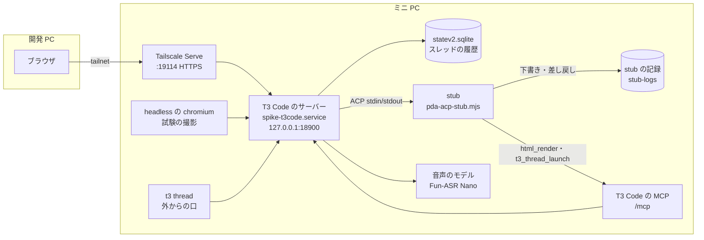

- T3 Code は専用のディレクトリ `~/spike-t3code` に入れ、データも `~/spike-t3code/home` に分けた。既存の `~/.t3` は作っていない。
- 画面の確かめは、ミニ PC の headless の chromium で `http://127.0.0.1:18900` を開いて行った。tailnet の URL を通したペアリングと WebSocket は、開発 PC の headless の chromium で確かめた (3.1 節)。
- stub は、依頼を受けると内部で「下書き → 差し戻し → 下書き → 通過」を模す。1 回目の下書きは指す先の無い指示語「前述」を含み、stub の中のゲートの代わりがそれを差し戻す。依頼の文に決まった語句があるときだけ、コマンドの報告と承認の要求、HTML の資料、子のスレッドの起動、150 秒の待機を行う (付録 A)。

## 3. 項目ごとの手順と結果

### 3.1 項目 1: ミニ PC に入れて起動し、tailnet に公開する

手順

1. 公式のインストーラー (`https://t3.codes/install.sh`) を取得して中身を読み、書き込む先が `T3CODE_HOME` と `T3CODE_INSTALL_BIN_DIR` の 2 か所だけで、シェルの設定ファイルを書き換えないことを確かめた。
2. 専用の場所を指定して安定版を入れた。

   ```sh
   T3CODE_VERSION=0.1.11 T3CODE_HOME=$HOME/spike-t3code/home T3CODE_INSTALL_BIN_DIR=$HOME/spike-t3code/bin sh install.sh
   ```

3. ユーザー単位の常駐 `spike-t3code.service` を置いて起動した (定義は付録 B)。`127.0.0.1:18900` だけで待ち受ける。常駐の `PATH` から `~/.local/bin` を外したが、T3 Code は `~/.local/bin/claude` を見つけたので、次の手順の設定で Claude と Codex の provider を無効にした。
4. 設定ファイル `~/spike-t3code/home/userdata/settings.json` で、組み込みの Claude (`claudeAgent`) と Codex の provider を無効にし、stub を provider として足した (付録 B)。
5. Tailscale Serve に公開した。初めに新しいポート 18900 に割り当てたが、tailnet の規則が通していなかった。オーナーの指示で、OpenClaw (`v03-openclaw.service`) に使っていた 19114 を T3 Code に付け替え、18900 の割り当ては外した。

   ```sh
   ~/.local/bin/tailscale-pda serve --bg --https=19114 http://127.0.0.1:18900
   ~/.local/bin/tailscale-pda serve --https=18900 off
   ```

起きたこと

- 起動からおよそ 2 秒で待ち受けを始め (ログで 16:43:30 に開始、16:43:32 に `Listening on http://127.0.0.1:18900`)、サーバーの常駐は約 0.45 GB のメモリを使った。
- 起動のログに、HTML の下見 (`html_preview`) とブラウザーのタブに使う T3 Code 自前の headless のブラウザーが、この機械の AppArmor の制限で動かないと出た。直すには `sudo t3 browser setup` が要る。`html_render` で資料を出すことには要らなかった (3.4 節)。
- 18900 には開発 PC から届かなかった (接続のタイムアウト)。[mini-pc.md](../environment/mini-pc.md) の 2.2 節のとおり、tailnet の規則は開発 PC と iPhone から届くポートを限っており、18900 は入っていない。規則に入っている 19114 に付け替えると届いた。
- 開発 PC の headless の chromium で、ミニ PC の `t3 pair` が出した URL の origin を `https://pda-web.tailaff53a.ts.net:19114` に置き換えて開くと、ペアリングが通り、スレッドの一覧が WebSocket 越しに出た。T3 Code の認証のセッションの一覧には、接続元として開発 PC の tailnet のアドレスが記録された。確かめに使ったセッションは取り消した。

  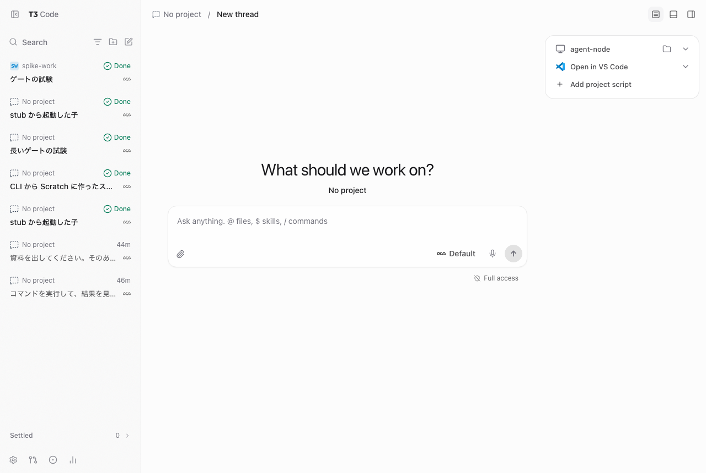

- 認証の無い接続は、Serve 越しの形の見出しを付けても `401` で断られた。ペアリングした端末だけが使える。
- 19114 を付け替えたので、tailnet から OpenClaw (`127.0.0.1:5114`) に届く Serve の割り当ては無くなった。付け替える前は、開発 PC の OpenClaw の node (`ai.openclaw.node`。会社のコネクタをミニ PC から使う v0.3 の経路) が動いていて、OpenClaw に tailnet 越しの接続が張られていた。OpenClaw の常駐そのものは動いたままである。

```text
$ tailscale-pda serve status   (19114 の行だけ)
https://pda-web.tailaff53a.ts.net:19114 (tailnet only)
|-- / proxy http://127.0.0.1:18900

$ curl https://pda-web.tailaff53a.ts.net:19114/   (開発 PC から)
200
```

### 3.2 項目 2: 通過した一通だけが画面と履歴に残る

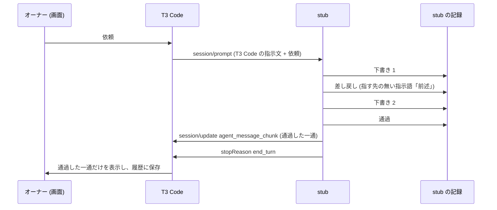

手順

1. `t3 thread start` で stub の provider のスレッド「ゲートの試験」を作り、返事を待った。
2. stub の記録、T3 Code の保存先 (`~/spike-t3code/home` の全体。DB、provider のログ、添付)、`t3 thread show` の履歴、Web の画面を見た。

起きたこと

- stub の記録には、下書き 1、差し戻しとその理由、下書き 2、通過が残った。

  ```text
  {"kind":"draft","attempt":1,"text":"【下書き1】設計の要点をまとめて返してください。 について、前述のとおり対応しました。"}
  {"kind":"gate","attempt":1,"pass":false,"reason":"指す先の無い指示語「前述」を使っている"}
  {"kind":"draft","attempt":2,"text":"【確定】「設計の要点をまとめて返してください。」を受け付けました。…"}
  {"kind":"gate","attempt":2,"pass":true}
  ```

- T3 Code の保存先の全ファイルを「下書き1」「前述のとおり」で探しても見つからず、確定の一通の文は DB (`statev2.sqlite` の WAL) にだけあった。provider のログは ACP の要求の名前と状態だけを書き、本文を書かない。

  ```text
  $ t3 thread show mcp:f881ed11-…
  ゲートの試験
  mcp:f881ed11-…  completed  pda-stub/default
  [user]
  設計の要点をまとめて返してください。
  [assistant]
  【確定】「設計の要点をまとめて返してください。」を受け付けました。依頼の文を確かめ、作業を終えました。この一通だけが画面に出ます。
  ```

- 画面にも確定の一通だけが出た。

  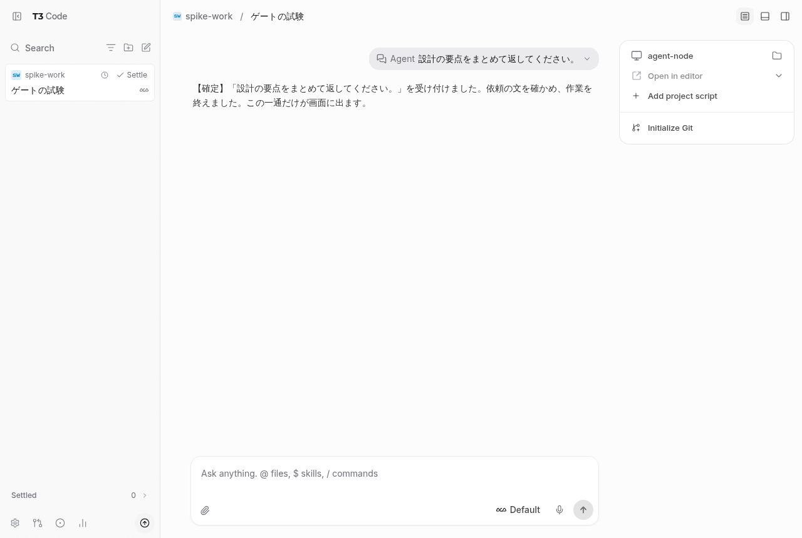

- 差し戻しを繰り返す回数は stub の中で決まり、T3 Code は関わらない。stub が 150 秒何も報告せずに待っても、T3 Code は依頼を打ち切らず、待ったあとの一通を受け取った (`t3 thread start` の開始 17:09:18、完了 17:11:50)。

この項目は、stub が下書きを ACP に流さない作りなので、下書きが残らないことは作りから決まる。確かめたのは、T3 Code が ACP で受け取っていないものを別の経路で拾って画面や履歴に出さないことと、ゲートが長く考えても依頼が切れないことである。

### 3.3 項目 3: コマンドと出力、承認の操作 1 回で続きが動く

手順

1. Web の画面で「or start without a project」から、プロジェクトに属さないスレッドを始め、権限を「Full access」(既定) から「Supervised」(錠の印) に替えた。
2. 「コマンドを実行して、結果を見せてください。」と送った。stub は、`uname -a && ls -la ~/spike-t3code/work` を実行して報告し、続けて `date` の実行を `session/request_permission` で求める。
3. 会話の中に出た「Approve」を 1 回押した。

起きたこと

- 承認の要求は会話の中に、コマンドと「Waiting for approval · Decline · Approve」で出た。左のスレッドの一覧にも「Approval」の印が出た。

  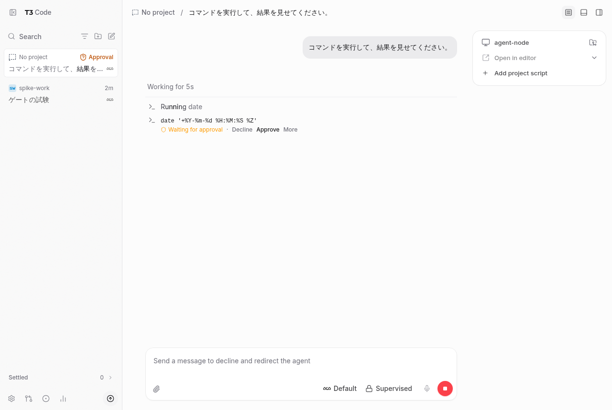

- 「Approve」を 1 回押すと、stub に `allow-once` が届き、stub は `date` を実行して確定の一通を返した。許可のポップアップは出なかった。

  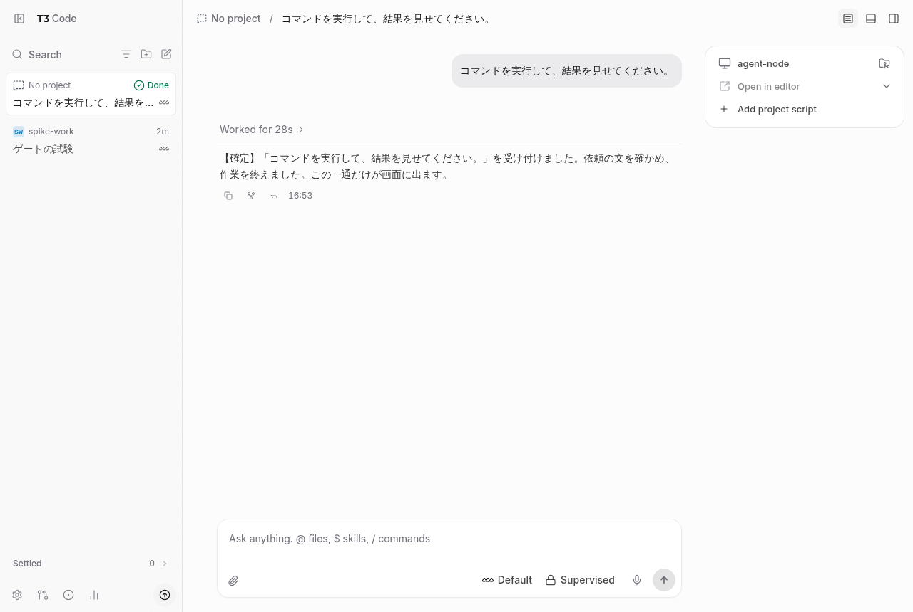

- 終わったあとは、作業が「Worked for 28s」の行に畳まれる。その行を開き、さらに「Ran 2 commands and used 1 tool」を開くと、コマンドごとに出力が読める。

  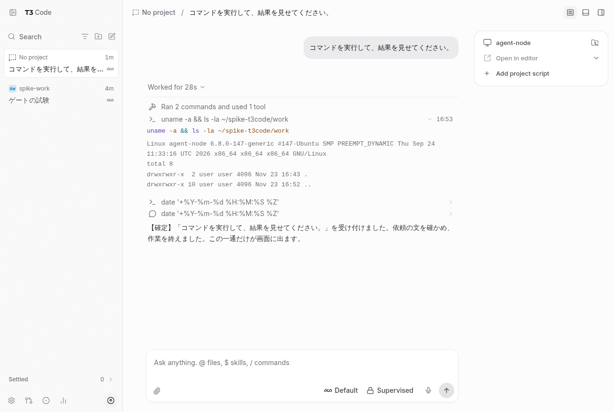

- 権限が「Full access」のスレッドでは、承認の要求は T3 Code が自動で許可し、画面に出ない。T3 Code の文書のとおりで ([providers-acp.md](https://github.com/pingdotgg/t3code/blob/v0.1.11/docs/user/providers-acp.md) の「Permissions and terminals」)、Supervised と Auto-accept edits でだけ会話の中に出る。

### 3.4 項目 4: HTML の資料をスレッドの中に出す

手順

1. 新しいスレッドで「資料を出してください。そのあと子のセッションを起動してください。」と送った。
2. stub は、T3 Code が ACP の provider の処理に渡す環境変数 `T3_ACP_MCP_ENDPOINT` と `T3_ACP_MCP_AUTHORIZATION` を使って、T3 Code の MCP の口 (`http://127.0.0.1:18900/mcp`) の道具 `html_render` に、自己完結の HTML を渡した。

起きたこと

- 道具は `attachmentId` を返し、画面では確定の一通の上に資料が表として出た。スマホの幅でも崩れなかった (3.7 節)。

  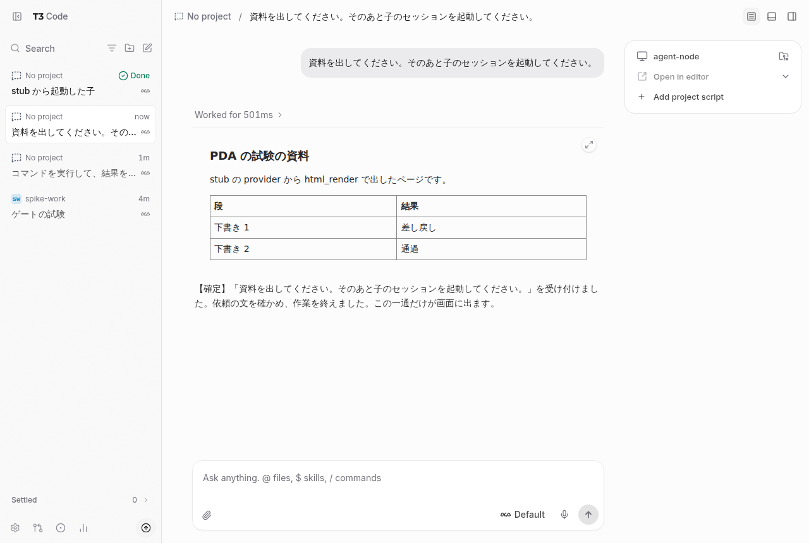

- この経路は、T3 Code の headless のブラウザー (sudo の設定が要る) を使わずに動いた。資料の出来を公開の前に絵で確かめる道具 `html_preview` は、そのブラウザーが要るので、この機械では今は使えない。
- 資料は T3 Code の添付としてスレッドに付く。開いて見たのは headless の chromium の 1 端末だけである。T3 Code にペアリングした端末なら、claude.ai などのログインに関わらず開けるはずだが、別の端末では見ていない。

### 3.5 項目 5: 外からスレッドを作り、メッセージを送る

手順と起きたこと

- ミニ PC の上の `t3 thread start` は、プロジェクトの指定を必須にする。Scratch のプロジェクト (プロジェクトに属さないスレッドの入れ物。T3 Code が持つ) の ID を渡すと、プロジェクトに属さない新しいフォルダ `~/spike-t3code/home/scratch/2026-11-23-cli-b8e1c7d8` でスレッドが始まり、`--wait` で返事を受け取れた。

  ```sh
  t3 thread start --base-dir ~/spike-t3code/home --provider pda-stub --model default --wait --json <Scratch のプロジェクトの ID> "外の CLI からの依頼です。"
  t3 thread send --base-dir ~/spike-t3code/home <スレッドの ID> "続けての依頼です。" --wait --json
  ```

  Scratch のプロジェクトの ID は、stub の中から呼んだ `t3_thread_launch` が返した `projectId` で得た。

- stub の中から MCP の `t3_thread_launch` に `scratch: true` を渡すと、プロジェクトに属さない子のスレッド「stub から起動した子」ができ、stub の provider で動いて一通を返した。子のスレッドは左の一覧に「No project」で並び、オーナーは画面でそのスレッドに入って話しかけられる。

  ```text
  $ t3 thread show mcp:7ed05f6c-…
  stub から起動した子
  mcp:7ed05f6c-…  completed  pda-stub/default
  (no branch)  /home/user/spike-t3code/home/scratch/2026-11-23-085eca91
  ```

- 外の利用者として環境の `/mcp` を呼ぶ口は、T3 Code の MCP の認証 (OAuth の承認か、承認の画面に入れるコード) を要る。`t3 auth session issue` で発行した bearer では `invalid_mcp_credential` で断られた。ミニ PC の上の PDA の常駐が使う口は `t3 thread` で足り、メインセッションが子を起こす口は provider の中からの MCP で足りるので、この試験では OAuth の承認は行っていない。
- 外から送ったメッセージは、画面では「Agent」の印の付いた吹き出しで出る (3.7 節の絵)。T3 Code は依頼の文に「this message came through T3 Code's tools」と書き添える。

### 3.6 項目 6: 音声をミニ PC のモデルで文字にする

手順

1. T3 Code の環境の音声の口 (`/api/voice/*`) で状態を読んだ。音声は使える状態で、GPU は無く CPU で動く。
2. T3 Code のモデルの一覧 (ソースの `apps/server/src/speech/catalog.json`) から、日本語の誤りが少なく、ミニ PC の資源に収まるものを 2 つ取得した。

   | モデル | 大きさ | 一覧に書かれた日本語の誤り | 一覧に書かれた CPU での速さ (30 秒あたり) |
   |---|---|---|---|
   | Fun-ASR Nano Multilingual | 0.89 GB | 2.3% | 5.5 秒 |
   | SenseVoice Small | 0.25 GB | 7.6% | 1.5 秒 |

3. 開発 PC の読み上げ (macOS の Kyoko の声) で、フィラーを含む日本語の音声 (13 秒) を作り、2 つのモデルで文字にした。読ませた文は「えーと、PDAの入口の画面について、T3 Codeを借りる形で試験をしています。あのー、結果を資料にまとめて、明日の朝までに送ってください。」で、辞書に「PDA」と「T3 Code」を入れ、フィラーの除去を有効にした。
4. 選んだモデルを Fun-ASR Nano Multilingual にした。

起きたこと

| モデル | かかった時間 | 文字にした結果 |
|---|---|---|
| Fun-ASR Nano Multilingual | 2.8〜3.4 秒 | ええと、ppaの入り口の画面について、t3 コードを借りる形で試験をしています。あの結果を資料にまとめて 明日の朝までに送ってください。 |
| SenseVoice Small | 0.7〜1.2 秒 | の入り口の画面について3コードを借りる形で試験をして、います、あの結果を資料にまとめて、明日の朝までに送ってください。 |

- どちらも「PDA」と「T3 Code」を正しく書けず、辞書を渡しても直らなかった。Fun-ASR はフィラー「ええと」を残した。SenseVoice は冒頭の「えーと、PDA」を落とした。入力は人の声ではなく合成の音声である。
- Fun-ASR を読み込んだ文字起こしの処理は約 1.25 GB のメモリを使い、15 分使わないと降ろされる (既定の `min_15`)。
- 文字起こしのあとにモデルで整える機能 (Transcript cleanup) は、T3 Code の文章の生成のモデルを使う。この試験では Claude と Codex の provider を無効にしているので、使える生成のモデルが無い。
- 「Transcribe with」(どこで文字にするか) は端末ごとの設定で、オーナーの端末で選ぶ (7 節の手順 3)。

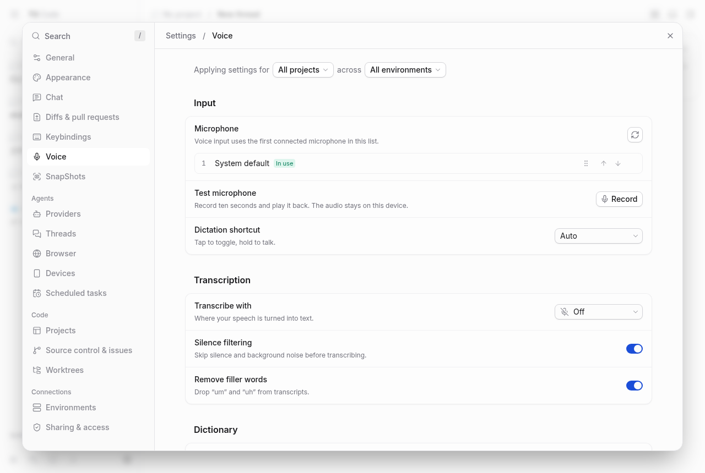

### 3.7 項目 7: スマホの幅の Web の画面

headless の chromium で、幅 390・高さ 844 の画面にして撮った。どの画面も横にはみ出さず、長い文は折り返された。

| スレッドの一覧 | ゲートの試験 | コマンドと出力 | HTML の資料 |
|---|---|---|---|
| 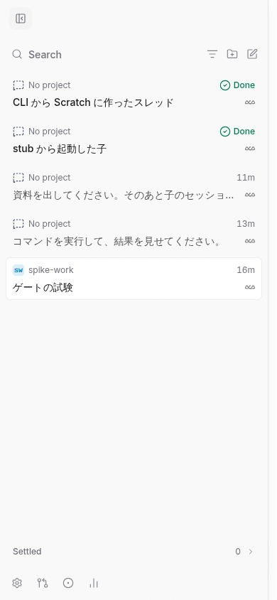 | 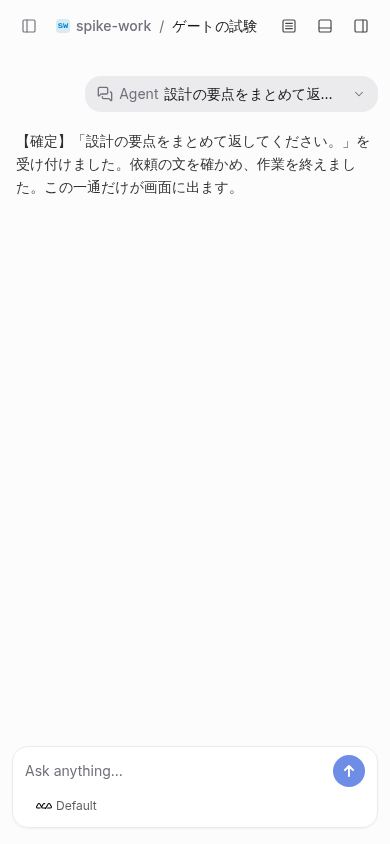 | 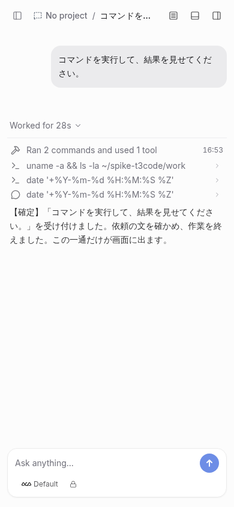 | 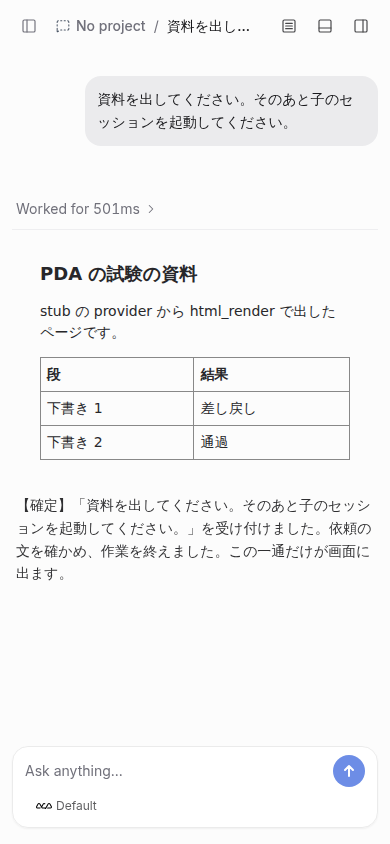 |

- 新しいスレッドの画面: [10-phone-home.png](../reports/evidence/spike-t3code-screen/10-phone-home.png)
- 横向き (幅 844・高さ 390): [14-phone-landscape-html-thread.png](../reports/evidence/spike-t3code-screen/14-phone-landscape-html-thread.png)
- provider の設定 (PC の幅。有効なのは PDA stub だけ): [17-settings-providers.png](../reports/evidence/spike-t3code-screen/17-settings-providers.png)

キーボードを出した状態は撮っていない。iOS の Safari でキーボードが入力欄を隠す不具合 [#19512](https://github.com/pingdotgg/t3code/issues/19512) が開いている。

## 4. PDA のパイプラインを ACP の provider として作るときに効く振る舞い

| 振る舞い | 証拠 | パイプラインで要ること |
|---|---|---|
| スレッドの最初の依頼の前に、T3 Code が自前の指示文 (約 7 KB。T3 Code の道具の使い方、PR の扱い) を付ける。オーナーの依頼は `<user_request>` の中にある | stub が受けた `session/prompt` | 依頼の文を取り出してから担い手に渡し、指示文は担い手に渡さない (役の規則は PDA の側で割り当てる) |
| T3 Code を起動し直したあとに古いスレッドを続けると、T3 Code はエージェントに `session/load` か `session/resume` を求める。持っていないと、スレッドは「Failed to open acpRegistry provider session」で失敗する | サーバーのログ `ACP agent does not advertise session/load or session/resume support` | `session/load` を持ち、T3 Code のスレッドの ID (`T3CODE_THREAD_ID`) から PDA のセッションを引き当てる |
| `session/load` のあとの依頼は「Context handoff」の形で来る。前の経過の要約のあとの、最後の `User message:` の後ろが新しい依頼である | stub が受けた `session/prompt` | この形からも依頼を取り出す |
| スレッドごとに provider の処理を 1 つ起こし、スレッドの依頼が終わっても残す。T3 Code の常駐を止めると一緒に止まる | `ps` の結果。stub の処理 1 つが 55〜80 MB。観測したのは試験の間 (十数分) で、もっと長く放置したときに T3 Code が降ろすかは見ていない | パイプラインの処理は軽く保つか、ACP の口だけを薄く作り、重い処理は常駐の 1 か所に置く |
| 150 秒何も報告しない依頼も切れなかった。ソースの依頼の経路 (`AcpSessionRuntime` の `session/prompt`) に時間の上限は見当たらない | 150 秒の待機のあとも一通が届いた。それより長い待機は試していない | ゲートの待ち合わせと差し戻しの繰り返しを、パイプラインの中で回せる (C14) |
| エージェントの処理の環境に、T3 Code の MCP の口と、その場限りの bearer と、スレッドの ID を渡す | `session/new` と環境変数 | 資料の表示 (`html_render`) と子のスレッドの起動 (`t3_thread_launch`) を、この口で行う |
| 承認の要求が画面に出るのは、スレッドの権限が Supervised か Auto-accept edits のときだけ。新しいスレッドの既定は Full access で、自動で許可される | 3.3 節 | オーナーに承認を求める命令は Supervised で出すか、T3 Code の権限の既定を変える |
| 終わった作業は「Worked for …」の行に畳まれ、コマンドと出力は 2 段開くと読める | 3.3 節の絵 | 画面の側の作りで、パイプラインでは変えられない |
| 外から送ったメッセージは「Agent」の印で表示される | 3.7 節の絵 | メインセッションが子に渡した依頼は、オーナーの発言と見分けられる |
| T3 Code の provider の判定は、PATH に無くても `~/.local/bin/claude` を見つけた (Claude の provider は設定で無効にして止めた) | provider の設定の画面 | T3 Code の Claude の provider は、設定ファイルで `claudeAgent` を無効にしておく |

### 4.1 最初の実行で起きた子のスレッドの連鎖

stub の最初のバージョンは、子のスレッドを起こす合図の語 (「spawn」など) を、T3 Code の指示文を含む依頼の文の全体で探していた。T3 Code の指示文には「spawn_agent」の語があるので、最初の依頼で子が起き、子の依頼にも同じ指示文が付くので、子が次の子を起こし続けた。stub を直した時点で止まったが、それまでに起きた子のスレッドごとに stub の処理が残り、合わせて約 3.7 GB のメモリを使っていた。

- 止め方: T3 Code の常駐を止めると、残っていた stub の処理も止まった。
- 片付け: 連鎖のスレッドを含む T3 Code の DB と Scratch のフォルダを退避して、T3 Code のデータを初めからにした。退避したものは、試験を終えた時点で消した。
- 直したこと: stub は、`<user_request>` の中 (起動し直したあとは最後の `User message:` の後ろ) だけから依頼を取り出し、合図は決まった語句 (「子のセッションを起動して」など) に絞った。直したあとに 1 度、起動し直したあとの依頼の「起動し直した」の語に合図が当たり、子が 1 つ余分に起きた。これを受けて合図を語句にした。

PDA のパイプラインでは、担い手に渡す依頼の文を T3 Code の指示文から切り離し、子を起こすのはメインセッションの道具の呼び出しに限る。

## 5. 確かめられなかったこと

- スマホのアプリから tailnet の URL でつなぐこと。開発 PC の headless のブラウザでは通った (3.1 節)。アプリでの見え方はオーナーが見る。
- スマホへの push の通知。T3 Code の文書では T3 Connect (T3 のアカウント) が要り、Tailscale の直接の接続だけでは届かない ([mobile-notifications.md](https://github.com/pingdotgg/t3code/blob/v0.1.11/docs/user/mobile-notifications.md))。T3 Connect は使わない条件なので試していない。
- 人の声での音声入力。3.6 節の結果は合成の音声である。

## 6. ミニ PC に残したものと消し方

オーナーがスマホで見え方を見るまで、次のものを動かしたまま残した。

- ユーザー単位の常駐 `spike-t3code.service` (自動起動が有効)。定義は `~/.config/systemd/user/spike-t3code.service`。
- Tailscale Serve の割り当て `https://pda-web.tailaff53a.ts.net:19114` → `http://127.0.0.1:18900`。付け替える前は `http://127.0.0.1:5114` (OpenClaw) だった。
- `~/spike-t3code/`
  - `bin/t3`: T3 Code の起動の口。
  - `home/`: T3 Code の本体 (`runtime/versions/0.1.11`)、データ (`userdata/`。スレッドの DB、設定ファイル、音声のモデル 2 つで約 1.1 GB)、Scratch のフォルダ。
  - `pda-acp-stub.mjs`: stub (付録 A)。
  - `stub-logs/`: stub の記録。スレッドごとの下書き・差し戻し・通過と、ACP の通信の全文 (`wire.jsonl`)。
  - `work/`: プロジェクト「spike-work」のフォルダ (空)。
- T3 Code が自分で作る systemd の slice (`app-t3code*.slice`)。常駐を止めると中身が無くなる。

試験のために発行した認証のセッション (headless のブラウザーのペアリング、bearer) は取り消した。T3 Code の認証のセッションは、今は 1 つも無い。

消し方 (ミニ PC で)。最後の行で 19114 を OpenClaw に戻す。

```sh
systemctl --user disable --now spike-t3code.service
rm ~/.config/systemd/user/spike-t3code.service
systemctl --user daemon-reload
rm -r ~/spike-t3code
~/.local/bin/tailscale-pda serve --bg --https=19114 http://127.0.0.1:5114
```

## 7. オーナー向け: 端末から T3 Code につなぐ手順

1. ペアリングの URL を作る。ミニ PC で次を実行し、出た `Pairing URL` の `http://127.0.0.1:18900` を `https://pda-web.tailaff53a.ts.net:19114` に置き換える (`#token=` からあとは残す)。URL は 10 分で切れ、1 台につき 1 回使える。セッションに頼んでもよい。

   ```sh
   ssh agent-node '~/spike-t3code/bin/t3 pair --base-dir ~/spike-t3code/home --ttl 10m --label iphone'
   ```

   `t3 pair --tailscale` は、Tailscale Serve の 443 の割り当てを書き換えるので使わない。
2. つなぐ。
   - スマホのアプリ: [App Store](https://apps.apple.com/us/app/t3-code-remote-claude-more/id6787819824) か [Google Play](https://play.google.com/store/apps/details?id=com.t3tools.t3code) で T3 Code を入れ、Settings → Environments → Add environment に、手順 1 の URL を `https://` から貼る。
   - PC のブラウザ: 手順 1 の URL を開く。
3. 音声をミニ PC で文字にする設定にする。モデルはミニ PC で Fun-ASR Nano Multilingual を選んである。
   - スマホのアプリ: 既定は端末の上で文字にする。ミニ PC で文字にするには Settings → Voice → Transcribe on で `agent-node` を選ぶ。
   - PC のブラウザ: Settings → Voice → Transcribe with で `agent-node` を選ぶ。
4. 試す。新しいスレッドは PDA stub の provider で動く。次の語句を含めると、stub がその動きをする。
   - 「コマンドを実行して」: コマンドの報告と承認の要求。承認を画面で見るには、送る前に入力欄の下の権限を Supervised (錠の印) にする。
   - 「資料を出して」: HTML の資料。
   - 「子のセッションを起動して」: プロジェクトに属さない子のスレッド。
   - それ以外の文: 確定の一通だけを返す。

スマホへの push の通知は届かない (5 節)。

## 付録 A: stub のコード (`~/spike-t3code/pda-acp-stub.mjs`)

Node.js 24 で動く。依存のパッケージは無い。

```js
#!/usr/bin/env node
// PDA の応答パイプラインの代わりの最小の ACP エージェント (試験用)。
// stdin/stdout で ACP v1 の JSON-RPC (1 行 1 メッセージ) を話す。
// 下書きと差し戻しは内部の記録 (STUB_LOG_DIR) にだけ書き、ACP では通過した一通だけを報告する。
import { spawnSync } from "node:child_process";
import { appendFileSync, mkdirSync } from "node:fs";
import { randomUUID } from "node:crypto";
import { homedir } from "node:os";
import { join } from "node:path";
import { createInterface } from "node:readline";

const LOG_DIR = process.env.STUB_LOG_DIR ?? join(homedir(), "spike-t3code", "stub-logs");
mkdirSync(LOG_DIR, { recursive: true });
const wireLog = join(LOG_DIR, "wire.jsonl");

const record = (file, entry) =>
  appendFileSync(join(LOG_DIR, file), JSON.stringify({ at: new Date().toISOString(), ...entry }) + "\n");

let nextId = 1;
const pending = new Map();
const sessions = new Map();

const send = (message) => {
  const line = JSON.stringify({ jsonrpc: "2.0", ...message });
  appendFileSync(wireLog, JSON.stringify({ at: new Date().toISOString(), dir: "out", line }) + "\n");
  process.stdout.write(line + "\n");
};
const respond = (id, result) => send({ id, result });
const fail = (id, code, message) => send({ id, error: { code, message } });
const notify = (method, params) => send({ method, params });
const request = (method, params) =>
  new Promise((resolve, reject) => {
    const id = `stub-${nextId++}`;
    pending.set(id, { resolve, reject });
    send({ id, method, params });
  });

const update = (sessionId, body) => notify("session/update", { sessionId, update: body });
const say = (sessionId, text) =>
  update(sessionId, { sessionUpdate: "agent_message_chunk", content: { type: "text", text } });

// 担い手の代わり: 1 回目の下書きは規約に外れる語を含み、2 回目は直してある。
const draft = (prompt, attempt) =>
  attempt === 1
    ? `【下書き1】${prompt} について、前述のとおり対応しました。`
    : `【確定】「${prompt}」を受け付けました。依頼の文を確かめ、作業を終えました。この一通だけが画面に出ます。`;

// 終端のゲートの代わり: 指す先の無い指示語「前述」を差し戻す。
const gate = (text) =>
  text.includes("前述")
    ? { pass: false, reason: "指す先の無い指示語「前述」を使っている" }
    : { pass: true };

const runGatedReply = (sessionId, prompt) => {
  const turnId = randomUUID();
  for (let attempt = 1; attempt <= 5; attempt += 1) {
    const text = draft(prompt, attempt);
    record(`${sessionId}.jsonl`, { turnId, kind: "draft", attempt, text });
    const verdict = gate(text);
    record(`${sessionId}.jsonl`, { turnId, kind: "gate", attempt, ...verdict });
    if (verdict.pass) return text;
  }
  return "ゲートを通る一通を作れませんでした。";
};

const runCommand = (command) => {
  const result = spawnSync("/bin/sh", ["-c", command], { encoding: "utf8", timeout: 20_000 });
  return { output: `${result.stdout ?? ""}${result.stderr ?? ""}`, exitCode: result.status ?? -1 };
};

const reportCommand = (sessionId, command) => {
  const toolCallId = `cmd-${randomUUID()}`;
  update(sessionId, {
    sessionUpdate: "tool_call",
    toolCallId,
    title: command,
    kind: "execute",
    status: "in_progress",
    rawInput: { command },
  });
  const { output, exitCode } = runCommand(command);
  update(sessionId, {
    sessionUpdate: "tool_call_update",
    toolCallId,
    status: exitCode === 0 ? "completed" : "failed",
    content: [{ type: "content", content: { type: "text", text: output } }],
    rawOutput: { exitCode, output },
  });
  return { toolCallId, exitCode };
};

const askAndRun = async (sessionId, command) => {
  const toolCallId = `ask-${randomUUID()}`;
  const toolCall = {
    toolCallId,
    title: command,
    kind: "execute",
    status: "pending",
    rawInput: { command },
  };
  update(sessionId, { sessionUpdate: "tool_call", ...toolCall });
  const answer = await request("session/request_permission", {
    sessionId,
    toolCall,
    options: [
      { optionId: "allow-once", name: "Allow", kind: "allow_once" },
      { optionId: "reject-once", name: "Reject", kind: "reject_once" },
    ],
  });
  record(`${sessionId}.jsonl`, { kind: "permission", command, answer });
  const allowed = answer?.outcome?.outcome === "selected" && answer.outcome.optionId === "allow-once";
  if (!allowed) {
    update(sessionId, { sessionUpdate: "tool_call_update", toolCallId, status: "failed" });
    return false;
  }
  update(sessionId, { sessionUpdate: "tool_call_update", toolCallId, status: "in_progress" });
  const { output, exitCode } = runCommand(command);
  update(sessionId, {
    sessionUpdate: "tool_call_update",
    toolCallId,
    status: exitCode === 0 ? "completed" : "failed",
    content: [{ type: "content", content: { type: "text", text: output } }],
    rawOutput: { exitCode, output },
  });
  return true;
};

// T3 Code が渡す MCP の口 (Streamable HTTP) を直接呼ぶ。
let mcpSession;
const mcpPost = async (body) => {
  const endpoint = process.env.T3_ACP_MCP_ENDPOINT;
  const authorization = process.env.T3_ACP_MCP_AUTHORIZATION;
  if (!endpoint || !authorization) throw new Error("T3_ACP_MCP_ENDPOINT is not set");
  const response = await fetch(endpoint, {
    method: "POST",
    headers: {
      authorization,
      "content-type": "application/json",
      accept: "application/json, text/event-stream",
      ...(mcpSession ? { "mcp-session-id": mcpSession } : {}),
    },
    body: JSON.stringify({ jsonrpc: "2.0", ...body }),
  });
  mcpSession = response.headers.get("mcp-session-id") ?? mcpSession;
  const text = await response.text();
  if (!("id" in body)) return undefined;
  const payload = text.trimStart().startsWith("{")
    ? text
    : text
        .split("\n")
        .filter((line) => line.startsWith("data:"))
        .map((line) => line.slice(5).trim())
        .pop();
  return JSON.parse(payload ?? "{}");
};
const mcpCall = async (name, args) => {
  if (!mcpSession) {
    await mcpPost({
      id: "init",
      method: "initialize",
      params: {
        protocolVersion: "2025-06-18",
        capabilities: {},
        clientInfo: { name: "pda-acp-stub", version: "0.1.0" },
      },
    });
    await mcpPost({ method: "notifications/initialized" });
  }
  return mcpPost({ id: randomUUID(), method: "tools/call", params: { name, arguments: args } });
};

const reportMcp = async (sessionId, tool, args) => {
  const toolCallId = `mcp-${randomUUID()}`;
  update(sessionId, {
    sessionUpdate: "tool_call",
    toolCallId,
    title: `t3-code ${tool}`,
    kind: "other",
    status: "in_progress",
    rawInput: { server: "t3-code", tool, arguments: args },
  });
  let result;
  try {
    result = await mcpCall(tool, args);
  } catch (error) {
    result = { error: String(error) };
  }
  record(`${sessionId}.jsonl`, { kind: "mcp", tool, result });
  update(sessionId, {
    sessionUpdate: "tool_call_update",
    toolCallId,
    status: result?.error || result?.result?.isError ? "failed" : "completed",
    rawOutput: result,
  });
  return result;
};

const REPORT_HTML = `<!doctype html><html><head><meta charset="utf-8"><style>
body{font-family:system-ui,sans-serif;margin:0;padding:16px;background:var(--background,#111);color:var(--foreground,#eee)}
h1{font-size:18px;margin:0 0 8px} table{border-collapse:collapse;width:100%} td,th{border:1px solid #888;padding:6px;font-size:14px;text-align:left}
</style></head><body><h1>PDA の試験の資料</h1><p>stub の provider から html_render で出したページです。</p>
<table><tr><th>段</th><th>結果</th></tr><tr><td>下書き 1</td><td>差し戻し</td></tr><tr><td>下書き 2</td><td>通過</td></tr></table></body></html>`;

const handlePrompt = async (id, params) => {
  const { sessionId } = params;
  const raw = (params.prompt ?? [])
    .filter((block) => block.type === "text")
    .map((block) => block.text)
    .join("\n");
  // T3 Code は依頼の前に自前の指示を付けて渡す。オーナーの依頼は <user_request> の中にあり、
  // 起動し直した後の Context handoff では最後の "User message:" の後にある。
  const handoffAt = raw.lastIndexOf("User message:");
  const userRequest =
    /<user_request>([\s\S]*?)<\/user_request>/.exec(raw)?.[1] ??
    (handoffAt >= 0 ? raw.slice(handoffAt + "User message:".length) : raw);
  const prompt = userRequest.replace(/^\s*\[T3 Code:[^\]]*\]\s*/, "").trim();
  record(`${sessionId}.jsonl`, {
    kind: "prompt",
    prompt,
    rawLength: raw.length,
    hasT3Instructions: raw.includes("<t3_code_instructions>"),
    env: { T3CODE_THREAD_ID: process.env.T3CODE_THREAD_ID },
  });

  if (/コマンドを実行/.test(prompt)) {
    reportCommand(sessionId, "uname -a && ls -la ~/spike-t3code/work");
    const allowed = await askAndRun(sessionId, "date '+%Y-%m-%d %H:%M:%S %Z'");
    record(`${sessionId}.jsonl`, { kind: "askResult", allowed });
  }
  if (/資料を出して/.test(prompt)) {
    await reportMcp(sessionId, "html_render", { html: REPORT_HTML, title: "PDA の試験の資料", height: 220 });
  }
  if (/子のセッションを起動して/.test(prompt)) {
    const result = await reportMcp(sessionId, "t3_thread_launch", {
      message: "子のセッションの依頼です。下書きと差し戻しを経て一通だけ返してください。",
      scratch: true,
      title: "stub から起動した子",
    });
    record(`${sessionId}.jsonl`, { kind: "launch", result });
  }
  if (/待機して/.test(prompt)) {
    // 遅いゲートの代わり: 何も報告せずに 150 秒待つ。
    record(`${sessionId}.jsonl`, { kind: "wait", seconds: 150 });
    await new Promise((resolve) => setTimeout(resolve, 150_000));
  }
  say(sessionId, runGatedReply(sessionId, prompt));
  respond(id, { stopReason: "end_turn" });
};

const handle = async (message) => {
  if (message.method === undefined) {
    const waiter = pending.get(message.id);
    if (waiter) {
      pending.delete(message.id);
      if (message.error) waiter.reject(message.error);
      else waiter.resolve(message.result);
    }
    return;
  }
  const { id, method, params } = message;
  switch (method) {
    case "initialize":
      return respond(id, {
        protocolVersion: 1,
        agentCapabilities: {
          loadSession: true,
          promptCapabilities: { image: false, audio: false, embeddedContext: false },
          mcpCapabilities: { http: true, sse: false },
        },
        authMethods: [],
        agentInfo: { name: "pda-acp-stub", title: "PDA stub", version: "0.1.0" },
      });
    case "authenticate":
      return respond(id, {});
    case "session/new": {
      const sessionId = randomUUID();
      sessions.set(sessionId, { cwd: params?.cwd });
      record(`${sessionId}.jsonl`, {
        kind: "session",
        cwd: params?.cwd,
        mcpServers: (params?.mcpServers ?? []).map((server) => server.name ?? server.type),
      });
      return respond(id, { sessionId });
    }
    case "session/load": {
      // 履歴は PDA の側が持つ前提なので、読み戻しの出来事は送らずに session を受け直す。
      sessions.set(params.sessionId, { cwd: params?.cwd });
      record(`${params.sessionId}.jsonl`, { kind: "load", cwd: params?.cwd });
      return respond(id, {});
    }
    case "session/prompt":
      return handlePrompt(id, params).catch((error) => fail(id, -32603, String(error)));
    case "session/cancel":
      return undefined;
    default:
      if (id !== undefined) return fail(id, -32601, `Method not found: ${method}`);
      return undefined;
  }
};

createInterface({ input: process.stdin }).on("line", (line) => {
  if (!line.trim()) return;
  appendFileSync(wireLog, JSON.stringify({ at: new Date().toISOString(), dir: "in", line }) + "\n");
  let message;
  try {
    message = JSON.parse(line);
  } catch {
    return;
  }
  handle(message).catch((error) => process.stderr.write(`${error}\n`));
});
```

## 付録 B: 常駐の定義と設定ファイル

`~/.config/systemd/user/spike-t3code.service`

```ini
[Unit]
Description=T3 Code trial server for the PDA screen spike (2026-11-23)
After=network-online.target

[Service]
Type=simple
WorkingDirectory=%h/spike-t3code/work
Environment=PATH=%h/spike-t3code/bin:/usr/bin:/bin
Environment=T3CODE_HOME=%h/spike-t3code/home
ExecStart=%h/spike-t3code/bin/t3 serve --base-dir %h/spike-t3code/home --host 127.0.0.1 --port 18900 --no-browser %h/spike-t3code/work
Restart=on-failure
RestartSec=10
Nice=5
MemoryMax=3G

[Install]
WantedBy=default.target
```

`~/spike-t3code/home/userdata/settings.json` (試験を終えた時点。`speechModelId` から `idleCompaction` までは T3 Code が書き足した)

```json
{
  "speechModelId": "handy-computer/Fun-ASR-MLT-Nano-2512-gguf",
  "projectSettingsFolded": true,
  "idleCompaction": "onReturn",
  "providerInstances": {
    "codex": { "driver": "codex", "enabled": false },
    "pda-stub": {
      "driver": "acpRegistry",
      "displayName": "PDA stub",
      "enabled": true,
      "config": {
        "source": "local",
        "commandPath": "/home/user/.local/bin/node",
        "commandArgs": ["/home/user/spike-t3code/pda-acp-stub.mjs"]
      }
    },
    "claudeAgent": { "driver": "claudeAgent", "enabled": false }
  }
}
```
