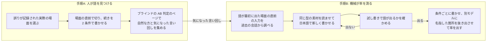
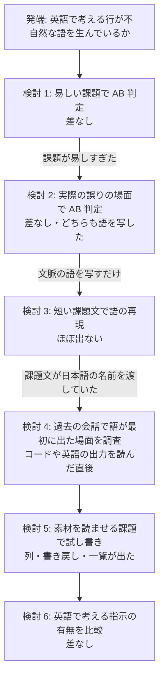

# 普通は使わない語の出方の評価: 「英語で考える」指示の検証と測り方

`docs/requirements.md` を物差しにした調査ではなく、参考情報として置く記録。2026-11-22〜23 に、CLAUDE.md の「Always Think in English, but respond in Japanese.」の行が、オーナーが指摘してきた不自然な語（「列」「書き戻し」「一覧」など）を生んでいるのかを確かめた。PDA の要件・設計・決定は変えない。

この記録は、PDA でユーザーとの対話を受け持つエージェントを切り出すとき、出力を精査するゲートを設計するとき、エスカレーションの仕組みの性能を評価するときに、この記録の測り方を再利用するために置く。

## 結論

- CLAUDE.md の「英語で考える」行を入れても、日本語の出来は良くならず、不自然な語の率も下がらなかった。オーナーのブラインドの AB 判定では差が出ず、不自然な語の率を測った比較では、行が無い条件のほうが率が同じか高かった。行は 2026-11-22 に「Respond in Japanese.」へ書き換え、そのままにしている。
- 「列」（DB のカラム）、「書き戻し」（読んだ値で保存し直す処理）、「一覧」（配列や集計の結果）は、英語で考える指示が無くても出た。その概念を名指した回数のうちの割合は、指示なしの条件で列 23%、書き戻し 21%、一覧 43% だった。オーナーは、列・書き戻し・一覧を Opus の学習に深く染みついた語彙と判断した。
- 思考の中身は記録に残らないため、列・書き戻し・一覧が「英語で考えてから訳す過程」で生まれるのか、日本語で書くときの語の選び方の癖なのかは、切り分けていない。
- 「表」（DB のテーブル）、「段」（ステップ）、「窓」（時間の範囲）は、素材を 1 つ読ませて説明させる課題では引き出せなかった。過去の会話では長い報告の中で出ており、引き出すには別の形の課題が要る。
- 再利用できる測り方は 2 つの組み合わせである。人のブラインドの AB 判定で不自然な語を見つけ、素材を読ませて新しく書かせる試験でその語の率を測る。

## 再利用する測り方

### 手順A: 実際の場面に基づくブラインドの AB 判定

不自然な語を「見つける」ための手順。語の率は測れないが、オーナーの感覚で何がおかしいかが分かる。

- 場面は、語の誤りの記録（collect-unclear-japanese スキルが残す事例）から、長く複雑な報告を書いていた場面を選ぶ。短く易しい課題では、どちらの条件でも文章に注意が向き、差が出ない。
- 会話の記録から、誤りの語が最初に出た出力の直前で切る。切った点より前の会話は要約して渡し、誤りが出たターンの中身はそのまま渡す（`materials/ab2-real-scenes/build.py`、`summarize.py`）。
- 条件だけを変えて続きを書かせ、組ごとに A と B の割り当てを入れ替えて伏せる（`materials/ab2-real-scenes/blind.py`）。
- 判定のページは Artifact にし、組ごとに「A の方が自然」「B の方が自然」「差が無い」と、気になった言い回しの欄を置く。回答は Artifact の db に保存し、Claude が読み取る（`materials/ab2-real-scenes/page.html`）。
- 判定の中でオーナーが挙げた言い回し（気になった言い回しの欄と口頭の指摘）が、手順B に渡す語の出所になる。今回の「一覧」は欄から、「書き戻し」は口頭の指摘から出た。
- 注意: 渡す要約と会話の中にすでに不自然な語があると、どちらの条件の出力もそれを写す。要約を作るモデルが新しく不自然な語を持ち込むこともある（今回、要約を書いた Sonnet が「重複防止の一覧」を持ち込んだ）。手順A は条件の差を測る道具ではなく、語を見つける道具として使う。

### 手順B: 素材を読ませて新しく書かせ、不自然な語の率を測る

語の出方を「数える」ための手順。

- まず、過去の会話の記録で、各語がその会話で最初に出た箇所と、その直前に読んでいた入力を調べる（`materials/repro-short-prompts/first_occ.py`）。2 回目以降の出現は会話の中の写しなので数えない。今回は、コード・スキーマや git の出力・SQL の結果・英語の設定を読んだ直後に、その中身を日本語で説明するときに出ていた。
- 課題の入力は、概念に日本語の名前が付いていない素材にする（マイグレーション、PHP や Go のコード、スキーマの差分、英語のランブックやレビューコメント）。指示の文は「次の素材を読み、〜を説明してください」だけにし、概念の日本語名も正しい言い換えの語も入れない（`materials/elicit-from-material/make_tasks.py` が課題文を検査する）。要約させずに新しく書かせる。
- 判定は文字列の一致ではなく用法で行う。別のモデル（Sonnet）に、出力の中で 6 種類の概念（DB のカラム、DB のテーブル、読んだ値の保存し直し、ステップ、時間の範囲、配列や集計の結果）を名指した箇所をすべて抜き出させ、使った日本語の名詞を記録させる（`materials/elicit-from-material/judge.py`）。抜き出した箇所の一部を人が読んで、判定が合っていることを確かめる。
- 率は「その概念を日本語の名詞で名指した回数のうち、誤りの語を使った回数」にする（`rate.py`、`rate_cmp.py`）。分母を取らないと、0 回が「正しい語を使った」のか「名指す機会が無かった」のか区別できない。
- 条件の比較の前に、過去の誤りが出たときと同じ条件だけで試し書きをする。語が過去の会話に近い頻度で出なければ、課題が誤っているので比較に進まず課題を直す。
- エフォートは medium 以上にする。low では思考が 1 回あたり 200 トークン前後しかなく、考える言語の影響を見る余地がほとんど無い。
- 今回測った 6 語（列・書き戻し・一覧・表・段・窓）には正しい用法もある。今回の判定では、「段階」は「段」の誤りに数えず、「文字列」の「列」は DB のカラムの概念に入らないので数えていない。

## 経緯

### 発端

オーナーの CLAUDE.md の 6 行目には「Always Think in English, but respond in Japanese.」があった。語の誤りの記録には、英語の言い回しを訳したと見える語（「掃引」= sweep、「早送り」= fast-forward、「窓」= window など）が多く、この行が原因ではないかを確かめることにした。行を「Respond in Japanese.」に書き換え、2 つの条件で比べた。

### 検討 1: 易しい課題でのブラインドの AB 判定（2026-11-22）

- やったこと: 障害報告、PR の説明文、設計の比較などの短い課題を 5 つ作り、Opus に「英語で考える」と「日本語のみ」の 2 条件で 3 回ずつ書かせた。システムプロンプトは条件の 1 行だけにした。15 組をオーナーがブラインドで判定した（`materials/ab1-easy-tasks/`）。
- 結果: 英語で考える条件が 6 組、日本語のみの条件が 6 組、差が無いが 3 組で、差は出なかった。
- うまくいかなかった理由: オーナーの指摘は次のとおり。課題が易しく、文章の出来に注意を向けられる。高コンテキストの報告になるほど無意味な指示語や不自然な語が増える印象があり、易しい課題ではその場面を再現できない。課題 5（PR の説明文）のように、2 つの出力の中身がほとんど同じ課題もあった。課題ごとの偏りを分析すると、指示語は条件にかかわらず高コンテキストの課題に集中していた（`analyze.py`）。
- 次への変更: 実際に誤りが記録された、長く複雑な報告の場面を使う。

### 検討 2: 実際の誤りの場面でのブラインドの AB 判定（2026-11-22）

- やったこと: 語の誤りの記録から、長い報告の場面を 3 つ選んだ（「窓」「掃引」「止まる状態」の場面）。誤りを書いた時点のコンテキストは約 74 万・49 万・34 万トークンで、どの会話でもそれまでにオートコンパクションは走っていなかった。長い会話をそのまま読ませるのは重いので、誤りが出たターンより前の会話を Sonnet に要約させ、誤りが出たターンの中身はそのまま渡した。システムプロンプトには CLAUDE.md の全文（索引を展開したもの）を入れ、6 行目だけを変えた。Opus のエフォート medium で 2 回ずつ書かせ、6 組をオーナーが判定した（`materials/ab2-real-scenes/`）。
- 結果: 英語で考える条件が 3 組、日本語のみの条件が 1 組、差が無いが 2 組で、差は読み取れなかった。オーナーが気になった言い回しとして「重複防止の一覧」「その行が今回と同じものを損なう失敗を扱っていて、正答と同じ動作を求めていること」「規則が中身の合わない行に溶けて効かなくなります」を挙げ、口頭で「一覧」と「書き戻し」を挙げた。
- うまくいかなかった理由: オーナーの指摘は「すでに汚染済みの語彙を元に話しているから、日本語が綺麗になっても語彙が終わっているので読めない」。調べると、どちらの条件の出力も、渡した文脈にある語を写していた。「書き戻し」は元の会話で Backlog の課題の題名と当時の Claude の出力から繰り返し使われており、出力はどれも 10 回以上使った。「重複防止の一覧」は元の会話には無く、要約を書いた Sonnet が持ち込んだ語だった。「止まる状態」の場面は、切った位置で何を答えるかをモデルが自分で決めることになり、出力の中身が別々になって比較にならなかった。
- 次への変更: 文脈の汚れを除くため、短い課題文で語が再び出るかを試す。

### 検討 3: 短い課題文での語の再現（2026-11-23）

- やったこと: 語の誤りの記録から英語の言い回しを訳したと見える 12 語を選び、語ごとに 1 つの課題を作った。検討 2 でオーナーが挙げた言い回しからも、4 つの課題（書き戻し、一覧、同じものを損なう・正答、溶けて）を作った。語ごとに、誤りが出た場面と同じ事実と書き方の制約（見出し、表のセル、1 行の備考など）を短い課題文にした。条件は 3 つで、日本語のみ、英語で考える、英語の下書きを出してから日本語に訳す。Opus のエフォート low で 4 回ずつ書かせた（`materials/repro-short-prompts/`）。
- 結果: 日本語のみと英語で考えるの 2 条件では、どの語も出なかった。英語で書いて訳す条件でだけ、「早送り」（下書きの fast-forward を訳した語）と「書き戻し」（下書きの saves them back を訳した語）が 1 回ずつ出た。思考は 1 回あたり中央値で約 200 トークンだった。
- うまくいかなかった理由: オーナーの指摘は「各問題がすでに作文済みで、その作文を言い回しの調整ぐらいしかしていない。8 割方文章を作っていて、それを要約させる解き方のさせ方だから、新たに語彙が増えることはそうそうない」。課題文の段階で、概念に日本語の名前（「上書き」「工程」「手順」「記録」など）を付けて渡しており、モデルはそれを写して縮めただけだった。列・書き戻し・一覧・表・段・窓は、ちょっとした例文でも出ることが想像できる語で、それが出ないのは課題の設計が誤っているからだ、というのがオーナーの判断である。エフォート low で思考が短く、考える言語の影響を見る余地もほとんど無かった。この試験から出した「短い文脈では出ない、学習の癖ではない」という結論は取り下げた。
- 次への変更: オーナーの指示で 6 語（列・書き戻し・一覧・表・段・窓）に絞り、Claude Code の advisor（上位のモデルに方針を相談する道具）に方針を聞いた。方針は、語が最初に出た場面の入力の型を調べてから課題を作ること、課題文に概念の日本語名を入れないこと、分母を取った用法の判定にすること、試し書きで語が出ない課題は比較に進まないこと。

### 検討 4: 過去の会話で語が最初に出た場面の調査（2026-11-23）

- やったこと: 過去 60 日の会話の記録（515 の会話）から、各会話で 6 語のそれぞれを最初に使った箇所と、その直前の入力を抜き出した（`materials/repro-short-prompts/first_occ.py`）。
- 結果: 6 語はどれも頻繁に出ていた。使った会話の数は、一覧 309、表 227、列 208、段 159、窓 75、書き戻し 39 だった（正しい用法の回も含む）。最初に出る直前に読んでいたのは、主にコード、スキーマや git の出力、SQL の結果、英語の設定だった。例は「`tstamp` 列が変わっています」（スキーマの差分を読んだ直後）、「予約の表と投稿グループの更新者で見る」（DB のテーブルのこと）、「dispatcher の定期実行を有効にする段」（リリースのステップのこと）、「purge 窓の外にある行」（期間のこと）。
- 「一覧」の誤りの用法は、オーナーが次のように定めた。配列・リスト・辞書などのデータ構造、またはデータを集めて計算した結果の全体を「一覧」と呼ぶ用法。「配列でもいいのに、配列を避けて list とし、それを訳して一覧としているのかもしれない」という見立ても添えられた。

### 検討 5: 素材を読ませる課題での試し書き（2026-11-23）

- やったこと: 検討 4 の入力の型に合わせて、素材を読ませて日本語で新しく書かせる課題を 10 個作った。列と表は同じ 2 つの課題で兼ね、ほかの 4 語は 2 つずつにした。条件は、過去の誤りが出たときと同じ「英語で考える」と、「英語で書いて訳す」の 2 つ。Opus のエフォート medium で 3 回ずつ書かせ、Sonnet に名指した箇所を抜き出させた（`materials/elicit-from-material/`）。
- 結果（英語で考える条件、その概念を名指した回数のうち誤りの語を使った割合）:
  - 列: 15%（7/48）
  - 書き戻し: 30%（22/73）
  - 一覧: 28%（29/105）
  - 表: 0%（0/36）
  - 段: 0%（0/125）。ステップは「手順」「処理」「段階」「ジョブ」と書いていた
  - 窓: 1%（1/103）。時間の範囲は「間」「3 時間以内」「隙間」と書いていた
- 英語で書いて訳す条件は使えなかった。30 回のうち 24 回は英語の下書きを出さず、日本語だけを書いた。そのため「list を経由して一覧と訳す」流れは確かめられていない。
- 判断: 列・書き戻し・一覧は、この課題で過去の会話に近い頻度で引き出せたので比較に進めた。表・段・窓は引き出せなかったので比較から外した。

### 検討 6: 英語で考える指示の有無の比較（2026-11-23）

- やったこと: 列・書き戻し・一覧を引き出した 6 課題で、「英語で考える」と「日本語のみ」の 2 条件を、Opus のエフォート medium で 5 回ずつ書かせた。システムプロンプトは CLAUDE.md の全文で、6 行目だけを変えた。
- 結果（その概念を名指した回数のうち誤りの語を使った割合）:
  - 列（DB のカラム）: 英語で考える 23%（18/79）、日本語のみ 23%（19/84）
  - 書き戻し（読んだ値で保存し直す処理）: 英語で考える 25%（35/138）、日本語のみ 21%（29/135）
  - 一覧（配列や集計の結果）: 英語で考える 31%（47/152）、日本語のみ 43%（63/148）
- 出た場面の例:
  - 列: マイグレーションとスキーマの差分を読ませた課題で「`post_google_location_relationships` への列追加」「営業時間の列だけを更新し」
  - 書き戻し: 読み込んでから upsert や UPDATE で保存するコードを読ませた課題で「最後にまとめて書き戻します」「手順 1 で読んだ値が手順 5 でそのまま書き戻されます」
  - 一覧: `pluck()` で作った ID の配列と、Go の関数が返す集計結果を説明させた課題で「既知のキーの一覧を作る」「失敗した投稿の ID の一覧を付けてアラートを送ります」
- 判断: 列・書き戻し・一覧は、英語で考える指示が無くても出る。列と書き戻しは 2 条件でほぼ同じ率で、一覧は指示が無い条件のほうが高かった。オーナーは、Opus の学習に深く染みついた語彙と判断し、検証をここで止めた。

## 分かりやすい根拠が得られた理由と、得られなかった理由

- 根拠が得られた試験（検討 6）は、次の 3 つを満たしていた。
  - 入力に概念の日本語名が無く、モデルが語を自分で選んだ。
  - 入力の型を、過去の会話で語が最初に出た場面から決めた。
  - 率に分母があり、条件の間で同じ物差しで比べられた。
- 根拠が得られなかった試験は、どれかが欠けていた。
  - 検討 1 は、課題の型が誤りの出る場面と違った。
  - 検討 2 は、文脈に語がすでにあり、出力がそれを写した。
  - 検討 3 は、課題文が日本語の名前を先に渡していた。
- ブラインドの AB 判定は、条件の差を測る道具としては働かなかったが、オーナーの感覚で不自然な語を見つける道具として働いた。検討 6 で測った 3 語のうち一覧と書き戻しは、AB 判定の中でオーナーが挙げた言い回しから来た。

## 残った論点

- 表・段・窓を引き出す課題の形。過去の会話では、長い報告や設計資料の中で出ていた。素材を 1 つ読ませる短い説明の課題では出なかった。
- 英語で考えて訳す過程と、語の選び方の癖の切り分け。英語で書く呼び出しと、その英語を訳す呼び出しを分ければ、訳す前の英語の文が必ず残り、訳した文で語が増えるかを直接日本語で書かせた文と比べられる。今回の「英語で書いて訳す」条件は、1 つの呼び出しの中で下書きを出させようとして、多くの回で下書きが出なかった。
- 思考の中身は `claude -p` の記録に残らず、トークン数しか分からない。指示が無いときに何語で考えているかは見えない。

## 資料

`materials/` に、各手順の道具と、検討 5・6 の入出力を置いた。会社名は伏せ字に置き換えてある。検討 2 の入力（実際の会話の記録と要約）と、検討 3・4 の出力は、仕事の内容を含むため置いていない。

- `ab1-easy-tasks/` 検討 1。課題と実行（`run.py`）、伏せた組の作成（`blind.py`）、判定のページ（`page.html`）、課題ごとの偏りの分析（`analyze.py`）、組と条件の対応（`mapping.json`）、判定（`judgments.txt`）
- `ab2-real-scenes/` 検討 2。誤りの語の位置の探索（`locate.py`）、コンテキストの大きさの計算（`ctxsize.py`）、会話の記録から要約前と誤りのターンを書き出す処理（`build.py`）、コンパクション相当の要約（`summarize.py`）、実行（`run.py`）、伏せた組の作成（`blind.py`）、判定のページ（`page.html`）、組と条件の対応（`mapping.json`）、判定（`judgments-raw/`）
- `repro-short-prompts/` 検討 3 と 4。課題（`tasks.json`、`tasks2.json`）、実行（`run.py`）、集計（`tally.py`）、出力の閲覧ページ（`gen.py`、`page.html`）、過去の会話で語が最初に出た箇所の抽出（`first_occ.py`）
- `elicit-from-material/` 検討 5 と 6。課題の作成と検査（`make_tasks.py`、`tasks.json`、比較に使った 6 課題の `tasks_cmp.json`）、実行（`run.py`。環境変数 `CONDS`・`RUNS`・`EFFORT`・`TASKS_FILE` で条件を選ぶ）、名指した箇所の抽出（`judge.py`）、率の集計（`rate.py` は検討 5、`rate_cmp.py` は検討 6）、出力（`out/`）、抽出の結果（`judge/`）

判定のページ（Artifact、オーナーだけが開ける）:

- 検討 1: https://claude.ai/artifact/Q83jypDXT7F163V61d88RE
- 検討 2: https://claude.ai/artifact/VgZh5YfJaXRu9UeWD6NkaJ
- 検討 3 の出力の閲覧: https://claude.ai/artifact/UxwuaCGpdJGxMWPDRzzdgZ
